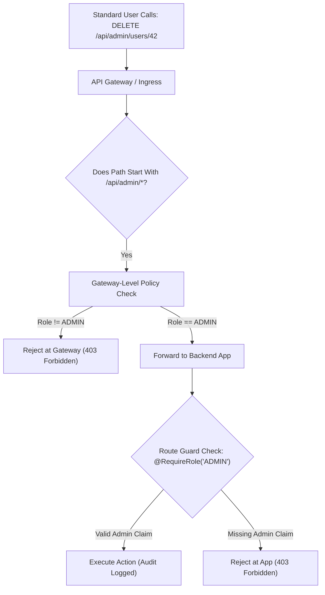

## Scenario

> **A user can access an admin API despite not being an admin. How would you fix it?**

This is an occurrence of **Broken Function-Level Authorization (BFLA)** (OWASP API Security Top 10 #5). It happens when an administrative endpoint (e.g., `DELETE /api/users/123` or `POST /api/settings/maintenance`) relies on the UI hiding the button rather than enforcing strict server-side role validation.


## Fast Revision (10-Second Recall)

- **The Golden Rule:** **UI hiding is not security.** If an API endpoint exists, an attacker will discover it and call it directly via Postman or cURL.
- **Top 4 Architectural Fixes:**
  1. **Strict Server-Side Route Guard:** Enforce a `@RequireRole('ADMIN')` guard on the route or controller level before executing business logic.
  2. **API Gateway Path Separation:** Separate admin APIs into dedicated route prefixes (`/admin/*`) and enforce network/gateway-level token claim checks.
  3. **Network / VPN Isolation (Defense-in-Depth):** Restrict `/admin/*` routes to internal VPCs, office IP ranges, or requiring corporate SSO/mTLS.
  4. **Deny-by-Default Architecture:** Configure the router so all routes require authentication and admin authorization *unless* explicitly marked with a `@Public()` decorator.
- **Key Tools:** NestJS CanActivate Guards, Express middleware, NGINX `allow/deny` CIDR blocks, API Gateway JWT authorizers.


## The 30-Second Spoken Script

If asked this in an interview, deliver this structured response:

> *When a standard user accesses an admin API, the immediate root cause is missing server-side authorization—relying on the frontend UI to hide admin buttons rather than enforcing checks on the backend.*
>
> *I resolve this with a defense-in-depth approach.*
>
> *First, at the application layer, I implement a Deny-by-Default architecture. Every route is protected by default unless explicitly decorated with `@Public()`. I attach a strict role guard to all administrative controllers that extracts the user's role from the verified JWT and rejects non-admin callers with a 403 Forbidden.*
>
> *Second, at the gateway layer, I route all administrative traffic under a dedicated path prefix like `/api/admin/*`. At the API Gateway, I enforce an authorizer policy that inspects the JWT before the request ever reaches the backend application container.*
>
> *Third, for enterprise environments, I restrict administrative endpoints to our internal VPN or zero-trust access proxy (such as Cloudflare Access or AWS Verified Access) so public internet traffic cannot reach admin routes.*


## Diagnostic Lifecycle



### 1. The Vulnerable Mistake (Security through Obscurity)
```typescript
// VULNERABLE: Only authenticated, but NOT authorized as admin!
app.delete('/api/users/:id', authenticateToken, async (req, res) => {
  // Any logged-in user can delete any other user!
  await db.user.delete({ where: { id: req.params.id } });
  return res.json({ message: 'User deleted' });
});
```

### 2. The Secure Implementation (Deny-by-Default Guard)
```typescript
// SECURE: Enforces strict admin check + audit log
app.delete('/api/admin/users/:id', authenticateToken, requireRole('ADMIN'), async (req, res) => {
  await db.user.delete({ where: { id: req.params.id } });
  await auditLog({ action: 'USER_DELETED', target: req.params.id, actor: req.user.id });
  return res.json({ message: 'User deleted' });
});
```


## Root Causes & Solutions Matrix

| Root Cause | Diagnostic Pattern | Fix |
| :--- | :--- | :--- |
| **Missing Route Guard** | Route has `authenticate` middleware but omitted `requireAdmin` check. | Attach `@RequireRole('ADMIN')` guard to entire controller class. |
| **HTTP Verb Omission** | Guard attached to `GET /admin/users` but forgotten on `POST` or `DELETE`. | Protect controller at the parent router level rather than individual methods. |
| **Client-Side Claim Tampering** | Backend decoded JWT without cryptographically verifying signature. | Ensure `jwt.verify()` runs with the secret key, never `jwt.decode()`. |
| **Misconfigured API Gateway Route** | Gateway path pattern matched `/admin` but missed `/admin/` or `/admin/*`. | Audit regex path matching rules in NGINX / AWS API Gateway. |


## Practical Debugging Commands & Code

### 1. Global Admin Guard Implementation (Express / TypeScript)
```typescript
import { Request, Response, NextFunction } from 'express';

export function requireAdmin(req: Request, res: Response, next: NextFunction) {
  const user = req.user;

  if (!user) {
    return res.status(401).json({ error: 'Unauthenticated' });
  }

  // Strict role check
  if (user.role !== 'ADMIN') {
    // Log security violation for threat detection
    console.warn(`[SECURITY_ALERT] Non-admin user ${user.id} attempted to access admin endpoint: ${req.method} ${req.originalUrl}`);

    return res.status(403).json({
      status: 'error',
      code: 'ADMIN_ACCESS_REQUIRED',
      message: 'You must be an administrator to access this resource.',
    });
  }

  next();
}
```

### 2. Restricting Admin Path via NGINX IP Whitelist
```nginx
location /api/admin/ {
    # Allow office VPN and internal subnet only
    allow 10.0.0.0/8;
    allow 192.168.1.0/24;
    deny all; # Block all public internet callers

    proxy_pass http://backend_upstream;
}
```


## Prevention & Senior Best Practices

1. **Adopt Deny-by-Default Route Architecture:** Configure authorization frameworks (like NestJS) to require `@Admin()` or `@Roles()` by default, requiring developers to explicitly opt-out with `@Public()`.
2. **Isolate Admin APIs on Subdomains:** Host administrative APIs on a separate subdomain (e.g., `admin-api.internal.company.com`) protected by zero-trust identity proxies.
3. **Mandatory Security Unit Tests:** Write automated unit tests that verify each admin endpoint returns 403 when called with non-admin tokens.

