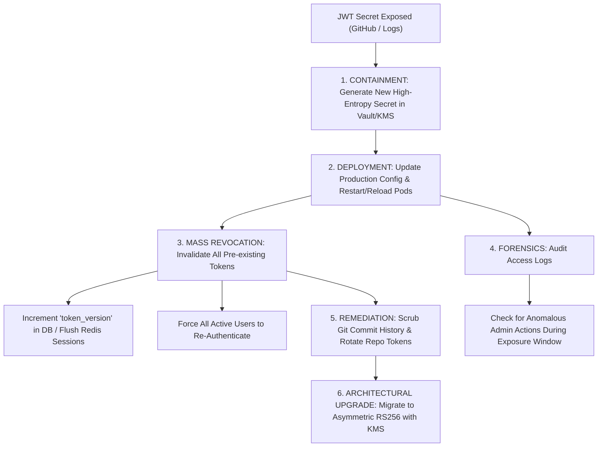

## Scenario

> **What would you do if a JWT secret key was accidentally exposed?**

If a JWT signing secret key (e.g., `JWT_SECRET=super-secret-key-123`) is accidentally committed to a public GitHub repository or leaked in logs, **your system is critically compromised**: anyone with that secret can mint valid administrator tokens (`{ "role": "admin", "id": 1 }`) that your backend will accept without question. The interviewer expects an immediate, **flawless emergency incident response sequence**.


## Fast Revision (10-Second Recall)

- **The Threat Level:** **Critical (P0 Incident).** Full authentication bypass. Attackers can forge any identity.
- **Top 5 Incident Response Steps:**
  1. **Immediate Triage:** Rotate the secret key in production immediately across all backend instances.
  2. **Mass Session Revocation:** Invalidate all existing tokens. Increment `token_version` on all user records in the database or flush active sessions in Redis.
  3. **Purge Leaked History:** Use `git-filter-repo` / BFG Repo-Cleaner to scrub the secret from git history; revoke GitHub personal access tokens.
  4. **Audit Access Logs for Forged Tokens:** Search APM/CloudWatch logs for requests containing admin tokens signed with the compromised key during the exposure window.
  5. **Migrate to Asymmetric Keys (RS256 / EdDSA):** Switch from symmetric shared secrets (`HS256`) to asymmetric public/private key pairs managed in AWS KMS.
- **Key Tools:** AWS KMS / HashiCorp Vault, `git-filter-repo`, PostgreSQL `UPDATE users SET token_version = token_version + 1`.


## The 30-Second Spoken Script

If asked this in an interview, deliver this structured response:

> *An exposed JWT secret key is a Severity 0 security incident because an attacker can forge arbitrary administrator tokens.*
>
> *My immediate first step is to contain the breach by rotating the secret key across all production instances via our secret manager (AWS Secrets Manager or Vault) and redeploying or triggering a hot-reload.*
>
> *Second, because rotating the key immediately invalidates legitimate users, I enforce a clean mass-revocation: I increment the `token_version` column across all user accounts in the database and flush active refresh tokens in Redis. This forces every active user to log in again and obtain a new, cleanly-signed token.*
>
> *Third, I conduct forensic log analysis: I query our access logs for any suspicious administrative requests originating during the exposure window.*
>
> *Finally, to prevent recurrence, I transition our signing architecture from symmetric HS256 to asymmetric RS256 using AWS KMS, ensuring application servers only hold the public key needed for verification, while the private signing key never leaves the secure hardware module.*


## Diagnostic Lifecycle



### 1. Symmetric (HS256) vs Asymmetric (RS256) Vulnerability Profile
- **Symmetric (HS256):** The identical secret key is used to both *sign* and *verify* tokens. If any backend microservice leaks the secret, attackers can *sign* forged tokens.
- **Asymmetric (RS256):** The private key lives strictly inside an Auth Server or AWS KMS. All API microservices only receive the *public key*. Even if an API server is completely hacked, the public key cannot be used to forge new tokens!


## Root Causes & Solutions Matrix

| Phase | Action Required | Technical Execution |
| :--- | :--- | :--- |
| **Immediate (0–15 min)** | Rotate the compromised secret. | Generate 64-byte random string; update AWS Secrets Manager; rollout restart. |
| **Immediate (0–15 min)** | Invalidate all existing tokens in the wild. | `UPDATE users SET token_version = token_version + 1;` and flush Redis. |
| **Containment (15–60 min)** | Purge secret from GitHub and git history. | Run `git-filter-repo --invert-paths --path .env`; force push; invalidate API keys. |
| **Forensics (Day 1)** | Identify if the key was exploited by an attacker. | Filter CloudWatch/Datadog logs for high-privilege endpoints during exposure duration. |
| **Permanent Fix** | Eliminate shared secrets entirely. | Switch to **RS256** with JSON Web Key Sets (JWKS) hosted in AWS KMS. |


## Practical Debugging Commands & Code

### 1. Emergency Database Mass Revocation Query
Invalidate every active JWT session immediately across the entire database:
```sql
-- Invalidate all active tokens for all users instantly
UPDATE users 
SET token_version = token_version + 1,
    updated_at = NOW();

-- Clear all cached session tokens from Redis
-- redis-cli EVAL "return redis.call('del', unpack(redis.call('keys', 'sess:*')))" 0
```

### 2. Dual-Key Verification Grace Period (Zero-Downtime Rotation)
If you need a graceful 15-minute rollout where new tokens use Key B while still accepting unexpired Key A tokens:
```typescript
import jwt from 'jsonwebtoken';

const CURRENT_PRIMARY_SECRET = process.env.JWT_SECRET_PRIMARY!; // New Key
const PREVIOUS_SECRET = process.env.JWT_SECRET_PREVIOUS;          // Old Key (During transition)

export function verifyTokenWithRotation(token: string) {
  try {
    // 1. Try verifying with new primary key
    return jwt.verify(token, CURRENT_PRIMARY_SECRET);
  } catch (err: any) {
    // 2. If signature fails and old key exists, verify against old key during transition
    if (err.name === 'JsonWebTokenError' && PREVIOUS_SECRET) {
      return jwt.verify(token, PREVIOUS_SECRET);
    }
    throw err;
  }
}
```

### 3. Permanently Scrubbing a Secret from Git History
```bash
# Using git-filter-repo to erase .env file from all commits
pip install git-filter-repo
git filter-repo --invert-paths --path .env --force

# Force push scrubbed history to remote
git push origin --force --all
git push origin --force --tags
```


## Prevention & Senior Best Practices

1. **Pre-Commit Secret Scanning (git-secrets / gitleaks):** Install `gitleaks` as a mandatory pre-commit hook in local developer environments to reject commits containing API keys or secrets before push.
2. **Migrate to Asymmetric RS256/EdDSA:** Avoid shared symmetric secrets. Use public/private key pairs where private keys are sealed inside HSMs (Hardware Security Modules) like AWS KMS or Vault.
3. **Automate Secret Scanning on CI/CD:** Enable GitHub Secret Scanning and Push Protection to immediately block any commit containing recognized secret patterns.

