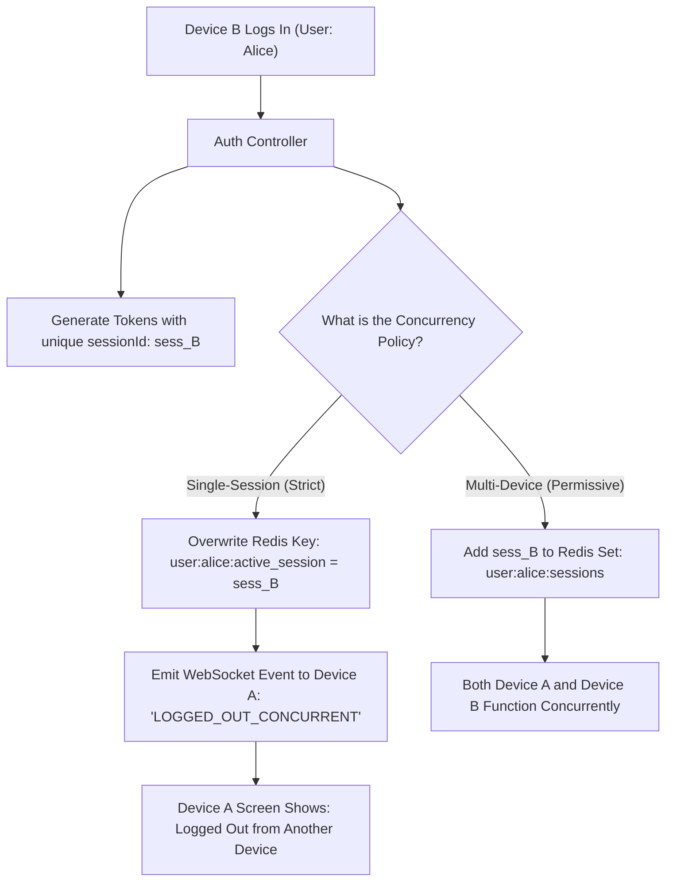

## Scenario

> **What happens if two users log in from the same account simultaneously?**

How a system handles concurrent logins depends heavily on the business domain. A streaming service (like Netflix) or SaaS product (like Slack) may allow multiple concurrent devices, whereas a high-security banking app or exam platform must strictly enforce **Single Active Session** constraints.


## Fast Revision (10-Second Recall)

- **Two Primary Business Models:**
  1. **Single-Session Enforcement (Strict):** New login terminates the previous session immediately (*"You were logged out because your account logged in from another device"*).
  2. **Multi-Session Registry (Permissive):** Both devices maintain distinct, trackable sessions in Redis (*"Active Devices"* dashboard).
- **How Single-Session is Enforced with JWTs:** Store a `session_version` or `active_session_id` in Redis. When Device B logs in, update Redis. When Device A makes an API call, its token version is outdated $\rightarrow$ rejected with 401.
- **Real-Time Eviction:** Push a WebSocket/SSE event to Device A to display a logout modal immediately.
- **Key Tools:** Redis Hash sets for session management, WebSockets for instant client eviction.


## The 30-Second Spoken Script

If asked this in an interview, deliver this structured response:

> *How we handle concurrent logins depends on the application's security policy: Single-Session Enforcement versus Multi-Device Management.*
>
> *For high-security applications like banking, we enforce Single Active Session. Even with stateless JWTs, we track the `activeSessionId` in Redis keyed by user ID. When User 2 logs in, we overwrite the key with User 2's session ID and emit a WebSocket event to User 1, immediately logging them out.*
>
> *When User 1 attempts another API call, our auth middleware checks Redis, detects that their token's session ID no longer matches the active session ID, and rejects the call with 401 Unauthorized.*
>
> *For collaborative SaaS platforms, we allow multiple concurrent sessions. Each device gets its own independent refresh token and session record in Redis with IP and user-agent metadata. We provide a 'Manage Active Devices' screen where users can view and revoke individual devices remotely.*


## Diagnostic Lifecycle



### 1. Single-Session Enforcement with Stateless JWTs
Pure stateless JWTs cannot be revoked individually by default. To enforce single sessions, store a lightweight pointer in Redis:
```json
// Redis Key: user:1024:active_session
{
  "sessionId": "sess_def456", // Current active session (Device B)
  "lastLoginIp": "203.0.113.19",
  "updatedAt": 1730332800
}
```
When Device A sends a JWT containing `sessionId: "sess_abc123"`, the auth middleware compares `jwt.sessionId === redis.activeSessionId`. Since `"sess_abc123" !== "sess_def456"`, Device A is rejected.


## Root Causes & Solutions Matrix

| Policy Model | Use Case | Implementation Strategy |
| :--- | :--- | :--- |
| **Strict Single Session** | Banking, FinTech, Proctoring exams. | Overwrite `active_session_id` in Redis on each login; invalidate previous token. |
| **Concurrent Multi-Device** | Streaming, Social Media, Slack. | Maintain a Redis Set of active session IDs per user; allow concurrent access. |
| **Device Limit (e.g., Max 4)** | Netflix, Spotify. | Count active sessions in Redis; reject 5th login or evict oldest session (FIFO). |
| **Account Sharing Abuse** | Users sharing single subscription among 10 people. | Geo-velocity anomaly checks: flag accounts active from multiple distinct cities simultaneously. |


## Practical Debugging Commands & Code

### 1. Single-Session Enforcement Middleware (Express & Redis)
```typescript
import { Request, Response, NextFunction } from 'express';
import Redis from 'ioredis';

const redis = new Redis();

export async function singleSessionGuard(req: Request, res: Response, next: NextFunction) {
  const user = req.user; // Decoded from JWT: { id: 42, sessionId: 'sess_123' }

  if (!user || !user.sessionId) {
    return res.status(401).json({ error: 'Invalid token structure' });
  }

  // 1. Fetch the currently active session ID for this user from Redis
  const activeSessionId = await redis.get(`user:${user.id}:active_session`);

  // 2. If the token's session ID doesn't match, user logged in elsewhere
  if (activeSessionId && activeSessionId !== user.sessionId) {
    return res.status(401).json({
      status: 'error',
      code: 'CONCURRENT_LOGIN_DETECTED',
      message: 'You have been logged out because your account was logged in from another device.',
    });
  }

  next();
}

// On Login Handler:
export async function onLoginSuccess(userId: number, res: Response) {
  const newSessionId = `sess_${crypto.randomUUID()}`;

  // Overwrite the single active session pointer
  await redis.set(`user:${userId}:active_session`, newSessionId);

  // Generate JWT containing this specific sessionId
  const token = jwt.sign({ id: userId, sessionId: newSessionId }, process.env.JWT_SECRET!, { expiresIn: '1h' });

  return res.json({ token });
}
```


## Prevention & Senior Best Practices

1. **Provide a Remote 'Log Out Everywhere' Button:** Store a `token_version` integer in the user record. Incrementing this counter immediately invalidates all active sessions across all devices.
2. **Real-Time Client Eviction:** Use WebSockets or Server-Sent Events to push an immediate logout event so the previous user's screen changes instantly without waiting for their next API call.
3. **Capture Client Fingerprint:** Record the browser user-agent and approximate city location on each login to present a clear *"Logged in from Chrome on macOS in Seattle"* message to the user.

