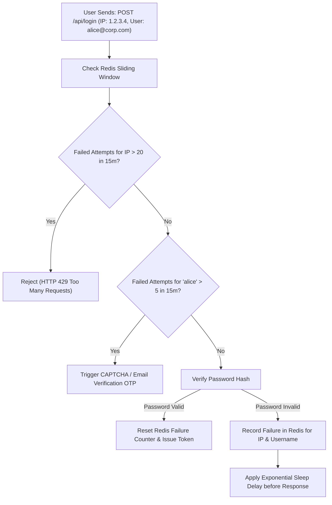

## Scenario

> **How would you implement login throttling?**

If a login endpoint allows unlimited attempts, attackers can execute automated dictionary attacks or credential stuffing scripts at thousands of attempts per second. Interviewers expect a design utilizing **Redis-based sliding window rate limiting with dual-key throttling (IP address + targeted username)**.


## Fast Revision (10-Second Recall)

- **The Core Flaw of IP-Only Throttling:**
  - If you throttle strictly by IP: Distributed botnets with 10,000 proxies bypass it easily.
  - If you throttle strictly by Username: Malicious users can intentionally lock out legitimate accounts (Denial of Service).
- **The Solution: Dual Composite Rate Limiting:**
  1. **Per-IP Rate Limit:** Max 20 failed logins per 15 minutes per IP (defeats single-source attacks).
  2. **Per-Account Rate Limit:** Max 5 failed logins per 15 minutes per username across all IPs (protects specific accounts).
  3. **Progressive Delays:** Introduce exponential wait times (1s, 2s, 4s, 8s) after each consecutive failed attempt.
- **Key Tools:** Redis Sorted Sets (`ZADD`, `ZREMRANGEBYSCORE`), `rate-limiter-flexible`, HTTP 429 Too Many Requests + `Retry-After`.


## The 30-Second Spoken Script

If asked this in an interview, deliver this structured response:

> *I implement login throttling using Redis and a Sliding Window algorithm with dual-key tracking: one key for the client IP address and one key for the target account username.*
>
> *Throttling by IP alone is useless against distributed botnets with rotating proxies, while throttling by username alone allows an attacker to easily trigger a Denial-of-Service lock on legitimate users.*
>
> *When a failed login attempt occurs, we record the attempt timestamp in a Redis Sorted Set for both keys with a 15-minute Time-To-Live.*
>
> *If an IP exceeds 20 failed attempts in 15 minutes, or if a single account receives more than 5 failed attempts across all IPs, the server immediately rejects subsequent requests with HTTP 429 Too Many Requests and a `Retry-After` header.*
>
> *For accounts facing repeated failures, instead of locking the account completely, we trigger step-up authentication like an email OTP or CAPTCHA.*


## Diagnostic Lifecycle



### 1. Redis Sliding Window Counter Mechanics
Using a Redis Sorted Set (`ZSET`):
1. Remove all entries older than 15 minutes: `ZREMRANGEBYSCORE key 0 (now - 900)`.
2. Add current timestamp: `ZADD key now now`.
3. Count remaining entries: `ZCARD key`.
4. If count > threshold $\rightarrow$ reject with HTTP 429.


## Root Causes & Solutions Matrix

| Vector | Attack Type | Defensive Mechanism |
| :--- | :--- | :--- |
| **Single IP Flooding** | Attacker tries 500 passwords from a single machine. | Per-IP rate limiting: Max 20 attempts per 15 minutes. |
| **Distributed Botnet** | 5,000 unique proxy IPs test 1 password against 1 account. | Per-Username rate limiting: Max 5 attempts per account. |
| **Account Lockout DoS** | Attacker intentionally fails 5 times to lock victim out. | Require CAPTCHA or Email OTP on threshold instead of permanent lock. |
| **Timing Attacks** | Measuring response duration to see if username exists. | Ensure failed login responses take consistent time (dummy bcrypt hash on missing user). |


## Practical Debugging Commands & Code

### 1. Redis Sliding Window Rate Limiter Implementation
```typescript
import Redis from 'ioredis';

const redis = new Redis();

interface ThrottleResult {
  allowed: boolean;
  retryAfterSeconds?: number;
}

export async function checkLoginThrottling(ip: string, email: string): Promise<ThrottleResult> {
  const now = Date.now();
  const windowMs = 15 * 60 * 1000; // 15-minute sliding window
  const ipKey = `throttle:login:ip:${ip}`;
  const userKey = `throttle:login:user:${email.toLowerCase()}`;

  // Multi-exec pipeline for atomic operation
  const pipeline = redis.pipeline();

  // Clear timestamps older than window
  pipeline.zremrangebyscore(ipKey, 0, now - windowMs);
  pipeline.zremrangebyscore(userKey, 0, now - windowMs);

  // Get current counts
  pipeline.zcard(ipKey);
  pipeline.zcard(userKey);

  const results = await pipeline.exec();
  const ipCount = results![2][1] as number;
  const userCount = results![3][1] as number;

  // Max 20 per IP, max 5 per target account
  if (ipCount >= 20 || userCount >= 5) {
    return {
      allowed: false,
      retryAfterSeconds: Math.ceil(windowMs / 1000),
    };
  }

  return { allowed: true };
}

export async function recordFailedLogin(ip: string, email: string) {
  const now = Date.now();
  const pipeline = redis.pipeline();
  const ipKey = `throttle:login:ip:${ip}`;
  const userKey = `throttle:login:user:${email.toLowerCase()}`;

  pipeline.zadd(ipKey, now, now.toString());
  pipeline.expire(ipKey, 900); // 15m TTL
  pipeline.zadd(userKey, now, now.toString());
  pipeline.expire(userKey, 900);

  await pipeline.exec();
}
```


## Prevention & Senior Best Practices

1. **Defeat Timing Attacks with Constant-Time Execution:** If a user does not exist in the database, always execute a dummy `bcrypt.compare()` with a mock hash so response latency is identical for valid and invalid usernames.
2. **Send `Retry-After` Header with HTTP 429:** Always include the `Retry-After: 900` header so standard API clients know when they are allowed to retry.
3. **Escalate to CAPTCHA Rather Than Hard Lockout:** Use Cloudflare Turnstile or reCAPTCHA v3 after 3 failed attempts to stop bots without locking out legitimate humans.

