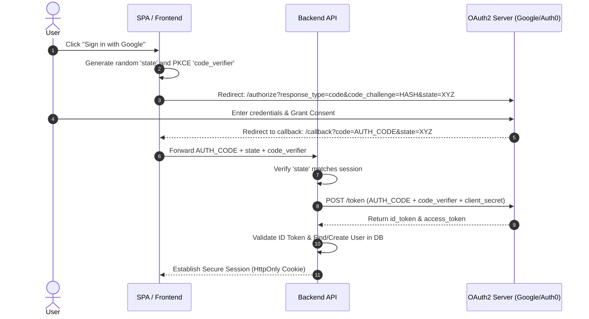

## Scenario

> **How would you implement OAuth2 authentication?**

OAuth 2.0 is the universal authorization framework powering "Log in with Google / GitHub" and third-party API delegations. In modern architectures, using legacy Implicit Grants is prohibited due to token leakage in URLs. The gold standard expected in interviews is the **Authorization Code Flow with Proof Key for Code Exchange (PKCE)**.


## Fast Revision (10-Second Recall)

- **The Standard:** **Authorization Code Flow with PKCE (RFC 7636)** for both Single-Page Applications (SPAs) and mobile/backend apps.
- **Top 4 Critical Components:**
  1. `state` parameter: Cryptographically random string protecting against Cross-Site Request Forgery (CSRF).
  2. `code_verifier` & `code_challenge`: PKCE parameters preventing authorization code interception attacks.
  3. Authorization Server (Google/Auth0/Keycloak) issuing a short-lived `authorization_code`.
  4. Backend-to-AuthServer Token Exchange (`POST /token`) returning `id_token` (OpenID Connect user profile) and `access_token`.
- **Key Tools:** Passport.js, OpenID Connect (`openid-client`), Auth0 / Cognito, PKCE generators.


## The 30-Second Spoken Script

If asked this in an interview, deliver this structured response:

> *I implement OAuth2 authentication using the Authorization Code Flow with PKCE, layered with OpenID Connect for user identity.*
>
> *First, when the user clicks 'Login with Google', the application generates a cryptographically random `state` parameter to prevent CSRF attacks, alongside a PKCE `code_verifier` and its hashed `code_challenge`.*
>
> *The user is redirected to the identity provider. After authenticating and consenting, Google redirects the browser back to our callback URL with an `authorization_code` and the `state` parameter.*
>
> *The application validates that the returned state matches the saved state. Then, our backend makes a secure server-to-server POST request to Google's `/token` endpoint, exchanging the code and our secret `code_verifier` for the tokens.*
>
> *Google verifies that the hash of the verifier matches the initial challenge and returns the ID Token and Access Token. We extract the user's verified email from the ID token, create or update the user record in our database, and establish an authenticated session.*


## Diagnostic Lifecycle



### 1. The Critical Purpose of PKCE (Proof Key for Code Exchange)
- Without PKCE, if a malicious app on a mobile device intercepts the `authorization_code` from the redirect URI, it could exchange the code for tokens.
- With PKCE, exchanging the code requires sending the plaintext `code_verifier`. Since only the legitimate client created the verifier, an attacker holding only the intercepted authorization code cannot redeem it!


## Root Causes & Solutions Matrix

| Flaw / Vulnerability | Risk | Resolution |
| :--- | :--- | :--- |
| **Omitting `state` Parameter** | Attacker executes OAuth CSRF, binding their account to victim's session. | Generate cryptographically secure random `state` stored in session/cookie; verify on callback. |
| **Using Legacy Implicit Grant** | Access tokens exposed in browser URL hash (`#access_token=...`). | Strictly use **Authorization Code Flow with PKCE**. |
| **Validating ID Token Without Keys** | Attacker crafts a forged JWT containing an arbitrary email. | Verify JWT signature against the Provider's published JWKS (`/.well-known/jwks.json`). |
| **Leaking Client Secret in Frontend** | Mobile app or SPA bundles `client_secret` into public JS. | Use PKCE without client secret on public clients; exchange code on backend server. |


## Practical Debugging Commands & Code

### 1. Generating PKCE Code Verifier and Challenge (TypeScript)
```typescript
import crypto from 'crypto';

// 1. Generate high-entropy cryptographic random string (43 - 128 chars)
export function generateCodeVerifier(): string {
  return crypto.randomBytes(32).toString('base64url');
}

// 2. SHA-256 hash the verifier and encode as base64url
export function generateCodeChallenge(verifier: string): string {
  return crypto.createHash('sha256').update(verifier).digest('base64url');
}
```

### 2. Token Exchange Implementation (Node.js Backend)
```typescript
import axios from 'axios';

export async function exchangeCodeForTokens(
  code: string,
  codeVerifier: string,
  redirectUri: string
) {
  const tokenEndpoint = 'https://oauth2.googleapis.com/token';

  const response = await axios.post(tokenEndpoint, {
    client_id: process.env.GOOGLE_CLIENT_ID,
    client_secret: process.env.GOOGLE_CLIENT_SECRET, // Protected on backend
    code,
    code_verifier: codeVerifier,                     // Validates PKCE
    grant_type: 'authorization_code',
    redirect_uri: redirectUri,
  });

  const { id_token, access_token, refresh_token } = response.data;
  return { idToken: id_token, accessToken: access_token, refreshToken: refresh_token };
}
```


## Prevention & Senior Best Practices

1. **Always Verify ID Tokens via JWKS:** Validate signature against provider's live JSON Web Key Set (`/.well-known/jwks.json`) with an LRU key cache.
2. **Never Store Tokens in `localStorage`:** Store resulting session tokens in `HttpOnly; Secure; SameSite=Lax` cookies to prevent XSS exfiltration.
3. **Bind Scopes Minimally:** Only request the minimal OAuth scopes required (e.g., `openid email profile`); never request broad access without justification.

