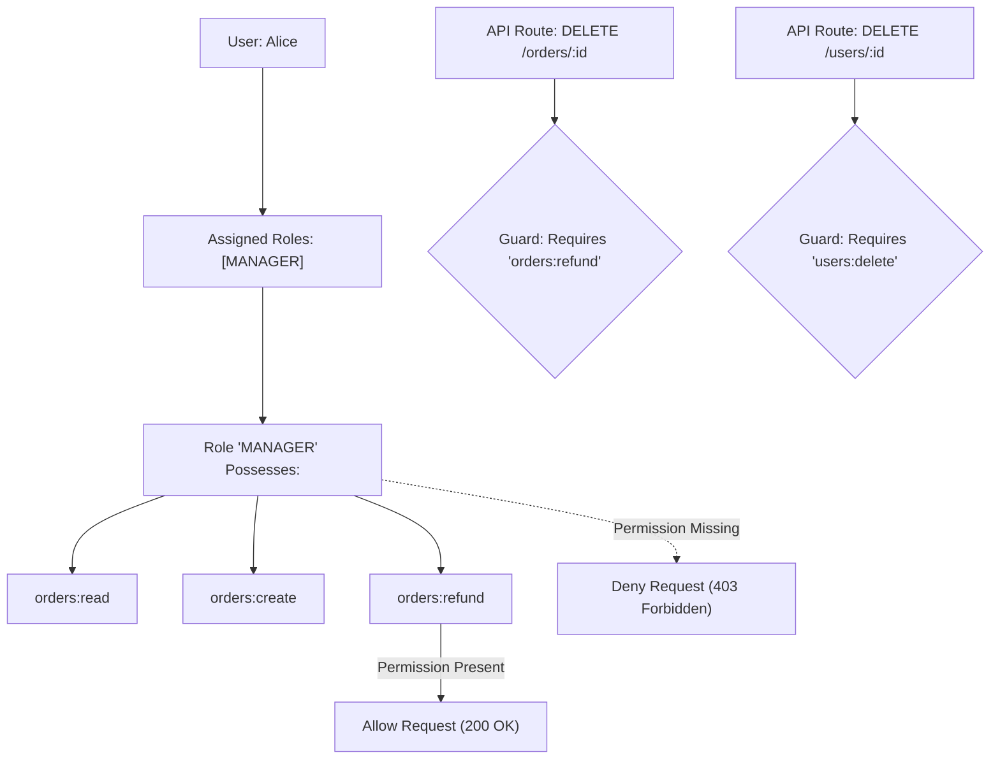

## Scenario

> **How would you implement role-based access control?**

Hardcoding roles like `if (user.role === 'admin')` directly inside controllers becomes unmaintainable as an application grows. The interviewer is testing whether you can design a **scalable, granular RBAC system consisting of Users, Roles, and Permissions with clean middleware abstraction**.


## Fast Revision (10-Second Recall)

- **The Golden Architectural Principle:** **Authorize by Permission, not by Role.**
  - Roles are assigned to Users (`User` $\rightarrow$ `Roles`).
  - Permissions are assigned to Roles (`Role` $\rightarrow$ `Permissions`).
  - Code checks *permissions* (`can('orders:delete')`), never *roles* (`is('manager')`).
- **Top 4 Database Tables:**
  1. `users` (id, email)
  2. `roles` (id, name: 'ADMIN', 'EDITOR', 'VIEWER')
  3. `permissions` (id, slug: 'users:read', 'orders:delete', 'billing:view')
  4. `role_permissions` (role_id, permission_id) & `user_roles` (user_id, role_id)
- **Key Tools:** CASL, NestJS Guards + Custom Decorators (`@RequirePermissions()`), Bitmask permissions for high-throughput microservices.


## The 30-Second Spoken Script

If asked this in an interview, deliver this structured response:

> *I implement RBAC around a core architectural rule: check permissions in code, never hardcode roles.*
>
> *At the data layer, I model a normalized many-to-many relationship: Users have Roles, and Roles have Permissions. Permissions are atomic actions on resources, named using the format `resource:action`—such as `orders:create` or `reports:export`.*
>
> *When a user logs in, the backend flattens all permissions from their assigned roles and caches the array in Redis or embeds them into their JWT claims.*
>
> *At the API layer, I use declarative route guards or decorators, such as `@RequirePermission('orders:delete')`. The middleware reads the user's flattened permissions and verifies the required permission is present.*
>
> *This decouples business logic from role names: if the product team later decides that 'Support Leads' should also be allowed to cancel orders, we simply update the database role-permission mapping without changing a single line of backend controller code.*


## Diagnostic Lifecycle



### 1. The Anti-Pattern: Hardcoded Roles
```typescript
// BAD PRACTICE:
if (user.role === 'admin' || user.role === 'super_admin' || user.role === 'billing_manager') {
  // Hard to test, breaks when new roles are introduced
}

// BEST PRACTICE:
if (hasPermission(user, 'billing:refund')) {
  // Clean, scalable, decoupled from organizational hierarchy
}
```


## Root Causes & Solutions Matrix

| Design Challenge | Risk | Architectural Remedy |
| :--- | :--- | :--- |
| **Role Explosion** | Creating dozens of hybrid roles (`MANAGER_WITH_REFUND_NO_DELETE`). | Deconstruct roles into composable, granular permission sets. |
| **Database Query on Every Request** | Querying 4 SQL join tables on every single API call adds 20ms latency. | Cache flattened permission arrays in Redis or embed in JWT claims. |
| **Role Inheritance** | Admins must automatically inherit all Editor and Viewer capabilities. | Implement hierarchical role inheritance trees in the authorization engine. |
| **Dynamic Permission Changes** | Admin revokes user permission, but user still has it for 8 hours in JWT. | Store a `permissions_version` counter in Redis; reject tokens with stale version. |


## Practical Debugging Commands & Code

### 1. Database Schema for Granular RBAC (PostgreSQL)
```sql
CREATE TABLE roles (
    id SERIAL PRIMARY KEY,
    name VARCHAR(50) UNIQUE NOT NULL
);

CREATE TABLE permissions (
    id SERIAL PRIMARY KEY,
    slug VARCHAR(100) UNIQUE NOT NULL -- e.g., 'orders:create', 'orders:delete'
);

CREATE TABLE role_permissions (
    role_id INT REFERENCES roles(id) ON DELETE CASCADE,
    permission_id INT REFERENCES permissions(id) ON DELETE CASCADE,
    PRIMARY KEY (role_id, permission_id)
);

CREATE TABLE user_roles (
    user_id INT REFERENCES users(id) ON DELETE CASCADE,
    role_id INT REFERENCES roles(id) ON DELETE CASCADE,
    PRIMARY KEY (user_id, role_id)
);
```

### 2. Declarative Permission Guard (Express / TypeScript)
```typescript
import { Request, Response, NextFunction } from 'express';

export function requirePermission(...requiredPermissions: string[]) {
  return (req: Request, res: Response, next: NextFunction) => {
    const userPermissions = req.user?.permissions || [];

    const hasAllRequired = requiredPermissions.every((perm) =>
      userPermissions.includes(perm)
    );

    if (!hasAllRequired) {
      return res.status(403).json({
        type: 'https://api.yourdomain.com/errors/forbidden',
        title: 'Forbidden',
        status: 403,
        detail: `Missing required permission(s): ${requiredPermissions.join(', ')}`,
      });
    }

    next();
  };
}

// Usage in Route Controller:
// app.delete('/api/orders/:id', requirePermission('orders:delete'), deleteOrderHandler);
```


## Prevention & Senior Best Practices

1. **Authorize at the Field Level When Needed:** For sensitive endpoints, combine RBAC with response masking so standard users cannot view fields like `taxId` or `ssn`.
2. **Never Trust Client Claims for Critical Decisions:** Always verify permissions on the backend; never rely on UI button hiding for security.
3. **Audit Every Role Change:** Record an immutable audit log entry in an `audit_events` table whenever a role or permission is assigned or revoked.

