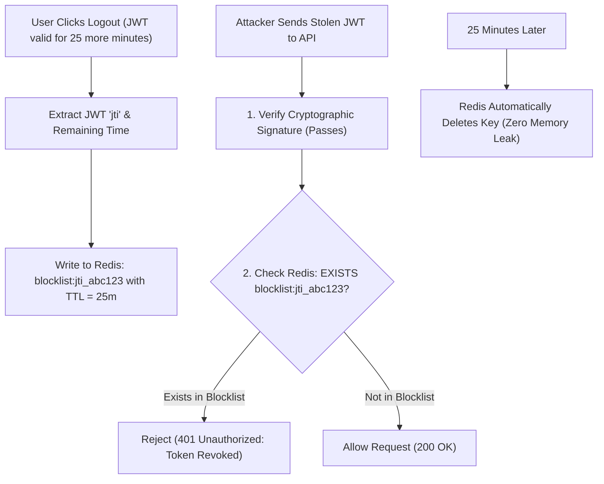

## Scenario

> **How would you invalidate a JWT token before its expiration?**

By definition, JSON Web Tokens are **stateless and self-contained**: once signed, any server with the secret key will verify the token as valid until its `exp` timestamp arrives. If a user clicks "Logout", changes their password, or their laptop is stolen, how do you prevent that validly-signed token from being used for the remaining 30 minutes?


## Fast Revision (10-Second Recall)

- **The Paradox:** Pure stateless JWTs cannot be revoked without state.
- **Top 3 Revocation Strategies:**
  1. **Token Blocklist in Redis (Specific Token Revocation):** On logout, save the token's unique ID (`jti`) to Redis with a TTL equal to the token's remaining lifetime. Middleware checks Redis: if `jti` exists $\rightarrow$ 401 Unauthorized.
  2. **User `token_version` Counter (Mass Revocation):** Store an integer `token_version` in the database / Redis. Include it in the JWT payload. On password reset, increment `token_version`. All older tokens fail the equality check immediately!
  3. **Short-Lived Tokens (10m) + Revocable Refresh Tokens:** Accept that access tokens live for 10 minutes max, and strictly revoke the *refresh token* in the database to prevent further renewals.
- **Key Tools:** Redis `SET key 1 EX remainingSeconds`, JWT `jti` (JWT ID claim), Database `token_version` column.


## The 30-Second Spoken Script

If asked this in an interview, deliver this structured response:

> *Because standard JWTs are stateless, instant revocation requires introducing a lightweight state check in the request pipeline.*
>
> *I use two complementary approaches depending on whether we want to revoke a single session or all sessions at once.*
>
> *For single-token logout, I use a Redis Token Blocklist. Every JWT is minted with a unique ID claim (`jti`). When the user clicks logout, we add that `jti` into Redis with a Time-To-Live exactly matching the token's remaining lifespan. The auth middleware performs a quick 1ms Redis check. If the `jti` is in the blocklist, it rejects the request.*
>
> *Because Redis automatically evicts the key once the token naturally expires, memory usage never grows unbounded.*
>
> *For security events like password changes or stolen accounts, I use a `tokenVersion` counter stored in the user record. Incrementing this counter instantly invalidates every single active JWT across all devices.*


## Diagnostic Lifecycle



### 1. Strategy A: Redis Blocklist with Automatic TTL Eviction
Why doesn't the Redis blocklist grow infinitely?
- If a token expires at 2:00 PM, and the user logs out at 1:40 PM:
- Set key `blocklist:<jti>` with a TTL of **20 minutes** (1,200 seconds).
- At 2:00 PM, Redis deletes the key automatically. Even if the attacker presents the token at 2:01 PM, it is rejected by standard signature expiration anyway!

### 2. Strategy B: User Token Version (Mass Invalidation)
```json
// User record in DB: { id: 42, tokenVersion: 3 }
// JWT Payload: { id: 42, tokenVersion: 3 } -> Valid!

// User changes password -> UPDATE users SET tokenVersion = tokenVersion + 1 (Now 4!)
// Next request with old JWT: token.tokenVersion (3) !== user.tokenVersion (4) -> REJECTED!
```


## Root Causes & Solutions Matrix

| Revocation Requirement | Recommended Strategy | Storage / Complexity |
| :--- | :--- | :--- |
| **User Clicks 'Log Out' (Single device)** | Redis Blocklist (`jti`) with remaining TTL. | Low: In-memory Redis lookup ($\approx 1\text{ms}$). Keys auto-evict. |
| **Password Changed / Account Compromised** | Increment user `token_version` in DB / Redis. | Minimal: Single counter check per request or cached in Redis. |
| **High Scale (> 100k RPS) Without Redis** | Architectural limit: Keep access tokens strictly short (5–10 minutes). | Zero state: Let token expire naturally; revoke refresh token. |
| **Organization-Wide Security Breach** | Rotate JWT Private Signing Key in AWS KMS. | Instant revocation of all tokens issued across entire enterprise. |


## Practical Debugging Commands & Code

### 1. Redis Blocklist Verification Middleware
```typescript
import { Request, Response, NextFunction } from 'express';
import jwt from 'jsonwebtoken';
import Redis from 'ioredis';

const redis = new Redis();

export async function authenticateAndCheckBlocklist(req: Request, res: Response, next: NextFunction) {
  const authHeader = req.headers.authorization;
  if (!authHeader?.startsWith('Bearer ')) {
    return res.status(401).json({ error: 'Missing token' });
  }

  const token = authHeader.split(' ')[1];

  try {
    // 1. Verify cryptographic signature & expiration
    const payload = jwt.verify(token, process.env.JWT_SECRET!) as any;

    // 2. Check if the token's unique jti is in the Redis blocklist
    const isBlocklisted = await redis.exists(`blocklist:${payload.jti}`);
    if (isBlocklisted) {
      return res.status(401).json({
        status: 'error',
        code: 'TOKEN_REVOKED',
        message: 'This session has been revoked. Please log in again.',
      });
    }

    req.user = payload;
    next();
  } catch (err) {
    return res.status(401).json({ error: 'Invalid or expired token' });
  }
}

// Logout Endpoint Handler
export async function logoutHandler(req: Request, res: Response) {
  const user = req.user; // { jti: 'uuid', exp: 1730332800 }
  const now = Math.floor(Date.now() / 1000);
  const remainingSeconds = user.exp - now;

  if (remainingSeconds > 0) {
    // Add jti to Redis with TTL equal to remaining lifespan
    await redis.set(`blocklist:${user.jti}`, '1', 'EX', remainingSeconds);
  }

  return res.json({ message: 'Logged out successfully' });
}
```


## Prevention & Senior Best Practices

1. **Always Include a `jti` Claim:** When signing JWTs, always include a unique UUID `jti` (JWT ID) so individual tokens can be tracked and blocklisted.
2. **Keep Access Token TTL Under 15 Minutes:** Shorter lifespans mean smaller Redis blocklists and smaller attack windows if a token is stolen.
3. **Use Redis Cluster for Low Latency:** Place Redis close to your application containers so blocklist checks take less than 1ms.

