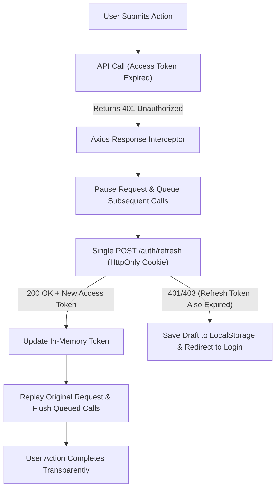

## Scenario

> **Your JWT token expires while the user is working. What would you do?**

If a user is typing a long form or in the middle of a checkout flow and their access token expires, abruptly kicking them out to the login screen destroys user trust. The interviewer is testing your knowledge of **silent token refresh architectures using Axios interceptors and refresh token rotation**.


## Fast Revision (10-Second Recall)

- **The Goal:** Seamlessly renew credentials in the background without interrupting the user or dropping in-flight requests.
- **The Core Architecture:**
  1. **Short-Lived Access Token (15m):** Used for stateless API authorization in the `Authorization: Bearer` header.
  2. **Long-Lived Refresh Token (7–30d):** Stored in a secure `HttpOnly; Secure; SameSite=Strict` cookie.
  3. **Axios 401 Response Interceptor:** Intercepts the 401, pauses pending requests in a queue, calls `POST /auth/refresh`, and replays all failed requests with the new token.
  4. **Single-Flight Refresh Lock:** Prevent 10 concurrent API calls from triggering 10 simultaneous refresh requests.
- **Key Tools:** Axios Response Interceptor, HttpOnly Refresh Cookie, Refresh Token Rotation.


## The 30-Second Spoken Script

If asked this in an interview, deliver this structured response:

> *When a JWT access token expires during an active user session, the application must perform a Silent Token Refresh without interrupting the user.*
>
> *I design this using a two-token model: short-lived 15-minute Access Tokens in memory, and a long-lived 7-day Refresh Token stored in a secure, HttpOnly, SameSite cookie.*
>
> *On the client, I configure an Axios response interceptor. When an API call returns 401, the interceptor pauses that request and any subsequent requests, queuing them in memory.*
>
> *A single-flight call is dispatched to `POST /auth/refresh`. The backend validates the refresh token, verifies it against Redis to ensure it hasn't been revoked, and issues a new access token.*
>
> *Once the new token is received, the interceptor flushes the queue, retrying all paused requests with the fresh token. The user experiences zero interruption or data loss.*


## Diagnostic Lifecycle



### 1. The Multi-Request Refresh Race Condition
If a dashboard loads 6 API calls simultaneously when the access token expires, all 6 will return 401 at the same millisecond.
- **Anti-pattern:** Firing 6 simultaneous `/auth/refresh` calls.
- **Best Practice (Singleflight Lock):** The first 401 acquires a `isRefreshing` lock and initiates the refresh. The other 5 requests push their callback promises onto a `failedQueue` array, resolving automatically once the single refresh completes.


## Root Causes & Solutions Matrix

| Issue | User Impact | Architecture Remedy |
| :--- | :--- | :--- |
| **Abrupt Session Termination** | User kicked to login screen while filling a 20-field form. | Silent refresh via Axios response interceptors. |
| **Concurrent Refresh Storm** | 10 parallel 401s fire 10 simultaneous refresh calls. | Use request queueing and a boolean `isRefreshing` mutex lock. |
| **Token Theft via XSS** | Refresh token stolen from `localStorage`. | Store refresh tokens strictly in `HttpOnly; Secure; SameSite=Strict` cookies. |
| **Stolen Refresh Token Reuse** | Attacker uses leaked refresh token indefinitely. | Implement **Refresh Token Rotation**: invalidate entire token family upon reuse detection. |


## Practical Debugging Commands & Code

### 1. Resilient Axios Interceptor with Request Queueing
```typescript
import axios from 'axios';

const apiClient = axios.create({ baseURL: '/api' });

let isRefreshing = false;
let failedQueue: Array<{ resolve: (token: string) => void; reject: (err: any) => void }> = [];

const processQueue = (error: any, token: string | null = null) => {
  failedQueue.forEach((prom) => {
    if (error) {
      prom.reject(error);
    } else {
      prom.resolve(token!);
    }
  });
  failedQueue = [];
};

apiClient.interceptors.response.use(
  (response) => response,
  async (error) => {
    const originalRequest = error.config;

    // If 401 and request hasn't been retried yet
    if (error.response?.status === 401 && !originalRequest._retry) {
      if (isRefreshing) {
        // Queue parallel requests while refresh is in flight
        return new Promise((resolve, reject) => {
          failedQueue.push({ resolve, reject });
        })
          .then((token) => {
            originalRequest.headers['Authorization'] = `Bearer ${token}`;
            return apiClient(originalRequest);
          })
          .catch((err) => Promise.reject(err));
      }

      originalRequest._retry = true;
      isRefreshing = true;

      try {
        // Send refresh request (Cookie sent automatically by browser)
        const { data } = await axios.post('/api/auth/refresh', {}, { withCredentials: true });
        const newAccessToken = data.accessToken;

        // Update default header and retry queued calls
        apiClient.defaults.headers.common['Authorization'] = `Bearer ${newAccessToken}`;
        processQueue(null, newAccessToken);

        originalRequest.headers['Authorization'] = `Bearer ${newAccessToken}`;
        return apiClient(originalRequest);
      } catch (refreshError) {
        processQueue(refreshError, null);
        // Both tokens expired: redirect to login
        window.location.href = `/login?redirect=${encodeURIComponent(window.location.pathname)}`;
        return Promise.reject(refreshError);
      } finally {
        isRefreshing = false;
      }
    }

    return Promise.reject(error);
  }
);
```


## Prevention & Senior Best Practices

1. **Short Access Token Lifetimes:** Set access token TTL to 10–15 minutes. This minimizes the vulnerability window if an access token is intercepted.
2. **Proactive Pre-Expiration Refresh:** In single-page applications, run a background timer (`setInterval`) that refreshes the access token 2 minutes *before* it expires to avoid hitting 401s entirely.
3. **Persist Unsaved Form State:** In frontend frameworks, serialize dirty form state to `sessionStorage` before redirecting to login so the user never loses typed content.

