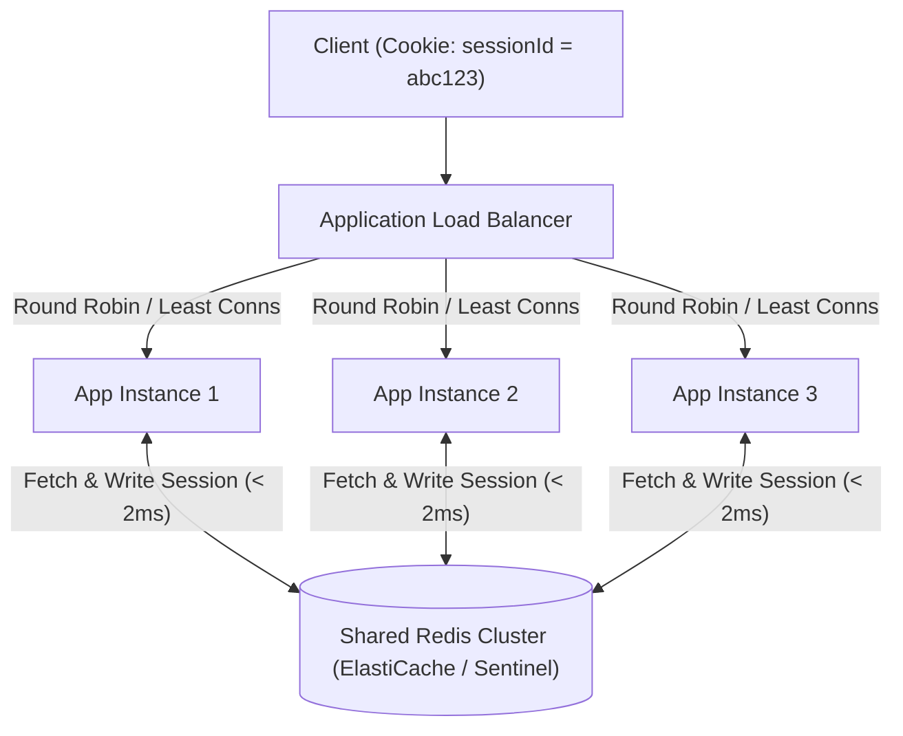

## Scenario

> **How would you manage sessions across multiple backend instances?**

When scaling horizontally from 1 backend server to 10 instances behind a load balancer, standard in-memory sessions (e.g., Express `req.session` stored in node memory) will fail: User logs in on Server A, but their next request hits Server B, which has no memory of the session and rejects them as unauthenticated.


## Fast Revision (10-Second Recall)

- **The 3 Architecture Options:**
  1. **Distributed In-Memory Store (Redis / Memcached) — Recommended:** Sessions are externalized to a centralized Redis cluster; any backend instance reads and writes to the shared store.
  2. **Stateless JWTs (Client-Side Storage):** Session state is encoded into a signed token stored by the client; servers store zero session state.
  3. **Sticky Sessions (Session Affinity at Load Balancer) — Anti-Pattern:** Routing the user to the same server every time based on IP or cookie. Fragile during auto-scaling or pod crashes.
- **Key Tools:** Redis Cluster with Sentinel (High Availability), `connect-redis`, AWS ElastiCache, Sticky Sessions via AWS ALB.


## The 30-Second Spoken Script

If asked this in an interview, deliver this structured response:

> *I manage sessions across distributed instances by enforcing stateless application nodes and externalizing session state to a shared Redis cluster.*
>
> *I avoid Sticky Sessions at the load balancer. While sticky sessions are easy to enable, they prevent true load distribution, fail completely during autoscaling, and terminate all active user sessions if a single pod crashes or redeploys.*
>
> *Instead, I use a centralized Redis store using `connect-redis`. When a request arrives at any of our 10 instances, the server uses the session ID from the cookie to fetch the session payload from Redis in under 2 milliseconds.*
>
> *For even higher scale, I transition to stateless JWTs where claims are signed and stored on the client, eliminating the database lookup entirely for routine authorization checks.*


## Diagnostic Lifecycle



### 1. Why Sticky Sessions Are an Anti-Pattern
- **Uneven Load Distribution:** One heavy enterprise customer with 500 users can saturate a single backend pod while other pods sit idle.
- **Server Deployment / Crash Disruption:** When Kubernetes terminates a pod during a rolling deployment, all users pinned to that pod are kicked out immediately.


## Root Causes & Solutions Matrix

| Approach | Latency | Scalability | Trade-offs |
| :--- | :--- | :--- | :--- |
| **In-Memory Sessions** | Fast (0.01ms) | Zero (Cannot scale past 1 server) | Broken immediately upon adding a second instance. |
| **Sticky Sessions (ALB)** | Fast (0.01ms) | Poor | Uneven traffic load; session loss on pod restarts. |
| **Centralized Redis Store** | Fast (1–2ms) | **Excellent** | Redis cluster must be configured for high availability (Sentinel/Replicas). |
| **Stateless JWT** | Instant (0ms DB lookups) | **Infinite** | Revocation is complex; payload size inflates every HTTP request header. |


## Practical Debugging Commands & Code

### 1. Distributed Redis Session Store Setup (Express)
```typescript
import session from 'express-session';
import RedisStore from 'connect-redis';
import Redis from 'ioredis';
import express from 'express';

const app = express();
const redisClient = new Redis({
  host: process.env.REDIS_HOST || '127.0.0.1',
  port: 6379,
  retryStrategy: (times) => Math.min(times * 50, 2000), // Reconnection resilience
});

const redisStore = new RedisStore({
  client: redisClient,
  prefix: 'sess:',
});

app.use(
  session({
    store: redisStore,
    secret: process.env.SESSION_SECRET!,
    resave: false,
    saveUninitialized: false,
    cookie: {
      secure: process.env.NODE_ENV === 'production', // Require HTTPS in prod
      httpOnly: true,                                // XSS mitigation
      sameSite: 'lax',
      maxAge: 1000 * 60 * 60 * 24 * 7,               // 7 days
    },
  })
);
```


## Prevention & Senior Best Practices

1. **Configure Redis for High Availability:** In production, never run a single standalone Redis node for sessions; use AWS ElastiCache with Multi-AZ automated failover or Redis Sentinel.
2. **Set Reasonable Session TTLs:** Always configure session expiration (`maxAge`) so abandoned sessions are automatically evicted from Redis RAM.
3. **Keep Session Objects Lightweight:** Only store the minimal identity data (e.g., `userId`, `role`, `orgId`) in the session object; never cache massive user profiles or complex queries in session state.

