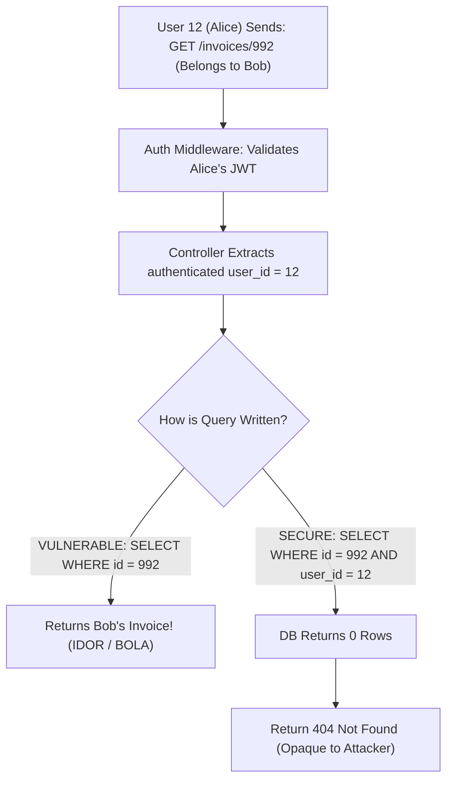

## Scenario

> **How would you prevent users from accessing another user's data?**

This is the classic **Insecure Direct Object Reference (IDOR)**, currently ranked as the **#1 vulnerability in the OWASP API Security Top 10: Broken Object-Level Authorization (BOLA)**. It happens when an API accepts an object identifier from the client (e.g., `GET /invoices/1042`) without verifying that the requesting user actually owns that object.


## Fast Revision (10-Second Recall)

- **The Vulnerability:** Attacker logs in as User A, inspects network tab, sees `GET /documents/501`, changes URL to `GET /documents/502`, and views User B's private documents.
- **Top 5 Defense Strategies:**
  1. **Scoped Database Queries (Primary Defense):** Never query by resource ID alone (`WHERE id = 502`). Always scope by the authenticated session user: `WHERE id = 502 AND user_id = currentUser.id`.
  2. **Never Trust Client-Supplied User IDs:** Derive the `userId` strictly from the verified JWT / session cookie, never from `req.body.userId` or route params.
  3. **Use Unpredictable UUIDs / ULIDs:** Replace sequential auto-incrementing integers (`1, 2, 3...`) with cryptographically secure UUIDv4 or ULIDs to eliminate enumeration attacks.
  4. **Multi-Tenant Row-Level Security (RLS):** Enable PostgreSQL Row-Level Security so the database engine automatically enforces `tenant_id = current_setting('app.current_tenant')`.
  5. **Policy / Policy Gate Middleware:** Use libraries like CASL or Pundit to verify `can('read', document, user)`.
- **Key Tools:** PostgreSQL Row-Level Security (RLS), UUIDv4 / ULID, CASL / Oso authorization libraries.


## The 30-Second Spoken Script

If asked this in an interview, deliver this structured response:

> *Preventing Broken Object-Level Authorization requires defense-in-depth at both the application and database tiers.*
>
> *First and most importantly, I enforce Scoped Database Queries. I never write `SELECT * FROM orders WHERE id = :id`. Instead, I always scope the query to the authenticated user derived from the validated JWT: `SELECT * FROM orders WHERE id = :id AND user_id = :currentUserId`.*
>
> *If the record does not belong to that user, the query returns zero rows, and the API returns a 404 Not Found rather than a 403, preventing attackers from confirming that the resource ID even exists.*
>
> *Second, I eliminate sequential integer IDs across public APIs, replacing them with UUIDv4 or ULIDs to make enumeration attacks mathematically impossible.*
>
> *Finally, in multi-tenant SaaS systems, I configure PostgreSQL Row-Level Security (RLS) at the database layer. This ensures that even if a developer forgets a `WHERE` clause in code, the database itself will never return rows belonging to another organization.*


## Diagnostic Lifecycle



### 1. The Vulnerable vs Secure Implementation

#### Vulnerable Code (Anti-Pattern)
```typescript
// VULNERABLE: Anyone can read anyone's profile by changing the URL param!
app.get('/api/profiles/:id', async (req, res) => {
  const profile = await db.profile.findUnique({
    where: { id: req.params.id }, // No ownership check!
  });
  return res.json(profile);
});
```

#### Secure Code (Scoped Query Pattern)
```typescript
// SECURE: Strictly scoped to the authenticated session user
app.get('/api/profiles/:id', async (req, res) => {
  const profile = await db.profile.findFirst({
    where: {
      id: req.params.id,
      userId: req.user.id, // Enforce ownership directly in SQL!
    },
  });

  if (!profile) {
    // Return 404 rather than 403 to prevent resource enumeration
    return res.status(404).json({ error: 'Profile not found' });
  }

  return res.json(profile);
});
```


## Root Causes & Solutions Matrix

| Security Flaw | Exploitation | Remediation |
| :--- | :--- | :--- |
| **Direct DB Lookup by ID** | Attacker iterates IDs (`/invoices/1`, `/invoices/2`...). | Scope query by session `userId` (`WHERE id = :id AND user_id = :userId`). |
| **Trusting Client `userId` in Body** | Attacker sends `{ "userId": 49821, "amount": 100 }` in body. | Overwrite or ignore body param; read `userId` strictly from `req.user.id`. |
| **Sequential Auto-Increment IDs** | Attacker easily scripts enumeration of all customer records. | Use UUIDv4 or KSUID/ULID for all public-facing entity identifiers. |
| **403 vs 404 Information Leakage** | 403 confirms ID exists; 404 hides existence. | Return 404 for unauthorized object access so attacker cannot map IDs. |
| **Multi-Tenant Accidental Leak** | Developer forgets `tenant_id` filter in a complex join. | Enforce PostgreSQL Row-Level Security (RLS) across all tenant tables. |


## Practical Debugging Commands & Code

### 1. PostgreSQL Row-Level Security (RLS) Policy
Enforce tenant isolation at the database engine level:
```sql
-- 1. Enable RLS on the table
ALTER TABLE documents ENABLE ROW LEVEL SECURITY;

-- 2. Create policy enforcing tenant ownership
CREATE POLICY tenant_isolation_policy ON documents
    USING (tenant_id = current_setting('app.current_tenant')::int);

-- In backend before query:
-- SET LOCAL app.current_tenant = 42;
-- Now any query (even SELECT * FROM documents) only sees rows where tenant_id = 42!
```


## Prevention & Senior Best Practices

1. **Adopt 404 Over 403 for Object Authorization:** When an unauthorized object is requested, return `404 Not Found` rather than `403 Forbidden`. A 403 confirms to an attacker that the object exists.
2. **Never Expose Internal Database Auto-Increment IDs:** Store an auto-increment integer for internal indexing performance, but expose an external `public_id: uuid` across all REST and GraphQL endpoints.
3. **Automate BOLA Penetration Tests:** Write integration tests in CI/CD that explicitly log in as User A and attempt to update or delete entities belonging to User B, asserting a 404 on every endpoint.

