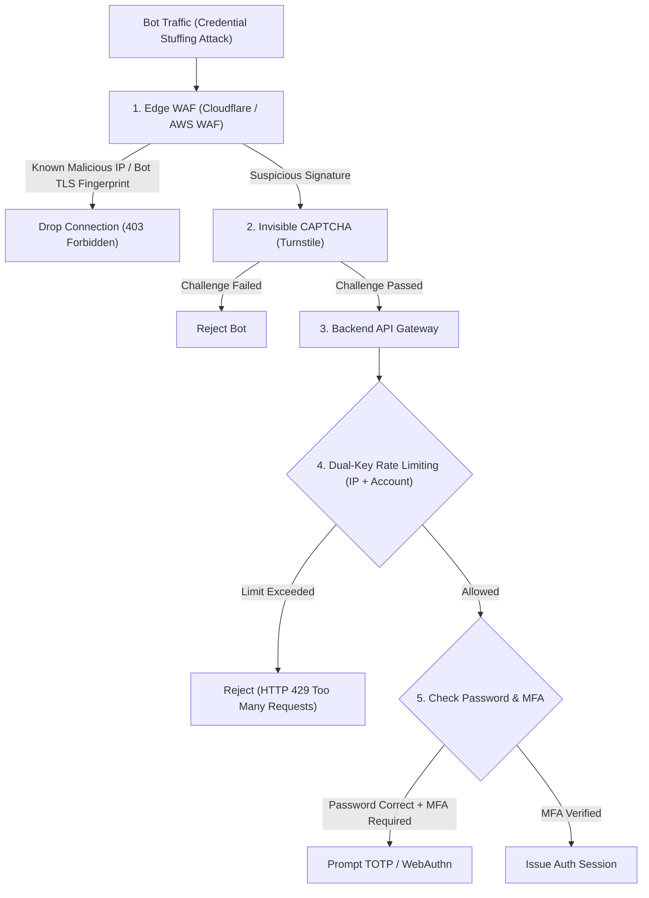

## Scenario

> **How would you prevent brute-force login attacks?**

Brute-force attacks range from simple dictionary attacks against a single account to massive **distributed credential stuffing attacks**, where botnets test millions of leaked username/password pairs from third-party breaches across your login endpoints. The interviewer is testing your **multi-tier defense-in-depth across the WAF, API Gateway, application, and identity levels**.


## Fast Revision (10-Second Recall)

- **The Difference:**
  - **Brute Force:** Many passwords tested against one account from one or few IPs.
  - **Credential Stuffing:** Millions of leaked username/password combos tested across many accounts from thousands of residential proxy IPs.
- **Top 5 Defense Layers:**
  1. **Edge WAF & IP Reputation:** Cloudflare / AWS WAF blocking known bot IPs, Tor exit nodes, and headless browsers (TLS fingerprinting).
  2. **Invisible CAPTCHA (Turnstile / reCAPTCHA v3):** Score incoming requests without forcing human friction; block scores below 0.5.
  3. **Multi-Factor Authentication (MFA / 2FA):** Even if credentials match, access is blocked without TOTP / WebAuthn passkey.
  4. **Breach Detection Integration:** Check password against HaveIBeenPwned API (k-anonymity model) during signup/login.
  5. **Behavioral Anomaly Detection:** Flag logins from impossible travel speeds (e.g., London and Tokyo within 20 minutes).
- **Key Tools:** Cloudflare WAF / Turnstile, HaveIBeenPwned API, MaxMind GeoIP, Fail2ban.


## The 30-Second Spoken Script

If asked this in an interview, deliver this structured response:

> *I prevent brute-force and credential stuffing attacks by implementing a multi-layered defense starting at the network edge and ending at the identity layer.*
>
> *At the edge, I configure our Web Application Firewall (like Cloudflare or AWS WAF) with managed bot protection. This uses TLS fingerprinting and IP reputation databases to immediately filter out automated headless browsers and known proxy networks.*
>
> *At the gateway, I integrate Cloudflare Turnstile—an invisible CAPTCHA that challenges suspicious client signatures without degrading the user experience for legitimate humans.*
>
> *At the application level, I enforce dual-key rate limiting (per IP and per targeted account). If repeated failures occur on an account, we enforce step-up authentication via email verification.*
>
> *Finally, the ultimate defense against credential stuffing is Multi-Factor Authentication (MFA) and breached password checking using the HaveIBeenPwned k-anonymity API.*


## Diagnostic Lifecycle



### 1. The Credential Stuffing Threat Model
Attackers do not guess randomly; they download 100 million credentials leaked from LinkedIn or Yahoo and run automated scripts against your API.
- Because 60% of people reuse passwords across services, 0.1% to 2% of attempts will be valid credentials!
- **Rate limiting alone fails** because the botnet rotates 50,000 unique IP addresses, sending only 1 request per IP every 5 minutes.


## Root Causes & Solutions Matrix

| Attack Vector | Tactic | Defensive Layer |
| :--- | :--- | :--- |
| **High-Volume Brute Force** | 100 requests/sec from single cloud VM. | IP Rate Limiting & Fail2ban at NGINX/WAF. |
| **Low-and-Slow Distributed Stuffing** | 10,000 residential IPs each making 1 call per hour. | Invisible CAPTCHA (Cloudflare Turnstile) & JA3 TLS fingerprinting. |
| **Stolen Leaked Passwords** | Valid email and password combo used by attacker. | Mandatory Multi-Factor Authentication (TOTP / WebAuthn) & HaveIBeenPwned checks. |
| **Account Takeover via Account Enumeration** | Attacker tests list of emails to see which return "Invalid Password" vs "User Not Found". | Uniform error messages: always return "Invalid email or password" for both cases. |


## Practical Debugging Commands & Code

### 1. Checking Passwords Against HaveIBeenPwned (k-Anonymity)
Ensure user is not using a known compromised password without leaking the password:
```typescript
import crypto from 'crypto';
import axios from 'axios';

export async function isPasswordCompromised(password: string): Promise<boolean> {
  // 1. Calculate SHA-1 hash of password
  const sha1Hash = crypto.createHash('sha1').update(password).digest('hex').toUpperCase();
  const prefix = sha1Hash.substring(0, 5);
  const suffix = sha1Hash.substring(5);

  // 2. Query HaveIBeenPwned using only first 5 chars (k-anonymity model: zero password leakage!)
  const response = await axios.get(`https://api.pwnedpasswords.com/range/${prefix}`);
  const hashes = response.data.split('\n');

  // 3. Check if matching suffix exists in returned list
  for (const line of hashes) {
    const [hashSuffix, count] = line.split(':');
    if (hashSuffix.trim() === suffix) {
      console.warn(`[SECURITY] Password found in ${count.trim()} historical data breaches!`);
      return true; // Password is breached!
    }
  }

  return false;
}
```

### 2. Validating Invisible Cloudflare Turnstile Token
```typescript
export async function verifyTurnstileToken(token: string, remoteIp: string): Promise<boolean> {
  const secretKey = process.env.CLOUDFLARE_TURNSTILE_SECRET_KEY!;

  const formData = new URLSearchParams();
  formData.append('secret', secretKey);
  formData.append('response', token);
  formData.append('remoteip', remoteIp);

  const res = await axios.post('https://challenges.cloudflare.com/turnstile/v0/siteverify', formData);
  return res.data.success === true;
}
```


## Prevention & Senior Best Practices

1. **Return Uniform Error Responses:** Never reveal whether the username or the password was incorrect. Always respond with `"Invalid email or password"` to prevent username enumeration.
2. **Encourage Passkeys / FIDO2:** Transition users towards WebAuthn / Passkeys; public-key cryptography makes credential stuffing mathematically impossible.
3. **Notify Users on Anomalous Logins:** Send an automated email notification whenever a login is detected from a new device, IP, or geographical region.

