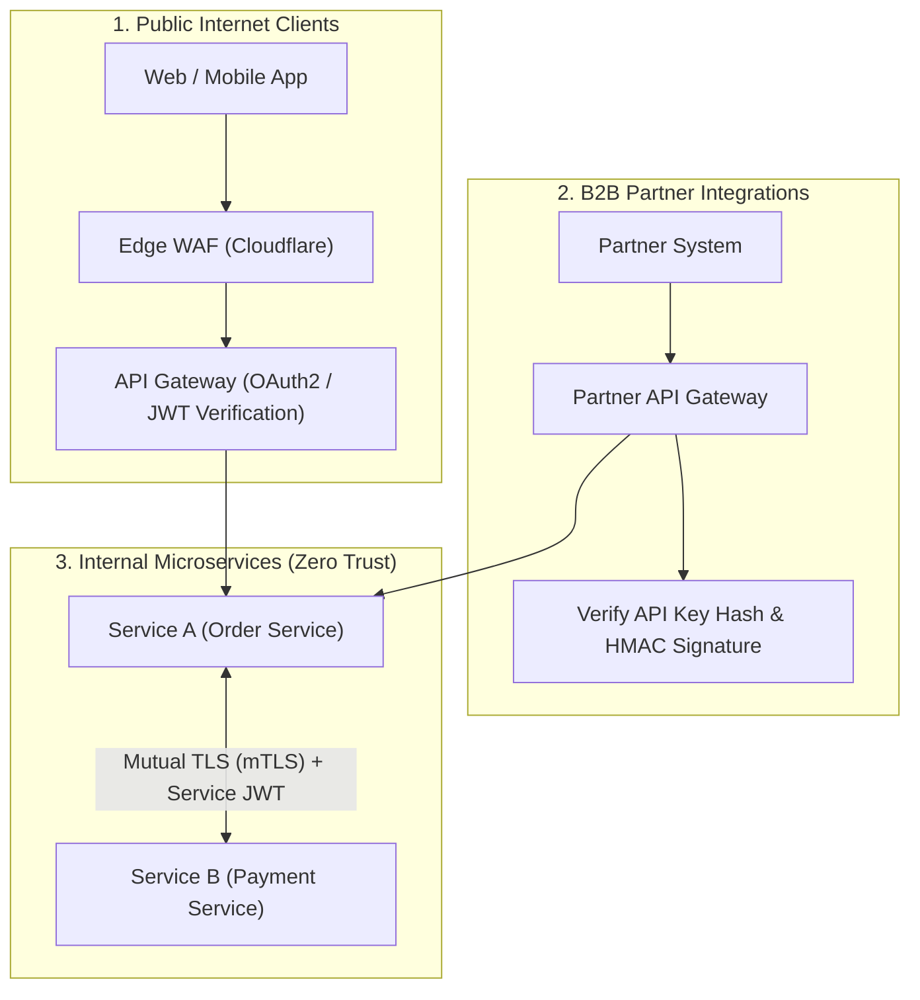

## Scenario

> **How would you protect APIs from unauthorized access?**

Securing an API requires different mechanisms depending on the caller: public mobile/web clients, B2B third-party partner developers, or internal service-to-service microservices. Interviewers expect a comprehensive **Zero Trust architectural framework covering both perimeter defense and cryptographic identity verification**.


## Fast Revision (10-Second Recall)

- **The Philosophy:** **Zero Trust** (Never trust the local network; authenticate and authorize every single hop).
- **The 3 Ingestion Tiers & Their Defenses:**
  1. **Public Web/Mobile Clients:** Short-lived JWTs (OIDC), OAuth2 PKCE, HttpOnly cookies, and Web Application Firewall (WAF) bot filtering.
  2. **B2B Partner Integrations:** Cryptographic API Keys (`X-API-Key` hashed with SHA-256 in DB), HMAC request signing, and IP CIDR allowlisting.
  3. **Internal Microservice-to-Microservice:** **Mutual TLS (mTLS)** via service meshes (Istio/Linkerd) and cryptographically signed JWT service tokens.
- **Key Tools:** Envoy / Istio (mTLS), Cloudflare WAF, API Gateway Key Management, HMAC signatures.


## The 30-Second Spoken Script

If asked this in an interview, deliver this structured response:

> *I protect APIs using a Zero Trust architecture tailored to the three distinct categories of API consumers.*
>
> *For public web and mobile users, all requests pass through an edge WAF and API Gateway. We authenticate users via OAuth2/OIDC using short-lived JWTs and HttpOnly cookies, enforcing strict rate limiting and schema validation.*
>
> *For third-party B2B partners, we issue high-entropy API Keys that are stored hashed in our database. For high-security financial transactions, we require HMAC request signing using a shared secret to guarantee request integrity and prevent replay attacks.*
>
> *For internal microservice communication, we never assume the internal network is secure. We enforce Mutual TLS (mTLS) through a service mesh like Istio, ensuring that every service verifies the cryptographic identity of the calling service before processing any request.*


## Diagnostic Lifecycle



### 1. B2B HMAC Request Signing (Integrity & Replay Protection)
How payment APIs (like Stripe or AWS) prevent tampering:
$$\text{Signature} = \text{HMAC-SHA256}(\text{SecretKey}, \;\; \text{Timestamp} + \text{Method} + \text{Path} + \text{BodyHash})$$
The server computes the identical signature:
1. Rejects request if timestamp is older than 5 minutes (prevents replay attacks).
2. Rejects request if calculated signature doesn't match client's `X-Signature` header (prevents parameter tampering).


## Root Causes & Solutions Matrix

| API Consumer Type | Threat | Protective Architecture |
| :--- | :--- | :--- |
| **Public Web / Mobile** | Credential stuffing, brute force, scraper bots. | Edge WAF, Cloudflare Turnstile, JWT with short expiry. |
| **B2B API Partners** | Leaked API key, parameter tampering in transit. | SHA-256 hashed keys in DB; HMAC request signatures; IP allowlisting. |
| **Internal Microservices** | Compromised pod sniffing internal network traffic. | **Mutual TLS (mTLS)** with automatic certificate rotation via Istio. |
| **API Endpoints Globally** | DDoS, resource exhaustion attacks. | Token-bucket rate limiting and payload size limits at Gateway. |


## Practical Debugging Commands & Code

### 1. Verifying HMAC Request Signatures (Node.js)
```typescript
import crypto from 'crypto';
import { Request, Response, NextFunction } from 'express';

export function verifyHmacSignature(req: Request, res: Response, next: NextFunction) {
  const signature = req.headers['x-signature'] as string;
  const timestamp = req.headers['x-timestamp'] as string;
  const partnerKey = req.headers['x-api-key'] as string;

  if (!signature || !timestamp || !partnerKey) {
    return res.status(401).json({ error: 'Missing security headers' });
  }

  // 1. Prevent Replay Attacks: Reject if timestamp is older than 5 minutes
  const now = Math.floor(Date.now() / 1000);
  if (Math.abs(now - parseInt(timestamp, 10)) > 300) {
    return res.status(401).json({ error: 'Request timestamp expired' });
  }

  // 2. Fetch partner shared secret from Vault / Redis
  const partnerSecret = getPartnerSecret(partnerKey);

  // 3. Recreate expected signature payload
  const payloadToSign = `${timestamp}.${req.method}.${req.originalUrl}.${JSON.stringify(req.body)}`;
  const expectedSignature = crypto
    .createHmac('sha256', partnerSecret)
    .update(payloadToSign)
    .digest('hex');

  // 4. Constant-time comparison to prevent timing attacks
  const isMatch = crypto.timingSafeEqual(
    Buffer.from(signature),
    Buffer.from(expectedSignature)
  );

  if (!isMatch) {
    return res.status(401).json({ error: 'Invalid HMAC signature' });
  }

  next();
}
```


## Prevention & Senior Best Practices

1. **Hash API Keys in Database:** Never store third-party API keys in plaintext; store them as SHA-256 hashes (`api_key_hash`), displaying the raw key to the partner only once upon creation.
2. **Enforce Mutual TLS (mTLS) for Backends:** Implement a service mesh like Istio or Linkerd to automate peer authentication and encryption without adding boilerplate code to microservice repositories.
3. **Continuous API Security Testing:** Use automated OpenAPI fuzzers and security scanners (e.g., 42Crunch, OWASP ZAP) to scan for broken authentication on new endpoints.

