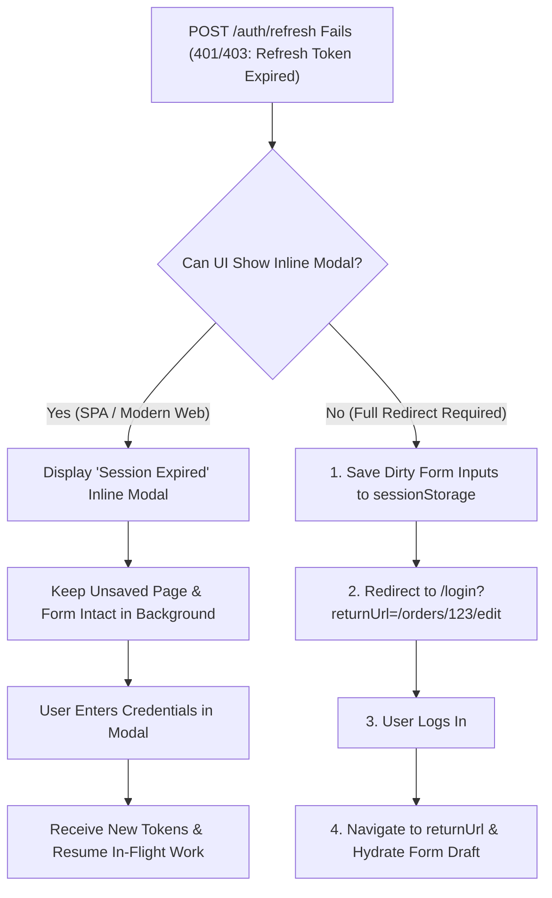

## Scenario

> **Your refresh token is also expired. How would you handle it?**

When both the access token and the refresh token are expired, silent renewal is no longer possible: the user's session has formally terminated. An unpolished system drops the user on a blank login page, destroying any active drafts or scroll position. The interviewer expects a **graceful re-authentication strategy that preserves user context**.


## Fast Revision (10-Second Recall)

- **The State:** Both Access Token (15m) and Refresh Token (e.g., 14 days) are expired or invalidated in Redis.
- **Top 4 Actions for Graceful Degradation:**
  1. **Purge In-Memory & Cookie State:** Clear client-side token state and tell the backend to delete the HttpOnly cookie.
  2. **Preserve Current URL (Deep Link):** Append the current route and query params (`/login?returnUrl=/orders/create?step=3`) so the user returns to their exact task post-login.
  3. **Auto-Save Dirty Form Drafts:** Serialize unsaved input states into `sessionStorage` before leaving the page.
  4. **Display Contextual Toast/Modal:** If possible, show an inline login modal overlay (`Re-authenticate to continue`) rather than navigating away from the page.
- **Key Tools:** `returnUrl` query parameter, `sessionStorage` draft persistence, Re-auth modal overlay.


## The 30-Second Spoken Script

If asked this in an interview, deliver this structured response:

> *When the refresh token is also expired, the session cannot be renewed silently, so the user must re-authenticate. However, the experience must be seamless and prevent data loss.*
>
> *First, before redirecting, the client captures any unsaved form state into `sessionStorage` and captures the current URL as a `returnUrl` parameter.*
>
> *Second, for optimal UX in single-page applications, instead of a full-page redirect, I trigger an inline Re-authentication Modal. The user enters their password or biomatrix in a popup while their unsaved page remains visible in the background. Once authenticated, the modal closes and the original action resumes.*
>
> *Third, if a full redirect is required, the login page reads the `returnUrl`, navigates back immediately upon successful authentication, and restores the draft state from `sessionStorage`.*
>
> *On the backend, I ensure the expired refresh token is evicted from Redis and all associated sessions are cleanly terminated.*


## Diagnostic Lifecycle



### 1. The Full-Page Redirect Trap vs Inline Re-Auth Modal
- **Full-Page Redirect (Poor UX):** User was writing a 1,000-word support ticket $\rightarrow$ tokens expire $\rightarrow$ redirected to `/login` $\rightarrow$ ticket draft deleted $\rightarrow$ user frustrated.
- **Inline Modal / Draft Save (High-End UX):** An overlay prompt appears: *"Your session expired for security. Please confirm your password."* The page underneath remains intact.


## Root Causes & Solutions Matrix

| Problem | User Consequence | Engineering Remedy |
| :--- | :--- | :--- |
| **Lost Input Data** | Form fields cleared upon navigation to login page. | Save unsaved form state to `sessionStorage` prior to redirect. |
| **Navigation Disorientation** | User always sent to `/dashboard` after login regardless of where they were. | Append `?returnUrl=${encodeURIComponent(currentPath)}` to login route. |
| **Open Redirect Vulnerability** | Malicious actor crafts `?returnUrl=https://phishing-site.com`. | Sanitize `returnUrl`: only allow relative paths starting with a single `/`. |
| **Zombie Refresh Cookies** | Expired cookie remains in browser, failing on every request. | Set `res.clearCookie('refresh_token')` with matching domain and path flags. |


## Practical Debugging Commands & Code

### 1. Frontend Draft Preservation & Redirect Handler
```typescript
export function handleSessionExpiration() {
  // 1. Capture current path for post-login return
  const currentPath = window.location.pathname + window.location.search;

  // 2. Identify and preserve dirty form state
  const activeForms = document.querySelectorAll('form');
  const formDataMap: Record<string, any> = {};

  activeForms.forEach((form, index) => {
    const data = new FormData(form);
    formDataMap[`form_${index}`] = Object.fromEntries(data.entries());
  });

  if (Object.keys(formDataMap).length > 0) {
    sessionStorage.setItem('UNSAVED_FORM_DRAFT', JSON.stringify(formDataMap));
  }

  // 3. Clear auth store
  useAuthStore.getState().logout();

  // 4. Redirect with safe relative return URL
  window.location.href = `/login?returnUrl=${encodeURIComponent(currentPath)}`;
}
```

### 2. Preventing Open Redirect Vulnerabilities on the Backend/Client
Never blindly redirect to user-supplied query params:
```typescript
export function getSafeReturnUrl(rawUrl: string | null): string {
  if (!rawUrl) return '/dashboard';

  // Security check: Must start with single '/', NOT '//' (protocol-relative URL)
  if (rawUrl.startsWith('/') && !rawUrl.startsWith('//')) {
    return rawUrl;
  }

  return '/dashboard'; // Fallback to safe internal page
}
```


## Prevention & Senior Best Practices

1. **Warn Users Before Session Expiration:** Display a countdown modal (e.g., *"Your session will expire in 2 minutes. Click here to stay logged in."*) when 90% of the refresh token TTL has elapsed.
2. **Sanitize Return URLs:** Always validate that the `returnUrl` is a relative internal path to prevent Open Redirect phishing attacks.
3. **Use Session Heartbeats on Active Tabs:** If a user is actively typing or moving their mouse, send an active heartbeat request to roll forward the sliding refresh window.

