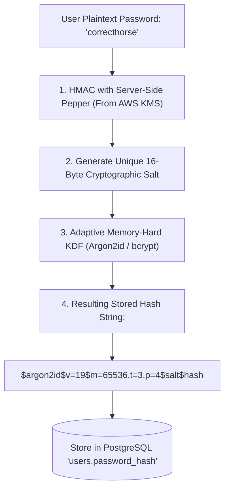

## Scenario

> **How would you securely store passwords?**

Storing passwords in plaintext or using fast hashing algorithms like MD5 or SHA-256 is an immediate security vulnerability. Fast algorithms allow modern GPUs to compute billions of hashes per second, cracking leaked databases within hours. The interviewer is testing your understanding of **slow cryptographic password hashing functions, salting, work factors, and pepper strategies**.


## Fast Revision (10-Second Recall)

- **The Golden Rule:** Never use fast general-purpose hashes (MD5, SHA-1, SHA-256). Always use **adaptive, memory-hard key derivation functions**.
- **Top 2 Algorithms:**
  1. **Argon2id (Winner of the Password Hashing Competition):** Resists both GPU and ASIC brute-force attacks via configurable memory and time parameters.
  2. **bcrypt (Industry Standard):** Adaptive work factor ($2^{\text{cost}}$); standard cost factor is 12 (takes $\approx 250\text{--}350\text{ms}$).
- **The 3 Cryptographic Defenses:**
  - **Salt (Unique per password):** Random 16-byte string defeating Rainbow Tables.
  - **Work Factor / Iterations:** Intentionally slows down computation to defeat brute-force dictionary attacks.
  - **Pepper (Server-Side Secret):** A secret key stored outside the database (in AWS KMS / Vault) appended to the password before hashing.
- **Key Tools:** `argon2` npm library, `bcryptjs`, AWS KMS for pepper management.


## The 30-Second Spoken Script

If asked this in an interview, deliver this structured response:

> *I store passwords using modern, memory-hard cryptographic key derivation functions—specifically Argon2id as the primary choice, or bcrypt with a minimum work factor of 12.*
>
> *I never use fast algorithms like SHA-256 or MD5 because modern GPUs can compute billions of SHA-256 hashes per second.*
>
> *First, every password is hashed with a cryptographically secure, unique 16-byte Salt generated automatically by the library. This prevents precomputed Rainbow Table attacks and ensures identical passwords produce completely different hash strings.*
>
> *Second, I calibrate the cost factor so hashing takes roughly 250 to 300 milliseconds on our server CPU. This is imperceptible to a logging-in user, but makes offline brute-force cracking mathematically infeasible.*
>
> *Finally, for enhanced security, I use a Pepper: a secret HMAC key stored in AWS Secrets Manager or KMS, separate from the database. Even if an attacker dumps the entire SQL database, they cannot crack the hashes without the external pepper.*


## Diagnostic Lifecycle



### 1. The Hash Format Breakdown
When you store a bcrypt or Argon2 hash in your database, it encapsulates the algorithm, cost, salt, and hash in one string:
```text
$2b$12$e8x/k... (Bcrypt)
│   │  └─ 22 characters: Salt (Unique per user) + 31 characters: Hash
│   └──── Cost Factor: 12 (2^12 = 4,096 iterations)
└──────── Algorithm identifier (bcrypt version 2b)
```


## Root Causes & Solutions Matrix

| Flaw / Practice | Vulnerability | Remediation |
| :--- | :--- | :--- |
| **Plaintext Storage** | Single database dump exposes all user credentials. | Hash passwords immediately upon receipt before saving. |
| **Fast Hashes (MD5 / SHA-256)** | GPUs crack 8-character passwords in minutes. | Migrate to **Argon2id** or **bcrypt** (cost 12+). |
| **Hardcoded Global Salt** | Rainbow tables can be precomputed for the single salt. | Use a unique 16-byte random salt per user (handled automatically by bcrypt/Argon2). |
| **Password Truncation (bcrypt 72-byte limit)** | bcrypt silently ignores bytes after 72 characters. | Pre-hash passwords with SHA-256 before bcrypt, or use Argon2id. |
| **No External Pepper** | Attacker with SQL injection dumps database and cracks hashes offline. | HMAC password with an external secret pepper stored in AWS KMS. |


## Practical Debugging Commands & Code

### 1. Robust Password Hashing Implementation with Argon2id
```typescript
import argon2 from 'argon2';
import crypto from 'crypto';

// Pepper stored securely in environment or secret manager (NEVER in DB)
const SERVER_PEPPER = process.env.PASSWORD_PEPPER || 'vault-managed-secret-key';

function applyPepper(password: string): Buffer {
  return crypto.createHmac('sha256', SERVER_PEPPER).update(password).digest();
}

export async function hashPassword(plainPassword: string): Promise<string> {
  const peppered = applyPepper(plainPassword);

  // Argon2id with OWASP-recommended parameters
  return await argon2.hash(peppered, {
    type: argon2.argon2id,
    memoryCost: 65536, // 64 MB RAM per hash (defeats GPU parallelization)
    timeCost: 3,       // 3 iterations
    parallelism: 4,    // 4 parallel threads
  });
}

export async function verifyPassword(plainPassword: string, storedHash: string): Promise<boolean> {
  const peppered = applyPepper(plainPassword);
  return await argon2.verify(storedHash, peppered);
}
```

### 2. Upgrading Password Hashes on Login (Work Factor Migration)
If you increase bcrypt cost from 10 to 12, re-hash transparently when users log in:
```typescript
export async function authenticateAndUpgradeHash(user: User, passwordAttempt: string) {
  const isValid = await bcrypt.compare(passwordAttempt, user.passwordHash);
  if (!isValid) return false;

  // Check if hash was created with an old, weak cost factor (< 12)
  if (bcrypt.getRounds(user.passwordHash) < 12) {
    const updatedHash = await bcrypt.hash(passwordAttempt, 12);
    await db.user.update({ where: { id: user.id }, data: { passwordHash: updatedHash } });
    console.log(`[SECURITY] Upgraded password hash cost factor for user ${user.id}`);
  }

  return true;
}
```


## Prevention & Senior Best Practices

1. **Adopt Argon2id as the Modern Standard:** Use Argon2id for new projects; it provides memory-hardness that mathematically neutralizes GPU and ASIC cracking rigs.
2. **Handle the 72-Byte bcrypt Boundary:** If using bcrypt, be aware it truncates passwords at 72 bytes. Pre-hashing with SHA-256 solves this cleanly.
3. **Never Log Passwords:** Ensure passwords and credentials are automatically scrubbed from request logs and error traces.

