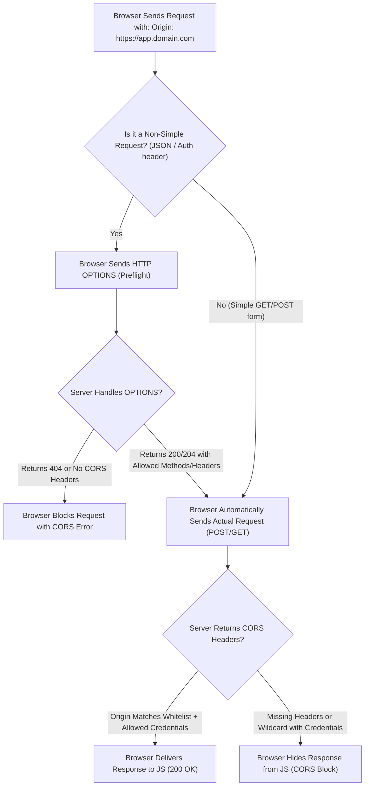

## Scenario

> **How would you handle CORS issues?**

*"Access to XMLHttpRequest at 'https://api.example.com' from origin 'https://app.example.com' has been blocked by CORS policy."* Every web developer has encountered this browser error. The interviewer wants to verify that you understand **CORS is a browser security mechanism, not a backend firewall**, and that you know how to configure preflight responses properly without resorting to insecure wildcard hacks like `Access-Control-Allow-Origin: *`.


## Fast Revision (10-Second Recall)

- **The Fundamental Concept:** CORS is enforced by the **browser**, not the server. Postman and cURL never face CORS because they are not web browsers.
- **Top 4 Triggers of CORS Rejections:**
  1. **Preflight `OPTIONS` Request Fails:** Non-simple request (custom headers like `Authorization` or `Content-Type: application/json`) requires an `OPTIONS` preflight that returned 404 or missing headers.
  2. **The Wildcard Conflict with Credentials:** If client sends cookies/auth headers (`credentials: 'include'`), the backend CANNOT return `Access-Control-Allow-Origin: *`. It must return the explicit origin.
  3. **Duplicate Headers from Gateway and App:** Both NGINX and Express append `Access-Control-Allow-Origin`, creating an invalid comma-separated header list.
  4. **Subdomain Mismatch:** `app.domain.com` calling `api.domain.com` is considered cross-origin (different host).
- **Key Headers:** `Origin`, `Access-Control-Allow-Origin`, `Access-Control-Allow-Methods`, `Access-Control-Allow-Headers`, `Access-Control-Allow-Credentials`.


## The 30-Second Spoken Script

If asked this in an interview, deliver this structured response:

> *First, I remember that CORS is a browser-enforced security mechanism designed to protect users, not an application bug. Postman will always succeed where a browser fails.*
>
> *When debugging a CORS error, I inspect the Network tab for the HTTP `OPTIONS` preflight request.*
>
> *If the preflight failed with a 404 or 500, it means our backend router or reverse proxy did not intercept and respond with a 204 or 200 to the preflight call.*
>
> *If the preflight passed but the actual request failed, the most common culprit is the credential wildcard conflict. If the frontend sends cookies or Authorization headers using `withCredentials: true`, the backend must return the explicit origin—like `Access-Control-Allow-Origin: https://app.example.com`—and specify `Access-Control-Allow-Credentials: true`. Returning a wildcard `*` is explicitly blocked by the browser specification.*
>
> *I resolve CORS centrally at the API Gateway or using trusted middleware, dynamically reflecting whitelisted origins.*


## Diagnostic Lifecycle



### 1. Simple vs Preflighted Requests
- **Simple Requests:** Standard `GET`, `HEAD`, `POST` with plain text or form data and standard headers. No preflight needed.
- **Preflighted Requests:** Any request sending `application/json`, `Authorization: Bearer`, custom headers (`X-Trace-Id`), or `PUT`/`DELETE`/`PATCH` methods. The browser automatically dispatches an `OPTIONS` request first!


## Root Causes & Solutions Matrix

| CORS Error Message | Underlying Issue | Resolution |
| :--- | :--- | :--- |
| **`Response to preflight request doesn't pass access control check`** | Server has no route handler for `OPTIONS` method. | Ensure CORS middleware is mounted before all routes: `app.use(cors())`. |
| **`The value of 'Access-Control-Allow-Origin' must not be the wildcard '*'`** | Frontend sent credentials (`withCredentials: true`), but backend returned `*`. | Reflect the requesting origin if it matches an allowed whitelist array. |
| **`Request header field authorization is not allowed by Access-Control-Allow-Headers`** | Preflight response did not explicitly whitelist `Authorization` header. | Add `Access-Control-Allow-Headers: Authorization, Content-Type`. |
| **`The 'Access-Control-Allow-Origin' header contains multiple values`** | Both NGINX and Node.js added the CORS header. | Remove CORS headers from either NGINX or application middleware (never both). |


## Practical Debugging Commands & Code

### 1. Robust Production-Grade Dynamic CORS Middleware (Express)
```typescript
import cors, { CorsOptions } from 'cors';

const allowedOrigins = [
  'https://app.yourdomain.com',
  'https://admin.yourdomain.com',
  'http://localhost:3000', // Local development
];

const corsOptions: CorsOptions = {
  origin: (origin, callback) => {
    // Allow non-browser requests (like mobile apps, curl, server-to-server) where origin is undefined
    if (!origin || allowedOrigins.includes(origin)) {
      callback(null, true);
    } else {
      callback(new Error(`CORS blocked: Origin ${origin} not permitted.`));
    }
  },
  credentials: true, // Allow cookies and authorization headers
  methods: ['GET', 'POST', 'PUT', 'DELETE', 'PATCH', 'OPTIONS'],
  allowedHeaders: ['Content-Type', 'Authorization', 'X-Correlation-Id'],
  maxAge: 86400,     // Cache preflight OPTIONS response for 24 hours (reduces traffic!)
};

export const configuredCors = cors(corsOptions);
```

### 2. Testing Preflight `OPTIONS` via cURL
Test CORS behavior directly from the command line:
```bash
curl -X OPTIONS https://api.yourdomain.com/v1/users \
  -H "Origin: https://app.yourdomain.com" \
  -H "Access-Control-Request-Method: POST" \
  -H "Access-Control-Request-Headers: Authorization, Content-Type" \
  -i
```
Look for:
```http
HTTP/1.1 204 No Content
Access-Control-Allow-Origin: https://app.yourdomain.com
Access-Control-Allow-Methods: GET, POST, PUT, DELETE, PATCH, OPTIONS
Access-Control-Allow-Headers: Authorization, Content-Type
Access-Control-Allow-Credentials: true
Access-Control-Max-Age: 86400
```


## Prevention & Senior Best Practices

1. **Use `Access-Control-Max-Age`:** Set preflight cache duration (e.g., 24 hours: `86400`). This eliminates redundant `OPTIONS` round-trips for returning users.
2. **Handle CORS at the Ingress / Reverse Proxy:** For microservices, handle CORS at the API Gateway or NGINX ingress so individual microservice teams don't reinvent conflicting configurations.
3. **Never Reflect Blindly in Production:** Never use `res.setHeader('Access-Control-Allow-Origin', req.headers.origin)` without validating against a strict whitelist; doing so completely bypasses CORS protection.

