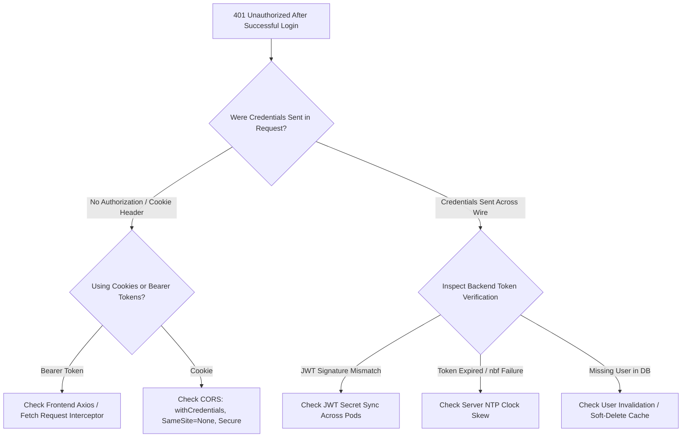

## Scenario

> **Your API returns 401 even after successful login. What could be wrong?**

A 401 Unauthorized means the request lacks valid authentication credentials. When login succeeds but subsequent authenticated requests fail with 401, the issue lies in **how the token/session is stored, transmitted, or validated by the backend**.


## Fast Revision (10-Second Recall)

- **The Core Distinction:** Login succeeded (credentials were valid), but the subsequent request's token was either **not sent**, **lost in transit**, or **rejected by verification**.
- **Top 5 Culprits for False 401s:**
  1. **Missing `Authorization: Bearer <token>` Header:** Frontend forgot to attach the token to the HTTP client (Axios interceptor missing).
  2. **Cookie Blocked by Browser (`SameSite` / `Secure` / Cross-Domain):** Cookie blocked because frontend and backend are on different domains without `SameSite=None; Secure`.
  3. **CORS Missing `credentials: include`:** Browser stripped the cookie because fetch/axios did not specify `withCredentials: true`.
  4. **JWT Secret Mismatch Across Multiple Instances:** Instance A signed the token with Secret 1; Instance B verified with Secret 2.
  5. **Server Clock Skew (NTP Desync):** Server clock is behind; token evaluated as `nbf` (not before) in the future or immediately expired.
- **Key Tools:** Browser Network Request Headers, `jwt.io` payload inspection, Server system time check (`timedatectl`).


## The 30-Second Spoken Script

If asked this in an interview, deliver this structured response:

> *When an API returns 401 immediately following a successful login, the breakdown is almost always credential transport or token verification.*
>
> *First, I check the Network tab of the failing request to see if the credentials actually crossed the wire. If using Bearer tokens, is the `Authorization: Bearer <token>` header present? If using HTTP-only cookies, is the `Cookie` header attached?*
>
> *If cookies are used across different domains—like `app.domain.com` and `api.domain.com`—browsers will silently drop them unless `SameSite=None`, `Secure=true`, and CORS specifies `Access-Control-Allow-Credentials: true` alongside `withCredentials: true`.*
>
> *If the token was sent, I inspect backend verification logs. The most common issues are JWT secret mismatches across distributed pods, asymmetric key rotation sync failures, or server clock drift where the `nbf` or `exp` claims fail validation.*


## Diagnostic Lifecycle



### 1. Step 1: Verify Credential Transmission
Inspect the HTTP request headers of the failed call in browser DevTools:
- **Case 1 (Bearer Token):** If `Authorization: Bearer eyJhb...` is missing, the frontend state management failed to persist or inject the token.
- **Case 2 (Cookies):** If the `Cookie` header is empty, the browser refused to send it due to cross-site cookie policies.

### 2. Step 2: The Cross-Origin Cookie Trap
If your frontend is on `https://example.com` and API is on `https://api.example.com`:
- Backend cookie MUST have: `SameSite=None; Secure; HttpOnly; Domain=.example.com`.
- Frontend fetch MUST have: `credentials: 'include'`.
- Backend CORS MUST have: `Access-Control-Allow-Credentials: true` and a specific origin (never `*`).


## Root Causes & Solutions Matrix

| Vector | Failure Mechanism | Resolution |
| :--- | :--- | :--- |
| **Missing Interceptor** | Token saved in `localStorage`, but not attached to subsequent requests. | Add Axios request interceptor to inject `Authorization: Bearer <token>`. |
| **Cross-Origin Cookie Dropped** | Browser blocks third-party cookie due to default `SameSite=Lax`. | Set `SameSite=None; Secure` on backend cookie; set `withCredentials: true` on client. |
| **CORS Wildcard Conflict** | Backend has `Access-Control-Allow-Origin: *` with credentials. | Set explicit origin (`https://app.domain.com`); wildcard is illegal with credentials. |
| **Distributed Secret Desync** | Pods in Kubernetes cluster have different `JWT_SECRET` environment variables. | Store secrets in a centralized vault (AWS Secrets Manager, Vault, Kubernetes Secret). |
| **Clock Drift (NTP)** | Token issued on Server 1 (clock ahead) rejected on Server 2 (clock behind). | Synchronize server clocks with NTP (`chrony`); configure clock tolerance (e.g., `clockTolerance: 30s`). |


## Practical Debugging Commands & Code

### 1. Configure CORS & Cookie for Secure Cross-Origin Auth (Express)
```typescript
import cors from 'cors';
import cookieParser from 'cookie-parser';

// 1. CORS MUST allow credentials and specify explicit origin
app.use(cors({
  origin: 'https://app.yourdomain.com', // NEVER '*' with credentials
  credentials: true,
}));

// 2. Cookie flags MUST permit cross-domain transmission
app.post('/api/login', (req, res) => {
  const token = generateJwt(req.body.userId);

  res.cookie('auth_token', token, {
    httpOnly: true,                 // Protect against XSS
    secure: true,                   // Require HTTPS
    sameSite: 'none',               // Allow cross-origin requests
    domain: '.yourdomain.com',      // Share across subdomains
    maxAge: 1000 * 60 * 60 * 24,    // 1 day
  });

  return res.json({ status: 'SUCCESS' });
});
```

### 2. Verifying Server Clock Synchronization (Linux)
```bash
# Check if NTP time synchronization is active and synchronized
timedatectl status

# If desynchronized, force NTP sync
sudo systemctl restart systemd-timesyncd
```


## Prevention & Senior Best Practices

1. **Configure JWT Clock Tolerance:** Always configure verification libraries with a small clock drift leeway (e.g., `jwt.verify(token, secret, { clockTolerance: 30 })`).
2. **Centralize Secret Management:** Never inject secrets directly via ad-hoc `.env` files across containers; use unified secret managers.
3. **Automate E2E Auth Tests:** Run automated Cypress/Playwright regression tests verifying that the full login-to-authenticated-request flow functions across isolated subdomains.

