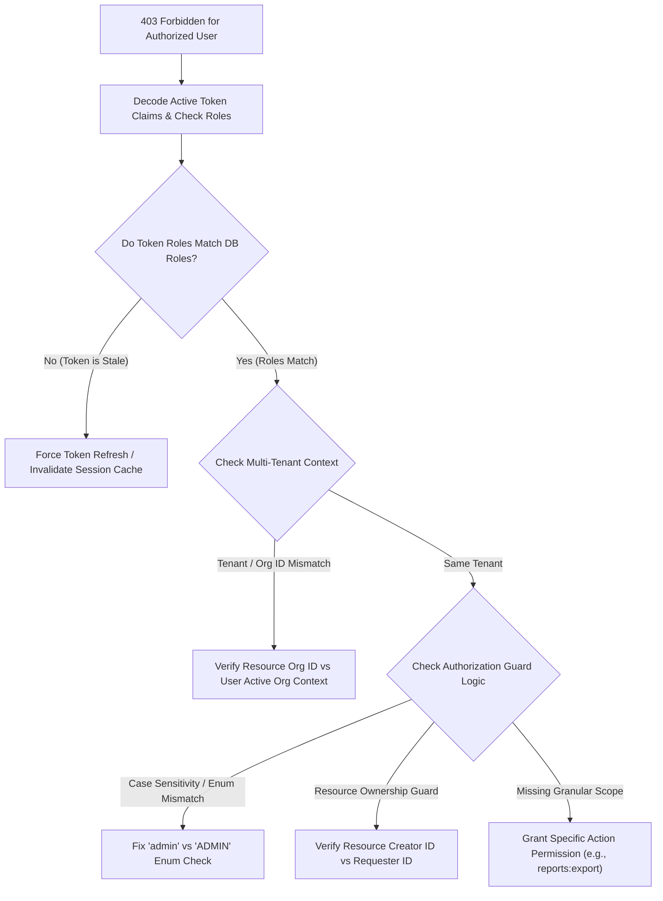

## Scenario

> **Your API returns 403 for an authorized user. How would you troubleshoot it?**

While a 401 indicates missing or invalid *identity* (Authentication), a 403 Forbidden indicates that the user's identity is verified, but they lack the required *permissions* (Authorization) for that specific resource. When a user who should have access receives a 403, it points to **permission cache drift, tenant isolation barriers, or policy rule mismatches**.


## Fast Revision (10-Second Recall)

- **401 vs 403:** 401 = *"I don't know who you are."* 403 = *"I know who you are, but you cannot touch this resource."*
- **Top 5 Causes of False 403 Errors:**
  1. **Stale JWT Claims:** User was recently promoted to `ADMIN`, but their active JWT still contains `role: "USER"` until token refresh.
  2. **Multi-Tenant Scoping Mismatch:** User is an admin in Organization A, but trying to access an entity belonging to Organization B.
  3. **Granular Permission / Scope Missing:** User has the base role, but lacks the specific OAuth scope or permission flag (e.g., `orders:read` vs `orders:write`).
  4. **Object-Level Ownership Check (ABAC/IDOR Guard):** User has admin rights, but the controller enforces strict resource ownership (`order.ownerId === currentUser.id`).
  5. **Case Sensitivity / Enum Mismatch:** Role in DB is `"admin"`, but route guard checks for `"ADMIN"`.
- **Key Tools:** Decoded JWT inspection (`jwt.io`), Authorization middleware audit logs, RBAC database tables (`user_roles`).


## The 30-Second Spoken Script

If asked this in an interview, deliver this structured response:

> *A 403 means authentication succeeded, but authorization policy rejected the action. My goal is to determine why the user's evaluated permission set didn't satisfy the route requirements.*
>
> *First, I decode the user's active access token to inspect their token claims. A very common issue is stale claims: the user's permissions were updated in the database, but their long-lived JWT still holds their old roles. In that case, forcing a token refresh resolves the issue.*
>
> *Second, I check multi-tenant isolation. In SaaS architectures, a user might be authorized in Tenant 1, but the request header or payload references an entity belonging to Tenant 2.*
>
> *Third, I inspect the authorization guard in the code. I check whether it uses simple Role-Based Access Control (RBAC) or Attribute-Based Access Control (ABAC), and verify whether case sensitivity or missing fine-grained scopes caused the rejection.*


## Diagnostic Lifecycle



### 1. Step 1: Check for Stale JWT Claims
If roles are embedded in the access token:
```json
// Token was issued 30 minutes ago:
{
  "sub": "user_123",
  "roles": ["MEMBER"] // User was promoted to ADMIN 5 minutes ago!
}
```
The server checks `token.roles.includes('ADMIN')` and correctly rejects with 403. The user must refresh their token to receive updated claims.

### 2. Step 2: Multi-Tenant & Resource Ownership Validation
Even if a user is an `ADMIN`, multi-tenant security rules must prevent cross-tenant access:
```typescript
// ABAC Rule:
if (resource.organizationId !== currentUser.organizationId) {
  throw new ForbiddenException('Cannot access resources belonging to another organization');
}
```


## Root Causes & Solutions Matrix

| Root Cause | Diagnostic Pattern | Fix |
| :--- | :--- | :--- |
| **Stale JWT Claims** | DB shows `role: 'ADMIN'`, but token payload shows `role: 'USER'`. | Trigger token refresh; reduce access token TTL (e.g., 15 minutes). |
| **Multi-Tenant Boundary** | User organization ID does not match entity organization ID. | Ensure user switches active organization context before requesting resource. |
| **Missing Specific Permission** | User has `MANAGER` role, but route requires `MANAGE_BILLING`. | Audit RBAC role-permission mapping table in DB. |
| **Case-Sensitivity Mismatch** | Guard checks `if (role === 'ADMIN')`, but database stores `'admin'`. | Normalize role strings using `.toUpperCase()` or strict Enums. |
| **IP / Geolocation Restrictions** | Corporate policy restricts admin actions to internal VPN IP ranges. | Verify if user is connected to required corporate network or VPN. |


## Practical Debugging Commands & Code

### 1. Robust RBAC / ABAC Guard Implementation with Clear Audit Logs
```typescript
import { Request, Response, NextFunction } from 'express';

export function requirePermission(requiredPermission: string) {
  return async (req: Request, res: Response, next: NextFunction) => {
    const user = req.user; // Populated by authentication middleware

    if (!user) {
      return res.status(401).json({ error: 'Unauthenticated' });
    }

    const hasPermission = user.permissions?.includes(requiredPermission);

    if (!hasPermission) {
      // Log authorization failure with rich context for debugging
      console.warn(`[AUTHZ_DENIED] User ${user.id} denied access to ${req.method} ${req.originalUrl}. ` +
                   `Required: ${requiredPermission}, User Possesses: [${user.permissions?.join(', ')}]`);

      return res.status(403).json({
        status: 'error',
        code: 'FORBIDDEN',
        message: 'You do not have permission to perform this action',
        requiredPermission,
      });
    }

    next();
  };
}
```


## Prevention & Senior Best Practices

1. **Short-Lived Access Tokens:** Keep JWT access tokens short-lived (5–15 minutes) so permission changes propagate quickly upon refresh.
2. **Log Structured Authorization Failures:** Always log the user ID, evaluated roles, target resource ID, and required permissions whenever a 403 is thrown.
3. **Use Declarative Policy Testing:** Unit test authorization policies independently from controllers using frameworks like CASL or Oso.

