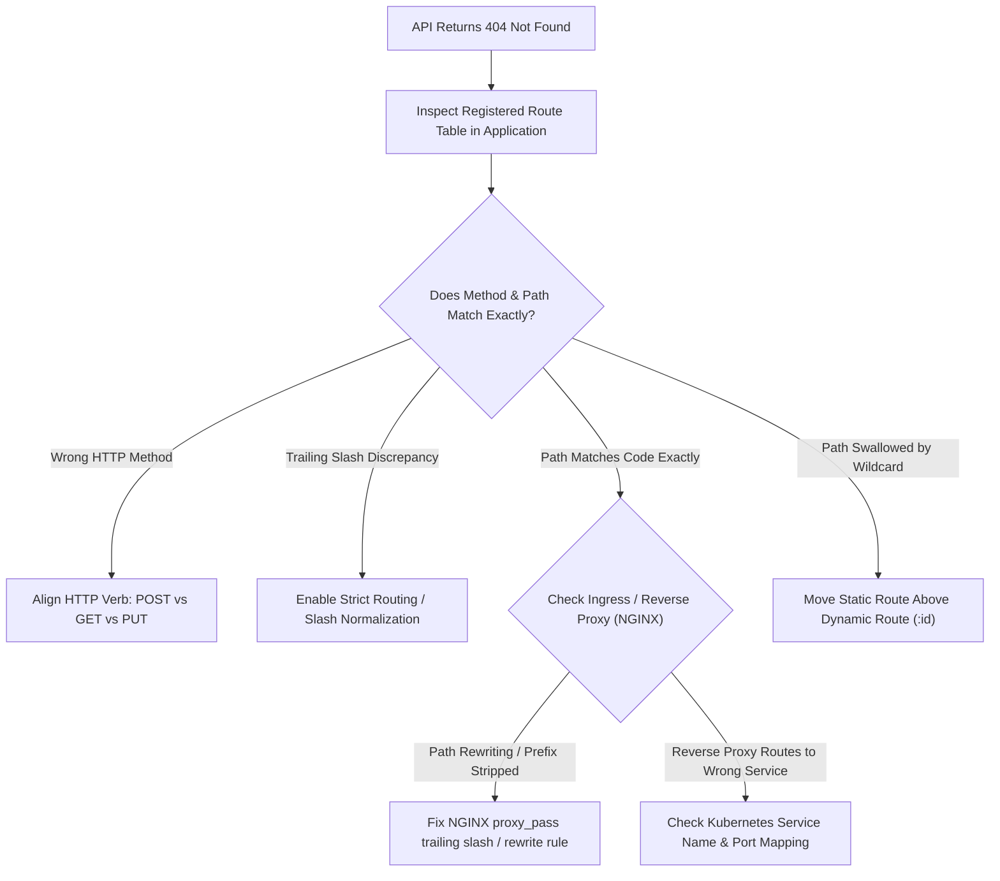

## Scenario

> **Your API returns 404, but the endpoint exists. What would you check?**

A 404 Not Found indicates that the server cannot map the incoming URI to an active route handler. When a developer says "I know this endpoint exists in code, but it keeps returning 404," the issue is usually an **HTTP method mismatch, reverse proxy path stripping, trailing slash quirk, or route definition ordering**.


## Fast Revision (10-Second Recall)

- **First Rule:** The server reached *some* router, but that router has no matching rule for the exact `(Method, Path)` tuple.
- **Top 5 Hidden Culprits:**
  1. **HTTP Method Mismatch:** Route defined as `POST /api/users`, but request sent as `GET` or `PUT`.
  2. **Trailing Slash Redirect / Rejection:** Framework treating `/api/users` and `/api/users/` as distinct paths without redirect.
  3. **Reverse Proxy Path Stripping:** NGINX or Kubernetes Ingress misconfigured with `/api/` prefix stripping, forwarding `/v1/users` instead of `/api/v1/users`.
  4. **Route Definition Order (Param Shadowing):** A generic parameterized route (`/users/:id`) defined before a static route (`/users/profile`), swallowing the request.
  5. **Global Prefix / Controller Decorator:** Forgetting that the controller has a `@Controller('v1')` prefix, meaning the real path is `/api/v1/users`.
- **Key Tools:** Reverse proxy access logs, Application route table dump (`express-list-endpoints`), Browser network request URL.


## The 30-Second Spoken Script

If asked this in an interview, deliver this structured response:

> *When a known endpoint returns 404, I start by comparing the exact HTTP request arriving at the server against the application's registered route table.*
>
> *First, I check the HTTP Verb. If an endpoint is registered as `POST`, sending a `GET` will return 404 in frameworks like Express unless explicitly handled.*
>
> *Second, I check the reverse proxy or Kubernetes Ingress rules. A classic bug in NGINX or Traefik is path rewriting—where a proxy strips the `/api` prefix, so the backend receives `/users` instead of the expected `/api/users`.*
>
> *Third, I inspect route definition order. If a wildcard parameterized route like `GET /users/:id` is registered above a static route like `GET /users/me`, the router tries to parse `'me'` as an ID, fails validation, and returns 404.*
>
> *Finally, I verify trailing slashes and base route prefixes.*


## Diagnostic Lifecycle



### 1. Step 1: Check Reverse Proxy Path Rewriting (The NGINX Slash Bug)
In NGINX, a trailing slash on `proxy_pass` drastically alters behavior:
```nginx
# BEWARE: Trailing slash on proxy_pass STRIPS the location match!
location /api/ {
    # Request: /api/users/123 -> Forwards: http://backend/users/123 (Prefix stripped!)
    proxy_pass http://backend_upstream/;
}

# VERSUS:
location /api/ {
    # Request: /api/users/123 -> Forwards: http://backend/api/users/123 (Preserved!)
    proxy_pass http://backend_upstream;
}
```

### 2. Step 2: Route Shadowing (Order of Registration)
```typescript
// BAD ORDER:
app.get('/users/:id', getUserById);   // Swallows /users/export, interprets "export" as ID!
app.get('/users/export', exportUsers); // UNREACHABLE (Returns 404 if "export" is not a valid UUID)

// CORRECT ORDER:
app.get('/users/export', exportUsers); // Specific static routes FIRST
app.get('/users/:id', getUserById);    // Dynamic parameterized routes LAST
```


## Root Causes & Solutions Matrix

| Root Cause | Evidence | Resolution |
| :--- | :--- | :--- |
| **HTTP Method Mismatch** | Client sends `GET`, server expects `POST`. | Change client request method to match endpoint definition. |
| **NGINX Prefix Stripping** | NGINX logs show `/api/users`, but app logs show `/users`. | Remove trailing slash from NGINX `proxy_pass` directive. |
| **Route Shadowing** | Dynamic `:id` route catches requests meant for static endpoints. | Re-order route definitions: specific static routes before generic wildcards. |
| **Trailing Slash Inconsistency** | `/users/` returns 404, but `/users` works. | Configure route normalization middleware (`strict routing: false`). |
| **Controller Global Prefix** | Controller has `@Controller('api/v1')` prefix omitted by caller. | Prepend global prefix to client URL. |


## Practical Debugging Commands & Code

### 1. Dump All Registered Application Routes at Startup
```typescript
// Print all active Express routes to console on startup
export function printRoutes(app: any) {
  const routes: any[] = [];
  app._router.stack.forEach((middleware: any) => {
    if (middleware.route) {
      // Direct route
      routes.push({
        method: Object.keys(middleware.route.methods).join(', ').toUpperCase(),
        path: middleware.route.path,
      });
    } else if (middleware.name === 'router') {
      // Router middleware
      middleware.handle.stack.forEach((handler: any) => {
        if (handler.route) {
          routes.push({
            method: Object.keys(handler.route.methods).join(', ').toUpperCase(),
            path: handler.route.path,
          });
        }
      });
    }
  });
  console.table(routes);
}
```

### 2. Normalized Trailing Slash Middleware
```typescript
import { Request, Response, NextFunction } from 'express';

export function normalizeTrailingSlash(req: Request, res: Response, next: NextFunction) {
  if (req.path.length > 1 && req.path.endsWith('/')) {
    const query = req.url.slice(req.path.length);
    const safePath = req.path.slice(0, -1);
    return res.redirect(301, safePath + query);
  }
  next();
}
```


## Prevention & Senior Best Practices

1. **Auto-Generate API Documentation:** Use OpenAPI / Swagger generated directly from code decorators so URLs and methods are always synchronized.
2. **Standardize on Trailing Slash Rules:** Configure frameworks and proxies to normalize paths (e.g., redirect trailing slashes) uniformly.
3. **Use Method Not Allowed (405):** Return `405 Method Not Allowed` with an `Allow` header instead of a generic 404 when the path exists but the verb does not match.

