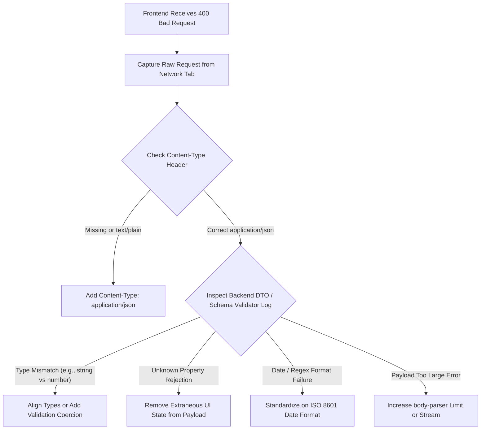

## Scenario

> **Your API returns 400 even though the frontend sends valid data. How would you investigate?**

A 400 Bad Request means the server received the HTTP request but rejected it before processing business logic. When frontend developers insist "the data is valid," the breakdown is usually a subtle **serialization mismatch, strict schema rule, or missing header**.


## Fast Revision (10-Second Recall)

- **The Core Conflict:** What the frontend considers "valid" is not what the backend schema parser requires.
- **Top 5 Hidden Causes of False 400 Errors:**
  1. **Missing or Incorrect `Content-Type` Header:** Sending JSON string without `Content-Type: application/json` causes body-parser to treat body as empty/raw text.
  2. **Type Coercion Failures (Strings vs Numbers/Booleans):** Sending `"123"` instead of `123`, or `"true"` instead of `true`, failing strict Zod/Joi/DTO validation.
  3. **Strict Stripping / Unknown Fields:** Validation library configured with `stripUnknown: false` or `forbidNonWhitelisted: true` rejecting extra frontend tracking keys.
  4. **Date / Time Formatting Mismatch:** Sending `DD/MM/YYYY` instead of strict ISO 8601 (`YYYY-MM-DDTHH:mm:ss.sssZ`).
  5. **Payload Size Limit Tripped:** Body exceeds default body-parser limit (e.g., Express default is 100KB), causing parser to reject before controller runs.
- **Key Tools:** Browser Network Tab (Raw Request Payload), Backend DTO validation error logs, Postman/cURL replication.


## The 30-Second Spoken Script

If asked this in an interview, deliver this structured response:

> *When a frontend sends supposedly valid data but receives a 400, I never rely on verbal descriptions—I inspect the raw wire payload.*
>
> *First, I inspect the actual raw HTTP request in the browser DevTools Network tab. I check the headers for `Content-Type: application/json` and copy the exact JSON payload.*
>
> *Second, I check the backend validation layer logs. Modern validation frameworks like Zod, class-validator, or Joi produce detailed field-level rejection logs. I look for strict type mismatches—such as string IDs versus integer IDs, or date strings failing ISO-8601 formats.*
>
> *Third, I check for schema whitelist rejection. If the backend uses `forbidNonWhitelisted`, an extra frontend state key like `isSubmitting: false` in the payload will cause a 400.*
>
> *Once identified, I ensure the API returns a structured RFC 7807 validation error detailing the exact field and expected type rather than a generic 400 Bad Request.*


## Diagnostic Lifecycle



### 1. Step 1: Compare Raw Payload vs DTO Schema
Inspect what was actually sent across the wire:
```json
// Frontend sent:
{
  "userId": "49821",          // String instead of integer!
  "isActive": "true",          // String instead of boolean!
  "submittedBy": "admin_ui"    // Extra property not in DTO!
}
```
If the backend uses NestJS `ValidationPipe({ whitelist: true, forbidNonWhitelisted: true })`, the extra `submittedBy` field immediately triggers a 400 error.


## Root Causes & Solutions Matrix

| Root Cause | Evidence | Resolution |
| :--- | :--- | :--- |
| **Missing `Content-Type` Header** | `req.body` is `undefined` or empty object on server. | Ensure frontend client sets `headers: { 'Content-Type': 'application/json' }`. |
| **Strict Type Checking (Zod/Joi)** | Error log: `expected number, received string`. | Cast values on frontend or use schema coercion: `z.coerce.number()`. |
| **Unexpected UI State in Payload** | Error: `property 'isLoading' should not exist`. | Sanitize request payload before sending; project only DTO fields. |
| **Date Timezone Incompatibility** | Error: `invalid date format`. | Always serialize dates to standard UTC ISO 8601 strings (`new Date().toISOString()`). |
| **Null vs Undefined vs Empty String** | Error: `expected string, received null`. | Standardize schema to accept `z.string().nullable().optional()`. |


## Practical Debugging Commands & Code

### 1. Replicating the Request with Exact Headers via cURL
```bash
curl -X POST "https://api.yourdomain.com/v1/users" \
  -H "Content-Type: application/json" \
  -H "Authorization: Bearer <token>" \
  -d '{"userId": 49821, "isActive": true}' \
  -v
```

### 2. Returning Actionable Field-Level 400 Errors (Zod Example)
Never return a generic `"Bad Request"`. Return the exact offending field:
```typescript
import { z } from 'zod';
import { Request, Response, NextFunction } from 'express';

const UserSchema = z.object({
  id: z.coerce.number(), // Coerce string "123" to number 123
  email: z.string().email(),
  birthDate: z.string().datetime(), // Enforce ISO 8601
});

export function validateUser(req: Request, res: Response, next: NextFunction) {
  const result = UserSchema.safeParse(req.body);

  if (!result.success) {
    // Return detailed breakdown of every invalid field
    const fieldErrors = result.error.errors.map(err => ({
      field: err.path.join('.'),
      issue: err.message,
      received: (err as any).received,
    }));

    return res.status(400).json({
      status: 'error',
      code: 'VALIDATION_FAILED',
      message: 'Request payload failed schema validation',
      errors: fieldErrors,
    });
  }

  req.body = result.data;
  next();
}
```


## Prevention & Senior Best Practices

1. **Share End-to-End TypeScript Types:** Use monorepos (Turborepo/Nx) with shared Zod schemas or generate client SDKs via OpenAPI/Swagger so frontend and backend types never drift.
2. **Implement Field-Level Validation Responses:** Ensure the backend 400 response clearly specifies the exact path, reason, and received value for each invalid attribute.
3. **Use Schema Coercion Sparingly:** Allow safe coercion (e.g., query param numbers) but reject ambiguous types to maintain database integrity.

