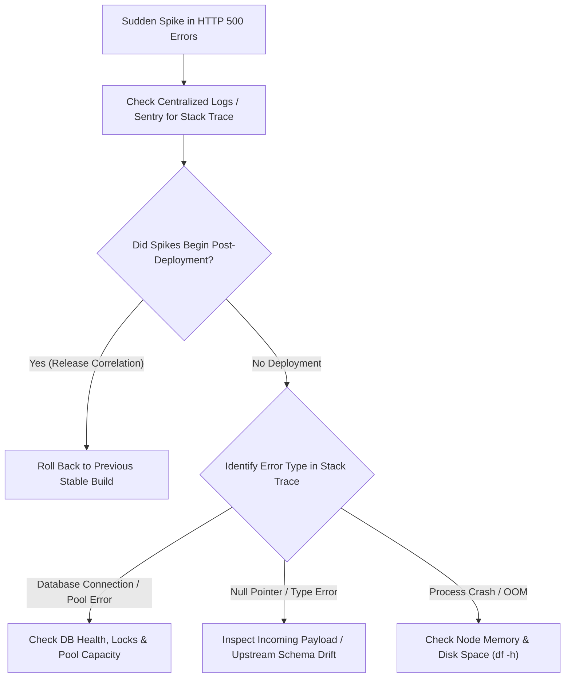

## Scenario

> **Your API suddenly starts returning HTTP 500. How would you debug it?**

An HTTP 500 Internal Server Error is a catch-all indicating that the server encountered an unhandled exception or crash. When it occurs suddenly across production, the interviewer expects an incident triage sequence prioritizing **blast radius assessment, log isolation, and fast mitigation**.


## Fast Revision (10-Second Recall)

- **First Move:** Check **Application Error Logs / Sentry / Datadog** filtered to the sudden spike window to extract the exact stack trace and error message.
- **Top 5 Causes of Sudden 500 Spikes:**
  1. **Unhandled Null Pointer / Undefined Access:** Code expecting a property on a payload or third-party response that changed.
  2. **Database Connectivity Outage:** Connection pool exhausted, primary node failover, or invalid database credentials.
  3. **Recent Deployment / Bad Migration:** Missing table column, broken environment variable, or invalid dependency version.
  4. **Downstream Service Crash:** Upstream microservice returning unexpected formats or failing without a fallback.
  5. **Out of Memory / Disk Full:** Node/JVM process failing to allocate memory or write temporary files.
- **Key Tools:** APM Error Tracking (Sentry, Datadog), `kubectl logs -l app=api --tail=100`, Error rate alert triggers.


## The 30-Second Spoken Script

If asked this in an interview, deliver this structured response:

> *When HTTP 500 errors spike, my immediate priority is triaging the blast radius and inspecting centralized error logs rather than guessing.*
>
> *First, I check our error tracking tool, such as Sentry or Datadog, to isolate the specific unhandled exception and stack trace causing the 500s.*
>
> *Second, I check whether the errors started immediately following a new deployment or configuration change. If a deployment coincides with the error spike, I trigger an immediate rollback to the previous stable release.*
>
> *Third, if there was no deployment, I check infrastructure dependencies: database connection pool saturation, Redis availability, and downstream third-party status.*
>
> *Once the immediate cause is mitigated, I ensure the route is wrapped in global exception handling with structured logging and correlation IDs so future errors are observable instantly.*


## Diagnostic Lifecycle



### 1. Identify the Exact Stack Trace
Never debug a 500 blindly. Look at centralized logs:
- `TypeError: Cannot read properties of undefined (reading 'id')` $\rightarrow$ Payload schema mismatch.
- `KnexTimeoutError: Knex: Timeout acquiring a connection` $\rightarrow$ DB connection pool drained.
- `ENOSPC: no space left on device` $\rightarrow$ Disk storage filled by unrotated logs or temp files.

### 2. Determine Blast Radius
- Is it occurring on **all routes** (infrastructure/database failure) or **a single endpoint** (code/logic bug)?
- Is it affecting **all users** or only users with specific account tiers or characters in their names?


## Root Causes & Solutions Matrix

| Error Signature | Underlying Cause | Immediate Resolution |
| :--- | :--- | :--- |
| **`ConnectionRefusedError`** | Database or cache server unreachable or restarted. | Check DB host status, security groups, and automated failover state. |
| **`TypeError / NullPointerException`** | Code assumes property exists on external API response. | Add optional chaining (`user?.address?.zip`) and fallback default values. |
| **`Timeout acquiring connection`** | Connection pool exhausted due to unclosed DB connections or long transactions. | Restart backend pods to reclaim leaked connections; increase pool size. |
| **`SyntaxError / Missing Module`** | Bad build asset or missing environment variable in new deployment. | Roll back deployment; verify `.env` secrets in CI/CD pipeline. |
| **`ENOSPC / Out of Disk`** | Disk is 100% full; server cannot write temporary session files. | Clear `/tmp`, truncate unrotated logs, and expand disk volume. |


## Practical Debugging Commands & Code

### 1. Stream Real-Time Production Error Logs in Kubernetes
```bash
# Stream only logs containing error/exception across all backend pods
kubectl logs -f -l app=backend-api --tail=100 | grep -iE 'error|exception|fatal|500'
```

### 2. Correlate Errors with Correlation ID Middleware
```typescript
import { Request, Response, NextFunction } from 'express';
import { v4 as uuidv4 } from 'uuid';

export function correlationIdMiddleware(req: Request, res: Response, next: NextFunction) {
  // Use existing correlation ID from gateway or generate new one
  const correlationId = req.headers['x-correlation-id'] || uuidv4();
  req.headers['x-correlation-id'] = correlationId;
  res.setHeader('x-correlation-id', correlationId);
  next();
}

// Global Error Handler
export function errorHandler(err: Error, req: Request, res: Response, next: NextFunction) {
  const correlationId = req.headers['x-correlation-id'];

  // Log full stack trace internally with correlation ID
  console.error(`[ERROR] [${correlationId}] ${err.message}`, {
    stack: err.stack,
    url: req.originalUrl,
    method: req.method,
  });

  // Never leak internal stack trace to client
  return res.status(500).json({
    status: 'error',
    code: 'INTERNAL_SERVER_ERROR',
    message: 'An unexpected error occurred. Please contact support with this tracking ID.',
    trackingId: correlationId,
  });
}
```


## Prevention & Senior Best Practices

1. **Automated Rollback Triggers:** Configure deployment pipelines (ArgoCD / Spinnaker) to roll back automatically if the HTTP 5xx error rate exceeds 1% over a 3-minute canary window.
2. **Never Expose Raw Stacks:** Ensure production builds strip stack traces from client responses to avoid security reconnaissance.
3. **Set Up Error Budget Alerts:** Trigger high-priority PagerDuty alerts on rate-of-change spikes in 500 errors rather than raw counts alone.

