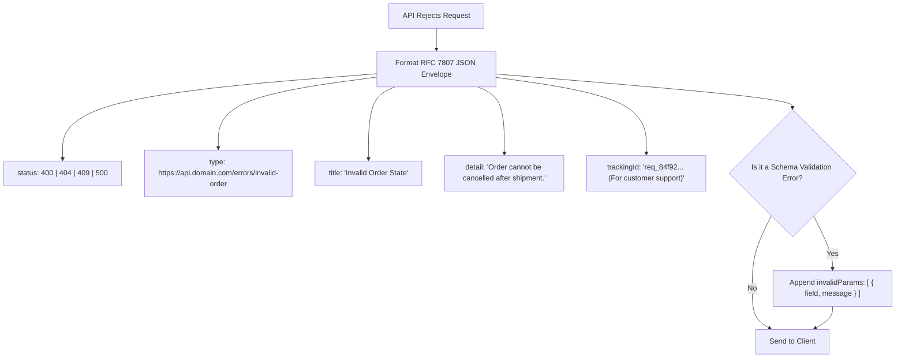

## Scenario

> **How would you design a consistent API error response?**

Inconsistent API errors (e.g., one endpoint returning `{ "error": "Not found" }`, another returning `{ "message": "Failed", "code": 404 }`, and another returning raw strings) force frontend and third-party developers to write fragile, convoluted error parsing logic. Interviewers look for adherence to **open standards, machine-readable codes, and developer ergonomics**.


## Fast Revision (10-Second Recall)

- **The Standard:** **RFC 7807 (Problem Details for HTTP APIs)**, updated in RFC 9457.
- **Top 5 Mandatory Fields in a Professional Error Contract:**
  1. `type`: A URI reference that identifies the problem type (documentation link).
  2. `title`: A short, human-readable summary of the problem type (does not change between occurrences).
  3. `status`: The HTTP status code as an integer (for sanity checking).
  4. `detail`: A human-readable explanation specific to this occurrence of the problem.
  5. `instance` / `trackingId`: A unique URI or UUID identifying the specific occurrence in internal logs.
- **Bonus for 400 Validation Errors:** Include an `invalidParams` array specifying the exact field name, value received, and validation rule violated.


## The 30-Second Spoken Script

If asked this in an interview, deliver this structured response:

> *I design API error responses by strictly adopting RFC 7807 (Problem Details for HTTP APIs), which is the industry standard for RESTful error communication.*
>
> *Every error response contains five standard fields: a URI `type` pointing to our API documentation, a static `title`, the integer HTTP `status`, a descriptive `detail` message, and an opaque `instance` or `trackingId` that matches our internal log correlation ID.*
>
> *For client-side form validation failures, I extend the RFC with an `invalidParams` array. Each item identifies the exact field path, the invalid value received, and the specific validation rule that failed.*
>
> *Crucially, we use stable, machine-readable string enums like `INSUFFICIENT_FUNDS` rather than expecting frontend clients to parse English detail strings.*


## Diagnostic Lifecycle



### 1. The Anti-Pattern vs The Standard

#### The Naive Inconsistent Approach (Anti-Pattern)
```json
// Endpoint A:
{ "error": "User not found" }

// Endpoint B:
{ "success": false, "err_code": 404, "msg": "Record missing" }

// Endpoint C (Crashed):
"Internal Server Error" // Plain string! Breaks JSON.parse() on client!
```

#### The RFC 7807 Standard Approach (Optimal)
```json
{
  "type": "https://api.example.com/errors/resource-not-found",
  "title": "Resource Not Found",
  "status": 404,
  "code": "USER_NOT_FOUND",
  "detail": "No active user found with ID 'usr_94821'.",
  "instance": "/v1/users/usr_94821",
  "trackingId": "9b1deb4d-3b7d-4bad-9bdd-2b0d7b3dcb6d",
  "timestamp": "2026-10-30T18:00:00Z"
}
```


## Root Causes & Solutions Matrix

| Problem in Error Design | Client Impact | Architectural Fix |
| :--- | :--- | :--- |
| **Inconsistent Keys** | Frontend has to write 5 different checks (`err.message \|\| err.error \|\| err.msg`). | Enforce single standardized TypeScript error interface across all microservices. |
| **Parsing English Strings** | `if (err.detail.includes("balance too low"))` breaks on typos or i18n translations. | Provide immutable machine-readable string codes: `code: "INSUFFICIENT_FUNDS"`. |
| **Generic Validation Rejections** | `"Bad Request"` forces user to guess which of 20 form inputs failed. | Return structured `invalidParams` array with precise field paths (`address.zipCode`). |
| **Mismatched HTTP Status** | Returning HTTP 200 with `{ "status": "error" }`. | Always return correct HTTP status codes (4xx/5xx) so caching and client interceptors work properly. |


## Practical Debugging Commands & Code

### 1. TypeScript Interface for RFC 7807 Error Contract
```typescript
export interface ValidationErrorDetail {
  field: string;
  message: string;
  receivedValue?: any;
}

export interface ProblemDetails {
  type: string;                     // URI link to documentation
  title: string;                    // Short human-readable summary
  status: number;                   // HTTP status code
  code: string;                     // Stable machine-readable enum
  detail: string;                   // Specific occurrence explanation
  instance?: string;                // URI of the request
  trackingId: string;               // Correlation ID for support logs
  timestamp: string;                // UTC ISO string
  invalidParams?: ValidationErrorDetail[]; // For 400 validation errors
}
```

### 2. Express Implementation of Validation Error Response
```typescript
import { Response } from 'express';

export function sendValidationError(
  res: Response,
  trackingId: string,
  invalidParams: ValidationErrorDetail[]
) {
  const errorPayload: ProblemDetails = {
    type: 'https://api.yourdomain.com/errors/validation-failed',
    title: 'Validation Failed',
    status: 400,
    code: 'INVALID_PAYLOAD',
    detail: 'One or more request parameters failed validation constraints.',
    trackingId,
    timestamp: new Date().toISOString(),
    invalidParams,
  };

  return res
    .status(400)
    .setHeader('Content-Type', 'application/problem+json')
    .json(errorPayload);
}
```


## Prevention & Senior Best Practices

1. **Use `application/problem+json` Content-Type:** Send the official RFC 7807 MIME type to signal standardized problem formatting to API clients.
2. **Never Return HTTP 200 for Errors:** Adhere to HTTP protocol semantics. Returning 200 with `{ "success": false }` disables automatic client-side retries and breaks monitoring proxies.
3. **Automate Schema Validation via Linters / SDKs:** Generate TypeScript client error types directly from OpenAPI specifications so frontend clients handle known error codes with exhaustive compile-time checking.

