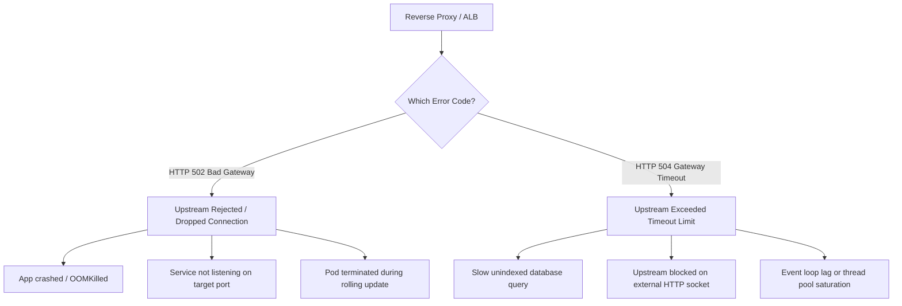

## Scenario

> **Your API returns 502 or 504. What could be the reason?**

Both 502 and 504 are **gateway/proxy-level error codes** returned by an intermediate proxy (like NGINX, Cloudflare, AWS ALB, or Envoy) when trying to communicate with the upstream backend application. Interviewers use this to test if you understand the boundary between infrastructure proxies and application processes.


## Fast Revision (10-Second Recall)

- **The Golden Distinction:**
  - **502 Bad Gateway:** The proxy contacted the upstream, but the upstream **closed the connection, crashed, or replied with invalid bytes** (Immediate failure).
  - **504 Gateway Timeout:** The proxy contacted the upstream, but the upstream **took too long to respond and exceeded the proxy's timeout limit** (Delayed failure).
- **Common 502 Causes:** Application crashed (`OOMKilled`), service not running on port, process restarted during request, SSL handshake failure to upstream.
- **Common 504 Causes:** Upstream blocked on slow database query, deadlock, heavy computation, unhandled hanging third-party call.
- **Key Tools:** Reverse proxy error logs (`/var/log/nginx/error.log`), Kubernetes pod status (`CrashLoopBackOff`), NGINX `proxy_read_timeout`.


## The 30-Second Spoken Script

If asked this in an interview, deliver this structured response:

> *While both are proxy errors generated by a load balancer or reverse proxy, 502 and 504 indicate completely different failure modes.*
>
> *A 502 Bad Gateway means the reverse proxy tried to talk to the backend application, but the connection was immediately rejected, reset, or dropped. The backend either crashed due to an Out-Of-Memory error, was not listening on the expected port, or terminated the TCP connection prematurely during a deployment.*
>
> *A 504 Gateway Timeout, on the other hand, means the connection was established successfully, but the backend application did not finish processing before the proxy gave up waiting. The backend was too slow—usually stuck on a slow database query, waiting on a hanging external service, or blocked in an infinite loop.*
>
> *I debug 502 by checking container crash logs and socket status. I debug 504 by inspecting distributed traces and slow query logs.*


## Diagnostic Lifecycle



### 1. Step 1: Decode the 502 Bad Gateway Signature
In `/var/log/nginx/error.log`:
- `connect() failed (111: Connection refused)` $\rightarrow$ Backend application process is dead or listening on the wrong port.
- `upstream prematurely closed connection while reading response header` $\rightarrow$ Backend process crashed mid-request (often due to an unhandled exception or SIGSEGV).
- `SSL routines:ssl3_read_bytes:tlsv1 alert` $\rightarrow$ TLS handshake cipher mismatch between proxy and upstream.

### 2. Step 2: Decode the 504 Gateway Timeout Signature
In `/var/log/nginx/error.log`:
- `upstream timed out (110: Connection timed out) while reading response header from upstream` $\rightarrow$ The backend accepted the connection, but did not return headers within `proxy_read_timeout` (usually 60 seconds).


## Root Causes & Solutions Matrix

| Code | Diagnostic Message | Cause | Resolution |
| :--- | :--- | :--- | :--- |
| **502** | `Connection refused` | Application process is stopped or failed to bind to `0.0.0.0`. | Verify app is running; check host and container port mapping. |
| **502** | `Upstream prematurely closed connection` | Process crashed during request execution (`OOMKilled`). | Inspect `dmesg` / Kubernetes exit code `137`; raise memory limits. |
| **502** | Connection dropped during rolling deployment | Proxy routed traffic to a shutting down pod before deregistration. | Add `preStop` sleep hook in Kubernetes container lifecycle. |
| **504** | `Upstream timed out while reading response` | Database query running longer than NGINX timeout. | Optimize query plan; add missing index; set database statement timeouts. |
| **504** | `Upstream timed out while connecting` | Host unreachable, security group blocking traffic, network partition. | Check VPC routing, firewall rules, and security group egress. |


## Practical Debugging Commands & Code

### 1. Check for Container OOM Crashes (502 Root Cause)
```bash
# Check if pod exited with code 137 (OOMKilled)
kubectl describe pod <pod-name> | grep -E 'Last State|Exit Code|Reason'

# Check system kernel logs for Out of Memory kills
dmesg -T | grep -i oom-killer
```

### 2. Tuning NGINX Upstream Timeouts (504 Mitigation)
```nginx
upstream backend_api {
    server 127.0.0.1:3000 max_fails=3 fail_timeout=10s;
    keepalive 32; # Keep persistent connections alive to backend
}

server {
    location /api/ {
        proxy_pass http://backend_api;
        
        # Connection timeouts
        proxy_connect_timeout 5s;  # Max wait to establish TCP connection
        proxy_send_timeout 30s;    # Max wait to transmit request
        proxy_read_timeout 30s;    # Max wait for backend to finish processing
        
        # Buffer configurations to prevent premature closed connections
        proxy_buffer_size 16k;
        proxy_buffers 4 32k;
    }
}
```


## Prevention & Senior Best Practices

1. **Graceful Shutdown Hooks (Zero 502s During Deploys):** Implement `SIGTERM` listeners in backend code to finish in-flight requests before exiting; use Kubernetes `preStop` hooks (e.g., `sleep 5`) to allow iptables to drain traffic.
2. **Always Align Timeout Hierarchies:** Ensure downstream timeouts are strictly shorter than upstream timeouts:
   $$\text{Database Timeout (3s)} < \text{Backend Timeout (10s)} < \text{NGINX Timeout (30s)} < \text{Client Timeout (60s)}$$
3. **Monitor Ingress Proxy Logs Separately:** Maintain alerts specifically on 502 vs 504 error rates; they point to completely different engineering teams (Infra/DevOps for 502 vs App/DB for 504).

