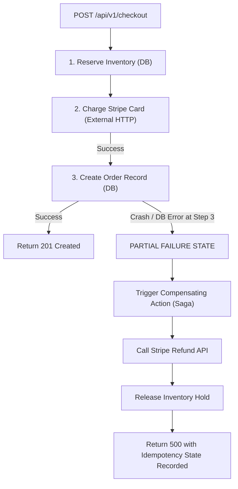

## Scenario

> **What would you do if an API fails halfway through processing a request?**

Consider an e-commerce checkout API that performs 4 sequential steps: (1) Deduct account balance, (2) Decrement inventory, (3) Charge credit card via Stripe, and (4) Send confirmation email. If the server crashes or the network drops at Step 3, you are left with **corrupted state: the user's balance is deducted, but no order was created**.


## Fast Revision (10-Second Recall)

- **The Problem:** Non-atomic distributed operations leave systems in inconsistent partial states.
- **Top 4 Solutions Depending on Architecture:**
  1. **Single Database: ACID Database Transactions:** Wrap all DB mutations in `BEGIN ... COMMIT` with automatic `ROLLBACK` on error.
  2. **External Non-Transactional Services (e.g., Stripe, S3):** Use **Compensating Transactions** (e.g., if inventory fails, issue an explicit Stripe refund).
  3. **Client Retries: Idempotency Keys:** Ensure the client can safely retry the exact same request without double-charging.
  4. **Async Distributed Workflows: The Saga Pattern / Transactional Outbox:** Persist the intent in the database first, then let an orchestrator or event queue drive steps to completion.
- **Key Tools:** Database `ROLLBACK`, Idempotency Key table, Temporal / BullMQ orchestrators, Transactional Outbox pattern.


## The 30-Second Spoken Script

If asked this in an interview, deliver this structured response:

> *When an API fails halfway through processing, the solution depends on whether the operations are confined to a single database or span external third-party services.*
>
> *For internal operations within the same database, I wrap everything in an atomic ACID transaction. If an error occurs at any point, the database issues an automatic rollback, restoring the exact initial state as if the request never happened.*
>
> *When external non-database services are involved—like charging a credit card or calling an external shipping vendor—database transactions cannot roll back the real-world side effect. In that scenario, I use the Saga Pattern.*
>
> *Each forward action has a matching Compensating Action. If step 3 fails, the system executes compensation: refunding the card and releasing the reserved inventory.*
>
> *Finally, I enforce client Idempotency Keys so that when the network drops and the user retries, the server recognizes the key and resumes or returns the cached result without duplicate execution.*


## Diagnostic Lifecycle



### 1. Single Database Solution: ACID Transactions
```typescript
// All or Nothing: Atomic rollback on failure
const client = await dbPool.connect();
try {
  await client.query('BEGIN');
  await deductBalance(client, userId, amount);
  await decrementInventory(client, productId, 1);
  await createOrder(client, userId, productId);
  await client.query('COMMIT'); // All 3 succeed together
} catch (err) {
  await client.query('ROLLBACK'); // Automatic complete rollback!
  throw err;
} finally {
  client.release();
}
```

### 2. Multi-Service / Third-Party Solution: Compensating Actions (Saga)
External APIs cannot be rolled back via SQL. You must explicitly execute undo operations:
- Forward Action: `stripe.charges.create()` $\rightarrow$ Compensating Action: `stripe.refunds.create()`.
- Forward Action: `inventory.reserve()` $\rightarrow$ Compensating Action: `inventory.release()`.


## Root Causes & Solutions Matrix

| Architecture Boundary | Failure Mode | Architectural Pattern |
| :--- | :--- | :--- |
| **Single Relational DB** | Failure at step 3 leaves steps 1 & 2 committed in DB. | Wrap entire block in a single SQL Transaction (`BEGIN / COMMIT / ROLLBACK`). |
| **External Third-Party API** | Money charged via Stripe, but DB crashes creating order. | **Compensating Action**: Catch block immediately calls Stripe Refund API. |
| **Client Network Timeout** | Server processed order, but client network dropped before receiving response. | **Idempotency Keys**: Client retries with same key; server returns saved order without re-processing. |
| **Side Effects (Emails/Push)** | Email sent to user, but transaction failed and rolled back. | **Transactional Outbox Pattern**: Insert email intent into DB table; worker sends only after commit. |


## Practical Debugging Commands & Code

### 1. Robust Idempotent Multi-Step Handler with Compensation
```typescript
export async function processCheckout(req: Request, res: Response) {
  const idempotencyKey = req.headers['idempotency-key'] as string;
  const { userId, productId, amount } = req.body;

  // 1. Check if request was already processed
  const existingJob = await db.idempotencyRecords.findUnique({ where: { key: idempotencyKey } });
  if (existingJob?.status === 'COMPLETED') {
    return res.status(200).json(existingJob.responsePayload);
  }

  let stripeChargeId: string | null = null;

  try {
    // Step A: Charge Stripe (External Side-Effect)
    const charge = await stripe.charges.create({ amount, currency: 'usd', customer: userId });
    stripeChargeId = charge.id;

    // Step B: Write to Database inside atomic transaction
    const order = await db.$transaction(async (tx) => {
      await tx.inventory.decrement(productId);
      return await tx.orders.create({ data: { userId, productId, chargeId: charge.id } });
    });

    // Step C: Save idempotency record
    await db.idempotencyRecords.create({
      data: { key: idempotencyKey, status: 'COMPLETED', responsePayload: order },
    });

    return res.status(201).json(order);
  } catch (error) {
    // Step D: COMPENSATING ACTION if failure occurred after external charge
    if (stripeChargeId) {
      console.warn(`[COMPENSATION] Order creation failed. Refunding Stripe charge: ${stripeChargeId}`);
      await stripe.refunds.create({ charge: stripeChargeId });
    }

    return res.status(500).json({ error: 'Checkout failed halfway and was safely rolled back' });
  }
}
```


## Prevention & Senior Best Practices

1. **Transactional Outbox for Events:** Never publish to message queues (Kafka/RabbitMQ) inside a database transaction block; write to an `outbox` table and publish asynchronously after commit.
2. **Mandatory Idempotency Keys:** Require an `Idempotency-Key` header on all critical payment, order, and billing mutation endpoints.
3. **Use Workflow Engines for Complex Sagas:** For workflows with more than 3 distributed steps, use state machine orchestrators like Temporal, AWS Step Functions, or Camunda.

