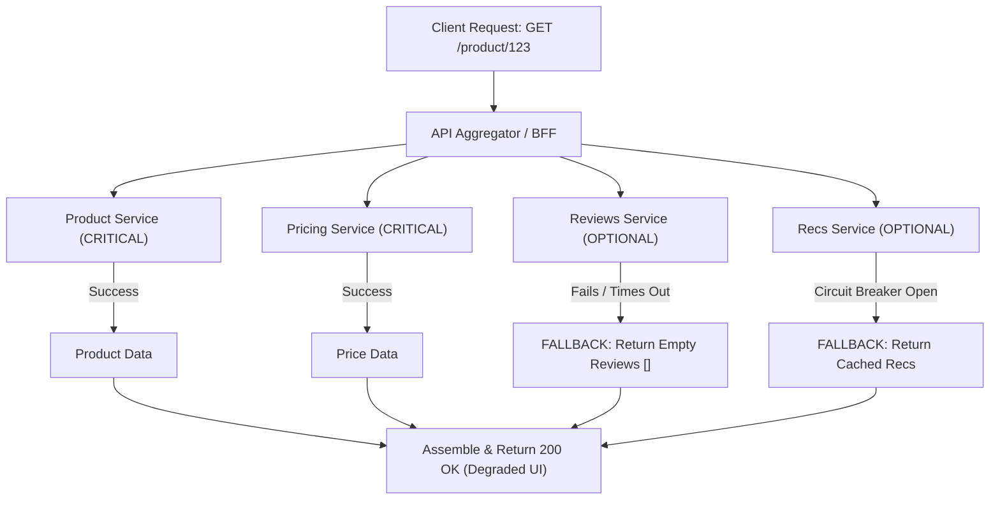

## Scenario

> **How would you handle partial failures when calling multiple services?**

In microservice architectures, an API aggregator or Backends-for-Frontends (BFF) endpoint frequently calls 4 or 5 separate microservices (e.g., User Service, Product Service, Recommendation Service, Reviews Service). If the Reviews Service is down or timing out, **should the entire product page crash with a 500 error, or should it degrade gracefully?**


## Fast Revision (10-Second Recall)

- **The Philosophy:** **Graceful Degradation.** Never let a non-critical downstream failure crash the entire user experience.
- **Top 5 Resilience Patterns:**
  1. **Differentiate Critical vs. Non-Critical Services:** Product details = Critical (fail request if down). Reviews/Recommendations = Non-critical (render empty or cached data).
  2. **`Promise.allSettled` Fan-Out:** Never use `Promise.all` (which rejects immediately if one call fails). Use `allSettled` to harvest all successful responses.
  3. **Circuit Breakers (Opossum / Resilience4j):** Trip open when a service fails repeatedly, returning fallback data in 0ms without exhausting network sockets.
  4. **Stale Cache Fallbacks:** If a service fails, serve the last-known cached response from Redis with an explicit `"stale": true` flag.
  5. **Bulkhead Pattern:** Isolate thread pools and HTTP connection pools per service so an outage in Service A cannot exhaust resources needed for Service B.
- **Key Tools:** `Promise.allSettled`, Circuit Breakers (Resilience4j / Opossum), Redis fallback cache.


## The 30-Second Spoken Script

If asked this in an interview, deliver this structured response:

> *I handle partial failures by categorizing downstream dependencies into hard and soft dependencies and applying graceful degradation.*
>
> *First, I identify which services are mission-critical. If the core Pricing or Inventory service fails, the request cannot complete and must return an error. But if secondary services—like Recommendations, Reviews, or Ads—fail, the request should still return 200 with fallback data.*
>
> *Second, in code, I execute calls concurrently using `Promise.allSettled` instead of `Promise.all`. This ensures that a rejected promise in one service does not abort other pending requests.*
>
> *Third, I wrap each downstream dependency in a Circuit Breaker. If the Reviews service goes down, the breaker trips, immediately returning an empty array or cached reviews without waiting for a 10-second network timeout.*
>
> *Finally, I isolate connection pools using the Bulkhead pattern so a struggling downstream service cannot exhaust threads needed to serve healthy dependencies.*


## Diagnostic Lifecycle



### 1. The Promise.all Trap (Anti-Pattern)
```typescript
// DANGEROUS: If reviewsService fails, the ENTIRE page crashes with 500!
const [product, price, reviews] = await Promise.all([
  fetchProduct(id),
  fetchPrice(id),
  fetchReviews(id), // 500 here kills product and price!
]);
```

### 2. The Resilient Promise.allSettled Approach (Optimal)
```typescript
// RESILIENT: Every promise completes independently
const results = await Promise.allSettled([
  fetchProduct(id),
  fetchPrice(id),
  fetchReviews(id),
]);
```


## Root Causes & Solutions Matrix

| Service Type | Failure Mode | Architectural Handling |
| :--- | :--- | :--- |
| **Critical Service** | Product Catalog or Authentication service down. | Fail request fast with structured 503 / 500 error; alert on-call engineer. |
| **Non-Critical Service** | Reviews or Recommendations service times out. | Return default empty array `[]` or cached data; UI hides widget. |
| **Cascading Socket Depletion** | Slow downstream service holds 200 sockets open, starving other calls. | **Bulkhead Pattern**: Isolate connection pools and max concurrent sockets per client. |
| **Repeated Failures** | Thousands of requests continuously pounding a failing service. | **Circuit Breaker**: Trip open and fail fast locally for 30s. |


## Practical Debugging Commands & Code

### 1. Robust Service Aggregation with Circuit Breakers & Fallbacks
```typescript
import CircuitBreaker from 'opossum';

// Wrap non-critical calls in Circuit Breakers
const reviewsBreaker = new CircuitBreaker(fetchReviewsFromService, {
  timeout: 1000,                // 1s timeout
  errorThresholdPercentage: 50, // Trip if 50% fail
  resetTimeout: 15000,          // Try again after 15s
});

// Define safe fallback
reviewsBreaker.fallback(() => ({ reviews: [], isDegraded: true }));

export async function getProductDetails(productId: string) {
  // 1. Run critical and non-critical calls in parallel
  const [productResult, reviewsResult] = await Promise.allSettled([
    fetchProductCatalog(productId),    // Critical
    reviewsBreaker.fire(productId),     // Non-critical with circuit breaker
  ]);

  // 2. Critical check: If product catalog failed, fail entire response
  if (productResult.status === 'rejected') {
    throw new Error('Core product service unavailable');
  }

  // 3. Optional check: Fallback gracefully if reviews failed
  const reviews = reviewsResult.status === 'fulfilled'
    ? reviewsResult.value
    : { reviews: [], isDegraded: true };

  return {
    ...productResult.value,
    reviews: reviews.reviews,
    _meta: {
      reviewsDegraded: reviews.isDegraded || false,
    },
  };
}
```


## Prevention & Senior Best Practices

1. **Classify Service Tiering in Design Docs:** Mandate that every microservice dependency is explicitly tagged as Tier 1 (hard dependency) or Tier 2/3 (soft dependency with fallback) before writing code.
2. **Contract-Level Degradation Flags:** Include metadata in API responses (e.g., `_partial: true`) so frontend UI components know to render skeleton states or fallback notices.
3. **Simulate Chaos in Staging:** Use Chaos Engineering tools (like Chaos Mesh or Gremlin) to inject latency and failures into downstream services to verify fallback behavior automatically.

