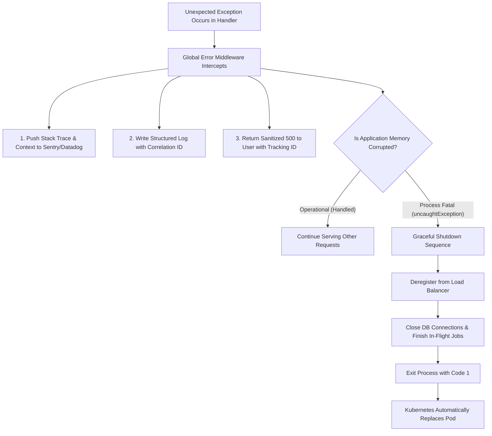

## Scenario

> **How would you handle unexpected exceptions in production?**

Unlike expected operational errors (e.g., user not found, invalid email format), an unexpected exception is an unpredicted edge case—a database socket failure, a null reference deep in a third-party library, or an unhandled promise rejection. The interviewer is testing your **reliability engineering mindset: fail-safe isolation, alerting, and rapid automated recovery**.


## Fast Revision (10-Second Recall)

- **The Core Rule:** **Crash early and fail-safe.** Never swallow unexpected exceptions or continue running in a corrupted runtime state.
- **Top 5 Rules for Unexpected Exceptions:**
  1. **Log & Capture Context:** Write structured JSON error log with request body, user ID, environment, and full stack trace to an APM (Sentry/Datadog).
  2. **Isolate Client Blast Radius:** Return a sanitized generic 500 JSON response with a unique Correlation ID (tracking ID) so the user never sees raw internals.
  3. **Graceful Process Restart:** For process-level unhandled exceptions (`uncaughtException`), stop accepting new traffic, finish in-flight requests, close DB pools, and exit with code 1.
  4. **Orchestrator Self-Healing:** Allow Kubernetes / Docker restart policies (`restartPolicy: Always`) to provision a fresh, clean container instance.
  5. **Automated Alert Escalation:** Trigger PagerDuty alerts if the error frequency exceeds a strict rate-of-change threshold.
- **Key Tools:** Sentry, Kubernetes Liveness & Readiness Probes, Structured Logging (Pino / Winston), Correlation IDs.


## The 30-Second Spoken Script

If asked this in an interview, deliver this structured response:

> *When an unexpected exception occurs in production, my approach is designed around three goals: protecting the user, capturing complete diagnostic context, and ensuring system self-healing.*
>
> *First, for the client, the global error filter catches the exception and returns a clean HTTP 500 containing a unique Correlation ID, preventing any stack traces or database connection strings from leaking.*
>
> *Second, for observability, the exception is instantly captured in Sentry and logged to our centralized log aggregator with the full stack trace, request metadata, and user context.*
>
> *Third, if the exception was fatal at the process level, I follow Node.js and distributed systems best practices: fail fast. Attempting to keep running after an uncaught exception risks memory leaks and corrupted state. The process finishes in-flight requests gracefully, closes connections, and exits with code 1, allowing Kubernetes to automatically spin up a fresh pod.*


## Diagnostic Lifecycle



### 1. Differentiating Operational Errors vs Programmer Bugs
- **Operational Errors:** Known runtime failure (e.g., PostgreSQL query timed out, payment card declined). Handled cleanly by returning 4xx or 503 without terminating the process.
- **Programmer Bugs (Unexpected):** Null reference, undefined function call, memory corruption. Potentially leaves the application state inconsistent; requires process restart.


## Root Causes & Solutions Matrix

| Scenario | Anti-Pattern | Best-Practice Solution |
| :--- | :--- | :--- |
| **Silent Swallowing** | `try { ... } catch (e) { /* do nothing */ }` | Always log and re-throw, or handle with explicit fallback. |
| **Zombified Process** | Continuing to serve traffic after an uncaught exception. | Fail fast: close server gracefully and exit with `process.exit(1)`. |
| **Leaking Internals** | Returning `err.stack` directly to client HTTP response. | Return generic message with opaque tracking ID (`trackingId: "c18f-..."`). |
| **Missing Request Context** | Sentry reports error, but cannot see what input payload caused it. | Attach sanitized request parameters, headers, and user ID to error context. |
| **Cascading Crash Storm** | Every instance crashes simultaneously on the same bad record. | Implement Dead Letter Queues (DLQ) for async jobs and input schema validation at gateway. |


## Practical Debugging Commands & Code

### 1. Robust Sentry Context & Graceful Shutdown Pattern
```typescript
import * as Sentry from '@sentry/node';
import { Server } from 'http';

export function setupProductionSafetyNet(server: Server) {
  // Catch unhandled Promise rejections
  process.on('unhandledRejection', (reason: Error, promise: Promise<any>) => {
    Sentry.captureException(reason, {
      extra: { type: 'unhandledRejection' },
    });
    console.error('[CRITICAL] Unhandled Promise Rejection:', reason);
  });

  // Catch fatal uncaught exceptions
  process.on('uncaughtException', (err: Error) => {
    Sentry.captureException(err, {
      extra: { type: 'uncaughtException' },
    });
    console.error('[FATAL] Uncaught Exception encountered. Initiating graceful shutdown...', err);

    // 1. Stop accepting new incoming requests
    server.close(() => {
      console.log('HTTP server closed.');
      // 2. Disconnect from database and exit
      dbPool.end().finally(() => {
        process.exit(1); // Kubernetes will provision a healthy replacement pod
      });
    });

    // Force shutdown after 10s if connections refuse to drain
    setTimeout(() => {
      console.error('Forcefully terminating process due to timeout.');
      process.exit(1);
    }, 10000).unref();
  });
}
```


## Prevention & Senior Best Practices

1. **Self-Healing Kubernetes Pods:** Configure `livenessProbe` and `readinessProbe` with appropriate `failureThreshold` and `initialDelaySeconds` to ensure crashed pods are evicted immediately.
2. **Dead Letter Queues (DLQ) for Poison Pills:** When an unexpected exception is triggered by an asynchronous message, move the payload to a Dead Letter Queue after 3 failed attempts rather than infinitely crashing workers.
3. **Structured Post-Mortems (RCA):** Every unexpected exception that affects more than 0.1% of users should require a root cause analysis and a regression test added to CI/CD.

