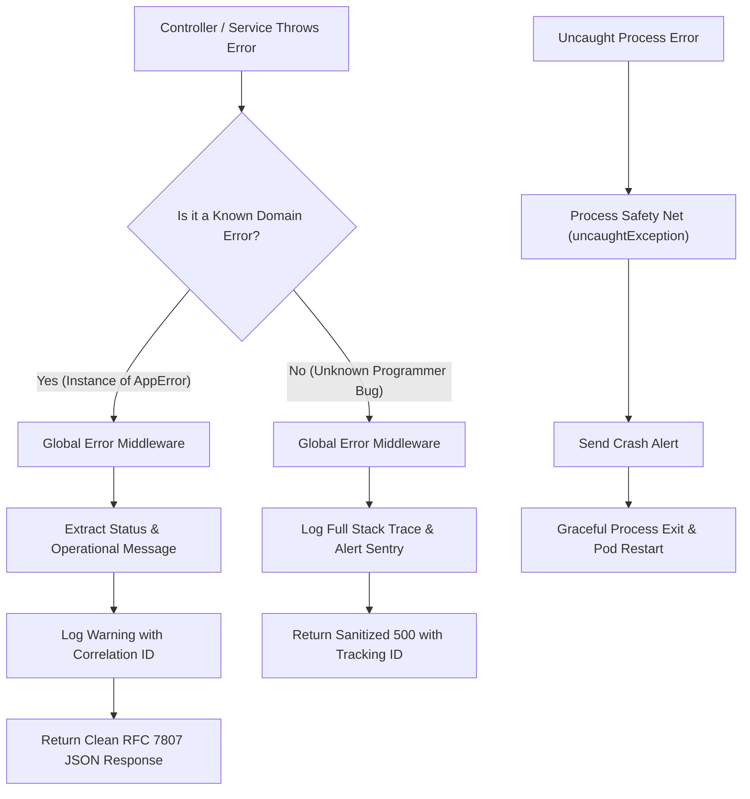

## Scenario

> **How would you implement global exception handling?**

Without global exception handling, unhandled exceptions crash the entire process, leak database connection sockets, return inconsistent error payloads, or expose sensitive stack traces directly to attackers. Interviewers ask this to test your **architectural defense-in-depth across the application lifecycle**.


## Fast Revision (10-Second Recall)

- **The 3-Layer Defense:**
  1. **Route Middleware Layer:** Framework-level global error middleware catching all rejected promises and thrown exceptions.
  2. **Domain Exception Hierarchy:** Custom class hierarchy (`AppError` $\rightarrow$ `NotFoundException`, `ConflictException`, `ValidationException`).
  3. **Process-Level Safety Net:** `process.on('unhandledRejection')` and `process.on('uncaughtException')` logging fatal crashes and exiting gracefully.
- **Key Deliverable:** Standardized error format adhering to **RFC 7807 Problem Details** (`type`, `title`, `status`, `detail`, `instance`).
- **Key Tools:** Express error middleware `(err, req, res, next)`, NestJS `@Catch()` Exception Filter, Pino / Winston structured loggers.


## The 30-Second Spoken Script

If asked this in an interview, deliver this structured response:

> *I implement global exception handling using a three-tier architecture: domain exception modeling, framework-level centralized middleware, and process-level crash safety nets.*
>
> *First, I establish a strongly-typed domain error hierarchy extending a base `AppError`. This distinguishes operational errors—like validation failures or missing entities where we know the exact HTTP status—from unexpected programmer bugs.*
>
> *Second, I register a centralized global error middleware at the bottom of the middleware pipeline. It intercepts all thrown errors, logs the full stack trace internally alongside a unique correlation ID, and maps the error to a consistent RFC 7807 JSON response without leaking internal implementation details.*
>
> *Finally, at the process runtime level, I listen to `uncaughtException` and `unhandledRejection`. If an unhandled fatal error slips through, we log it to our APM and perform a graceful process restart to prevent running in an undefined state.*


## Diagnostic Lifecycle



### 1. Step 1: Create Domain Error Hierarchy
Never throw generic strings or untyped errors:
```typescript
export abstract class AppError extends Error {
  abstract readonly statusCode: number;
  abstract readonly errorCode: string;
  readonly isOperational: boolean = true; // Known operational error

  constructor(message: string) {
    super(message);
    Object.setPrototypeOf(this, new.target.prototype);
    Error.captureStackTrace(this, this.constructor);
  }
}

export class NotFoundException extends AppError {
  readonly statusCode = 404;
  readonly errorCode = 'RESOURCE_NOT_FOUND';
}

export class ConflictException extends AppError {
  readonly statusCode = 409;
  readonly errorCode = 'RESOURCE_CONFLICT';
}
```


## Root Causes & Solutions Matrix

| Layer | Responsibility | What Happens if Missing? |
| :--- | :--- | :--- |
| **Domain Error Classes** | Encapsulates HTTP status codes and domain error codes. | Controller cluttered with repetitive `res.status(404).json(...)` logic. |
| **Global Error Middleware** | Intercepts all rejected promises in the request lifecycle. | Unhandled async promise rejection hangs connection or crashes process. |
| **Correlation ID Logging** | Attaches unique request ID to error logs and responses. | Impossible to find the corresponding backend log when a user reports an issue. |
| **Process Crash Handler** | Catches fatal bugs outside the HTTP request lifecycle. | Node process quietly enters corrupted state with memory leaks. |
| **Response Sanitizer** | Strips stack traces, DB queries, and file paths in production. | Security vulnerability: attackers gain insights into backend directory structure. |


## Practical Debugging Commands & Code

### 1. Centralized Express Global Error Middleware
```typescript
import { Request, Response, NextFunction } from 'express';
import { AppError } from './errors';

export function globalErrorHandler(
  err: Error,
  req: Request,
  res: Response,
  next: NextFunction
) {
  const correlationId = (req.headers['x-correlation-id'] as string) || 'UNKNOWN_REQ';

  // 1. Operational Known Errors (Safe to show message)
  if (err instanceof AppError) {
    console.warn(`[WARN] [${correlationId}] Operational Error: ${err.message}`, {
      code: err.errorCode,
      statusCode: err.statusCode,
    });

    return res.status(err.statusCode).json({
      type: `https://api.yourdomain.com/errors/${err.errorCode.toLowerCase()}`,
      title: err.name,
      status: err.statusCode,
      detail: err.message,
      trackingId: correlationId,
    });
  }

  // 2. Unhandled Programmer Bugs (500 Internal Server Error)
  console.error(`[FATAL] [${correlationId}] Unhandled System Error: ${err.message}`, {
    stack: err.stack,
    url: req.originalUrl,
    method: req.method,
  });

  return res.status(500).json({
    type: 'https://api.yourdomain.com/errors/internal-server-error',
    title: 'Internal Server Error',
    status: 500,
    detail: 'An unexpected internal error occurred. Please quote the tracking ID.',
    trackingId: correlationId,
  });
}
```

### 2. Process-Level Crash Safety Net
```typescript
// Listen for unhandled promise rejections
process.on('unhandledRejection', (reason: Error) => {
  console.error('[UNHANDLED_REJECTION] Non-intercepted Promise:', reason);
  // Send alert to APM / Sentry
});

// Listen for fatal uncaught exceptions
process.on('uncaughtException', (err: Error) => {
  console.error('[FATAL_CRASH] Uncaught Exception. Exiting gracefully...', err);
  // Graceful shutdown: close DB pools and exit so orchestrator (K8s) restarts pod
  server.close(() => {
    process.exit(1);
  });
});
```


## Prevention & Senior Best Practices

1. **Adopt RFC 7807 (Problem Details for HTTP APIs):** Standardize all API error envelopes across all services for consistent client-side parsing.
2. **Never Keep Running After `uncaughtException`:** The Node.js documentation explicitly advises exiting immediately after an uncaught exception because the application memory space is potentially corrupt.
3. **Async Middleware Wrappers:** In Express 4, unhandled promise rejections in async routes are not forwarded to error handlers automatically; use `express-async-errors` or wrap handlers.

