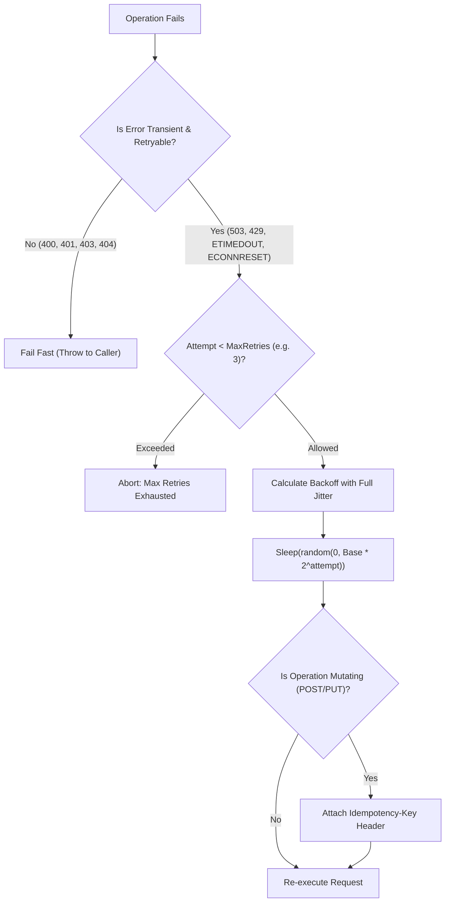

## Scenario

> **How would you implement retry logic?**

In distributed cloud architectures, network glitches, transient database lock timeouts, and brief container restarts are inevitable. Retrying blindly, however, can trigger a **thundering herd / retry storm** that completely crushes an already struggling downstream system. Interviewers expect a principled design based on **exponential backoff, full jitter, and strict retry limits**.


## Fast Revision (10-Second Recall)

- **The Golden Formula:** **Exponential Backoff with Full Jitter**
  $$\text{Wait Time} = \text{random}(0, \; \min(\text{MaxBackoff}, \; \text{BaseBackoff} \times 2^{\text{attempt}}))$$
- **Top 4 Rules of Safe Retries:**
  1. **Only Retry Transient Errors:** Retry network timeouts, connection resets, and HTTP 429/503. **Never retry 4xx client errors (400, 401, 403, 404)**.
  2. **Require Idempotency for Non-GET Requests:** Never retry a `POST` or `PUT` without sending a unique `Idempotency-Key`.
  3. **Full Random Jitter:** Jitter desynchronizes concurrent retries so 5,000 clients don't hit the server at the exact same millisecond.
  4. **Strict Maximum Retry Ceiling:** Limit retries to 3 attempts with a max delay ceiling (e.g., 5 seconds) to prevent infinite latency accumulation.
- **Key Tools:** Axios-retry, `async-retry`, Polly (.NET), Resilience4j (Java).


## The 30-Second Spoken Script

If asked this in an interview, deliver this structured response:

> *Implementing retry logic safely requires four core pillars: error classification, exponential backoff with full jitter, idempotency guarantees, and strict attempt limits.*
>
> *First, I filter by error type. Only transient errors—such as network connection timeouts, 503 Service Unavailable, or 429 Too Many Requests—should be retried. Retrying permanent errors like 400 Bad Request or 401 Unauthorized is futile and wastes resources.*
>
> *Second, I calculate delay using exponential backoff with full jitter. If 1,000 requests fail simultaneously, adding randomized jitter spreads the retry traffic over time, preventing a thundering herd from taking down the recovering service.*
>
> *Third, for mutating operations like POST or payment charges, retries are strictly gated by Idempotency Keys so the server never executes duplicate transactions.*
>
> *Finally, I enforce a maximum limit of 3 attempts with an overall timeout deadline.*


## Diagnostic Lifecycle



### 1. Why Linear Backoff Fails (The Thundering Herd)
- **Linear Backoff:** Attempt 1 waits 1s, Attempt 2 waits 2s, Attempt 3 waits 3s.
  - If 5,000 clients fail at time $T=0$, all 5,000 clients retry at $T=1s$, creating another massive traffic spike that crashes the database again.
- **Exponential Backoff with Full Jitter:** Spreads the 5,000 clients uniformly across random windows between 0 and $T$, smoothing out traffic spikes completely.


## Root Causes & Solutions Matrix

| Retry Bug / Anti-Pattern | Consequence | Engineering Remedy |
| :--- | :--- | :--- |
| **Retrying 400 / 404 Errors** | Wastes network bandwidth; client payload is permanently invalid. | Check status code: only retry if `status in [429, 502, 503, 504]` or `err.isNetworkError`. |
| **Retrying `POST /orders` Without Key** | Customer gets billed 3 times for 1 purchase. | Require `Idempotency-Key: uuid` header on all retried mutations. |
| **Fixed / Linear Delay** | All retrying instances slam the server in synchronized waves. | Add Full Jitter: randomize delay between 0 and calculated exponential backoff. |
| **Infinite Retries** | Thread hangs indefinitely; user connection never closes. | Enforce hard cap: `maxAttempts = 3`. |
| **Ignoring `Retry-After` Header** | Service returning 429 Rate Limit gets hammered further. | Respect upstream `Retry-After` HTTP response header if present. |


## Practical Debugging Commands & Code

### 1. Production-Grade Retry Utility with Exponential Backoff and Full Jitter
```typescript
interface RetryOptions {
  maxRetries?: number;
  baseDelayMs?: number;
  maxDelayMs?: number;
  retryableStatusCodes?: number[];
}

export async function executeWithRetry<T>(
  operation: (attempt: number) => Promise<T>,
  options: RetryOptions = {}
): Promise<T> {
  const {
    maxRetries = 3,
    baseDelayMs = 200,
    maxDelayMs = 3000,
    retryableStatusCodes = [408, 429, 500, 502, 503, 504],
  } = options;

  let attempt = 0;

  while (true) {
    try {
      return await operation(attempt);
    } catch (error: any) {
      attempt++;

      // Check if error is retryable
      const status = error?.response?.status;
      const isNetworkError = error.code === 'ECONNRESET' || error.code === 'ETIMEDOUT';
      const isRetryable = isNetworkError || (status && retryableStatusCodes.includes(status));

      if (!isRetryable || attempt >= maxRetries) {
        throw error; // Permanent failure or attempts exhausted
      }

      // Check for upstream Retry-After header
      const retryAfterHeader = error?.response?.headers?.['retry-after'];
      let delayMs: number;

      if (retryAfterHeader) {
        delayMs = parseInt(retryAfterHeader, 10) * 1000;
      } else {
        // Exponential Backoff with Full Jitter: random(0, min(maxDelay, base * 2^attempt))
        const exponentialLimit = Math.min(maxDelayMs, baseDelayMs * Math.pow(2, attempt));
        delayMs = Math.floor(Math.random() * exponentialLimit);
      }

      console.warn(`[RETRY] Attempt ${attempt} failed. Retrying in ${delayMs}ms... Reason: ${error.message}`);
      await new Promise((resolve) => setTimeout(resolve, delayMs));
    }
  }
}
```


## Prevention & Senior Best Practices

1. **Honor `Retry-After` Responses:** If an upstream service responds with HTTP 429 and `Retry-After: 12`, do not execute your custom backoff; wait the requested 12 seconds.
2. **Combine Retries with Circuit Breakers:** If retries across multiple requests fail consistently over 30 seconds, trip the circuit breaker open to stop issuing doomed retries entirely.
3. **Trace Retry Attempts in Headers:** Inject an `X-Retry-Attempt: 2` header so upstream services can monitor how many incoming calls are retries.

