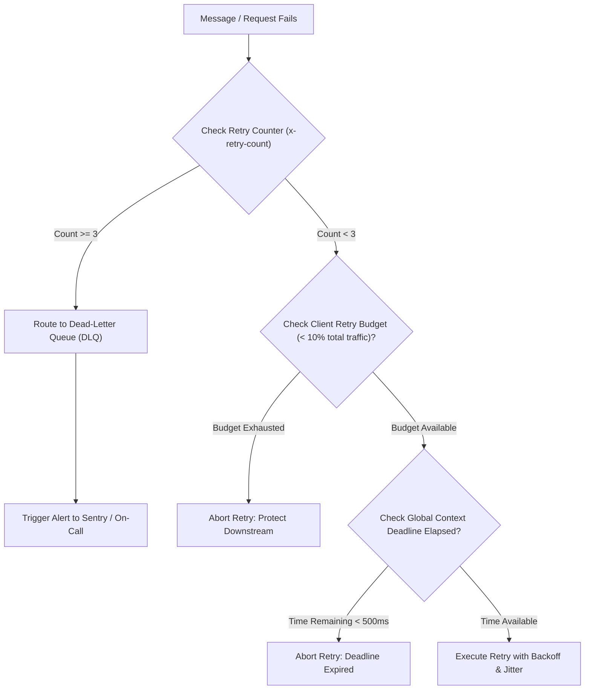

## Scenario

> **How would you prevent infinite retry loops?**

An infinite retry loop occurs when an application or background message consumer encounters a permanent failure (e.g., malformed JSON or schema constraint violation) and retries indefinitely. In microservices, **retry amplification** across 3 tiers (Service A retries 3 times $\times$ Service B retries 3 times $\times$ Service C retries 3 times = 27 calls) will multiply an outage into a complete systemic collapse.


## Fast Revision (10-Second Recall)

- **The Danger:** Infinite retry loops lock CPU threads, exhaust database connections, fill up log disks, and cause self-inflicted DDoS attacks.
- **Top 5 Safeguards Against Infinite Retries:**
  1. **Hard Maximum Attempt Counters:** Enforce an unbypassable limit (`maxAttempts = 3`) stored in memory or message metadata (`x-retry-count`).
  2. **Dead-Letter Queues (DLQ):** After $N$ failed attempts, route poison pills to a DLQ for manual inspection rather than re-queueing.
  3. **Circuit Breakers with Error Thresholds:** Trip open after a 50% failure rate; reject calls locally for 30 seconds without retrying.
  4. **Retry Budgets (Client-Side):** Limit retry calls to a maximum of 10% of total outbound requests across the client instance.
  5. **Context Deadlines / Time-To-Live (TTL):** Propagate a global deadline header (`X-Request-Deadline: 5000ms`); abort retries immediately if overall elapsed time exceeds the deadline.
- **Key Tools:** RabbitMQ/Kafka Dead Letter Exchanges, gRPC Context Deadlines, Envoy Retry Budgets, Redis attempt tracking.


## The 30-Second Spoken Script

If asked this in an interview, deliver this structured response:

> *Preventing infinite retry loops requires multi-layered architectural guardrails across both synchronous APIs and asynchronous message queues.*
>
> *For asynchronous workers, the biggest risk is a poison-pill message. I configure our queues with a strict retry count—typically 3 attempts with exponential backoff. If the message fails all 3 times, it is automatically routed to a Dead-Letter Queue (DLQ) for inspection, preventing worker threads from looping forever.*
>
> *For synchronous microservices, the risk is retry amplification across call chains. To stop this, I enforce Context Deadlines: the original edge gateway sets a 5-second total timeout that propagates across all downstream services. If 4 seconds have already elapsed, downstream services are forbidden from initiating another retry.*
>
> *Finally, I implement Client Retry Budgets, which restrict retries to no more than 10% of total outgoing traffic, and Circuit Breakers that stop retries entirely when a downstream service is struggling.*


## Diagnostic Lifecycle



### 1. The Retry Amplification Trap (Cascading Explosion)
Consider Service A calling Service B, which calls Service C:
- Service C has a brief 2-second hiccup.
- Service B retries 3 times.
- Service A experiences a timeout from Service B, so Service A retries 3 times.
- Each retry from A causes B to retry 3 more times.
- Total requests sent to failing Service C: $3 \times 3 \times 3 = 27\text{ requests}$ for a single user action!


## Root Causes & Solutions Matrix

| Vector | Failure Mode | Prevention Mechanism |
| :--- | :--- | :--- |
| **Poison Pill Message** | Malformed JSON in queue causes worker to crash and re-queue forever. | **Dead-Letter Queue (DLQ)**: Move to DLQ after 3 failures; commit acknowledgment. |
| **Retry Amplification** | Multi-tier microservices each independently retrying 3 times. | **Context Deadlines**: Propagate `X-Request-Deadline` header; enforce single-tier retry only. |
| **Runaway Client Loop** | Frontend `useEffect` catches error and immediately calls `fetch()` again. | Linting rules for dependency arrays; enforce client retry limits in TanStack Query. |
| **Downstream Under Stress** | Retries flood a database operating at 99% CPU capacity. | **Retry Budgets**: Cap total retries to 10% of total outbound requests. |
| **Permanent 4xx Error** | Client continuously retries a 404 or 400 error. | Strictly restrict retries to transient 5xx and network drop errors. |


## Practical Debugging Commands & Code

### 1. Context Deadline Propagation with Global Timeout (Node.js)
```typescript
import axios from 'axios';
import { Request, Response, NextFunction } from 'express';

// Middleware to establish and propagate request deadline
export function deadlineMiddleware(req: Request, res: Response, next: NextFunction) {
  const existingDeadline = req.headers['x-request-deadline'] as string;
  // Use existing deadline or establish 4-second maximum budget from now
  const deadlineTimestamp = existingDeadline ? parseInt(existingDeadline, 10) : Date.now() + 4000;

  req.headers['x-request-deadline'] = deadlineTimestamp.toString();
  next();
}

// Client helper that respects the remaining deadline before retrying
export async function callDownstreamWithDeadline(url: string, headers: any, attempt: number = 0) {
  const deadline = parseInt(headers['x-request-deadline'], 10);
  const remainingTimeMs = deadline - Date.now();

  // If less than 300ms remain, ABORT retry to prevent cascading latency
  if (remainingTimeMs < 300) {
    throw new Error('Aborting retry: Global request deadline exceeded.');
  }

  try {
    return await axios.get(url, {
      timeout: remainingTimeMs, // Bound the HTTP call to remaining time
      headers,
    });
  } catch (err: any) {
    if (attempt < 2 && remainingTimeMs > 1000) {
      return callDownstreamWithDeadline(url, headers, attempt + 1);
    }
    throw err;
  }
}
```

### 2. RabbitMQ Dead-Letter Exchange (DLX) Configuration
```bash
# Configure queue with dead-letter exchange after 3 retries
rabbitmqadmin declare queue name=orders-queue \
  arguments='{"x-dead-letter-exchange":"orders-retry-dlx", "x-max-delivery-count":3}'
```


## Prevention & Senior Best Practices

1. **Adopt Retry Budgets (Envoy / Finagle Pattern):** Never allow retries to exceed 10% of total application traffic. If the budget is exhausted, fail fast.
2. **Always Require Dead-Letter Queues:** Never create a production message queue (SQS, RabbitMQ, Kafka) without an associated Dead-Letter Queue and consumer monitoring alert.
3. **Only Retry at the Edge:** In microservice call trees, adopt an architectural policy where only the outermost caller (API Gateway or client) initiates retries, while internal downstream hops fail fast.

