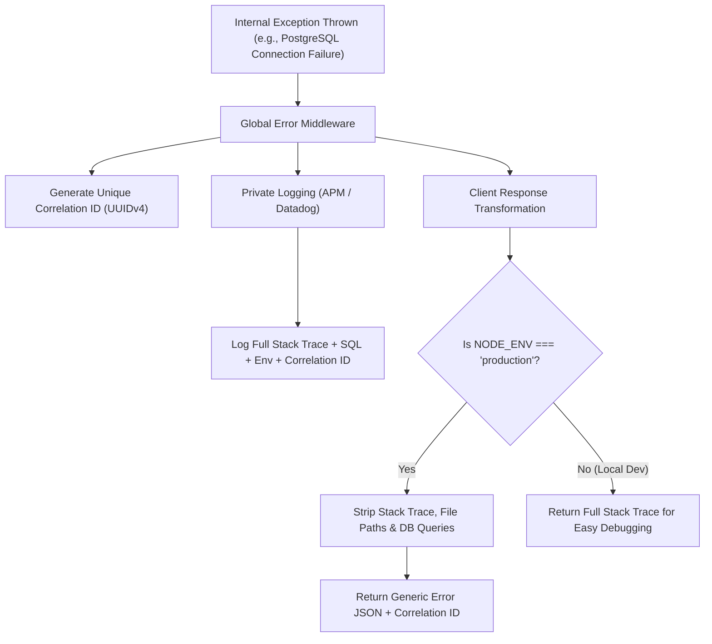

## Scenario

> **How would you prevent sensitive exception details from reaching the client?**

Leaking internal error details—such as SQL query fragments, database hostnames, file system paths, library versions, or API secret keys—is categorized under **OWASP Top 10 (A05: Security Misconfiguration / Information Disclosure)**. Attackers use these clues to map your infrastructure, discover zero-day vulnerabilities, or execute targeted SQL injections.


## Fast Revision (10-Second Recall)

- **The Threat:** Stack traces reveal file paths (`/home/deploy/api/db.ts`), database engines (`PostgreSQL 14.2`), table names, and environment variables.
- **Top 5 Defense Strategies:**
  1. **Environment Flag Gate:** Strip `err.stack` completely when `NODE_ENV === 'production'`.
  2. **Custom Domain Error Whitelisting:** Only display messages from known, approved `AppError` subclasses; replace all others with a generic message.
  3. **Correlation / Tracking ID:** Output an opaque UUID (`trackingId: "c18f-..."`) to the user, and log the real stack trace privately in internal logs.
  4. **Log & Response Sanitization:** Use log scrubbers to mask sensitive patterns (credit cards, passwords, Authorization bearer tokens).
  5. **Reverse Proxy Safety Net:** Configure NGINX `proxy_intercept_errors on` and custom `error_page 500 502 /50x.html` to catch unhandled upstream crashes.
- **Key Tools:** Pino logger redact option, Sentry Data Scrubbing, RFC 7807 Problem Details.


## The 30-Second Spoken Script

If asked this in an interview, deliver this structured response:

> *Preventing information leakage requires a strict separation between internal diagnostics and external client responses.*
>
> *First, at the application layer, my global error filter uses a whitelist approach: only explicitly declared operational errors—like validation messages or resource not found—are exposed to the client. All unexpected system errors are caught and sanitized into a generic message like 'An unexpected internal error occurred.'*
>
> *Second, I decouple debugging from the response by generating a unique Correlation ID. The real stack trace, SQL query, and host context are written to our private log aggregator keyed by that ID. The client receives only the status code and the tracking ID, which they can quote to customer support.*
>
> *Finally, at the gateway layer, I configure NGINX to intercept 50x errors so that even if a backend framework crashes before the error middleware runs, the reverse proxy returns a clean, static error page.*


## Diagnostic Lifecycle



### 1. What Attackers Look for in Raw 500 Errors
- Database errors: `syntax error at or near "SELECT" from users` $\rightarrow$ Confirms SQL injection vulnerability and table naming.
- File system paths: `/var/www/vhosts/app/config/secrets.js` $\rightarrow$ Informs local file inclusion (LFI) attacks.
- Framework version headers: `Express 4.16.0` $\rightarrow$ Informs automated CVE vulnerability scanning.


## Root Causes & Solutions Matrix

| Leakage Vector | Risk | Prevention Mechanism |
| :--- | :--- | :--- |
| **Raw Stack Traces** | Exposes absolute file paths and library versions. | Strip `stack` property in production error filter. |
| **SQL Engine Errors** | Reveals database schema, table columns, and ORM engine. | Catch database driver errors (`QueryFailedError`) and return generic message. |
| **Environment Variables in Logs** | Accidentally printing `process.env` during initialization errors. | Configure logger redactors to scrub keys matching `TOKEN|SECRET|PASS`. |
| **Framework Version Headers** | `X-Powered-By: Express` header advertised on every response. | Disable headers: `app.disable('x-powered-by')` or `helmet()`. |
| **Uncaught Crash HTML** | Default framework HTML crash screen shown to user. | Implement custom error middleware and NGINX `error_page` fallback. |


## Practical Debugging Commands & Code

### 1. Whitelist-Based Error Sanitization Filter
```typescript
import { Request, Response, NextFunction } from 'express';
import { v4 as uuidv4 } from 'uuid';

export function secureErrorFilter(
  err: any,
  req: Request,
  res: Response,
  next: NextFunction
) {
  const correlationId = (req.headers['x-correlation-id'] as string) || uuidv4();
  const isProd = process.env.NODE_ENV === 'production';

  // 1. Log full sensitive context internally
  console.error(`[SECURE_LOG] [${correlationId}]`, {
    message: err.message,
    stack: err.stack,
    databaseQuery: err.query, // Safe internally
    path: req.originalUrl,
  });

  // 2. Determine safe message for client
  const isOperational = err.isOperational === true;
  const statusCode = err.statusCode || 500;

  // In production, NEVER send unexpected error details to client
  const clientMessage = (isOperational || !isProd)
    ? err.message
    : 'An unexpected internal error occurred. Please contact support with this tracking ID.';

  return res.status(statusCode).json({
    status: 'error',
    code: isOperational ? err.errorCode : 'INTERNAL_SERVER_ERROR',
    message: clientMessage,
    trackingId: correlationId,
    // Only include stack trace during local development
    ...(isProd ? {} : { debugStack: err.stack }),
  });
}
```

### 2. Disable Identifying Headers with Helmet
```typescript
import helmet from 'helmet';

// Automatically removes X-Powered-By and adds security headers
app.use(helmet());
```


## Prevention & Senior Best Practices

1. **Adopt Helmet Middleware:** Always install `helmet` in Node.js applications to automatically strip `X-Powered-By` and enforce strict security headers.
2. **Automate PII and Secret Scrubbing:** Configure APM log forwarders (Datadog/Sentry) with regex scrubbing rules for patterns matching JWTs, API tokens, and passwords.
3. **Run Dynamic Application Security Testing (DAST):** Use automated security scanners (e.g., OWASP ZAP) in CI/CD to probe error endpoints for information leakage.

