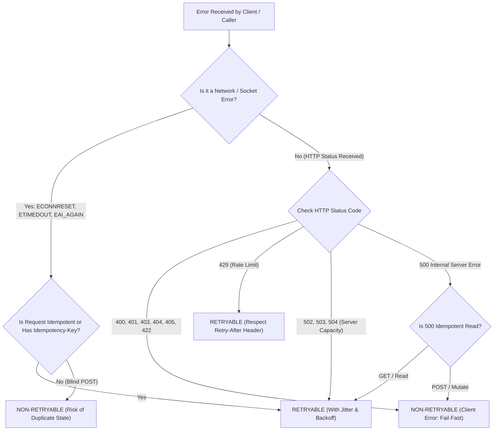

## Scenario

> **How would you distinguish between retryable and non-retryable errors?**

Blindly retrying every failed request is an anti-pattern. If an error is caused by invalid JSON syntax or missing permissions, retrying 1,000 times will produce the identical failure 1,000 times. Retrying must be reserved exclusively for **transient, self-healing disruptions**.


## Fast Revision (10-Second Recall)

- **The Golden Rule:**
  - **Retryable (Transient):** The request was valid, but a temporary environmental issue (network hiccup, rate limit, server reboot) prevented completion. A future retry may succeed.
  - **Non-Retryable (Permanent):** The request was fundamentally flawed (invalid data, bad credentials, missing route) or failed a permanent business rule. A future retry will never succeed without client changes.
- **Retryable HTTP Codes:** `408 Request Timeout`, `429 Too Many Requests`, `502 Bad Gateway`, `503 Service Unavailable`, `504 Gateway Timeout`.
- **Non-Retryable HTTP Codes:** `400 Bad Request`, `401 Unauthorized`, `403 Forbidden`, `404 Not Found`, `405 Method Not Allowed`, `409 Conflict`, `422 Unprocessable Entity`.
- **Retryable Socket Errors:** `ECONNRESET`, `ETIMEDOUT`, `EAI_AGAIN` (temporary DNS lookup failure), `ECONNREFUSED` (during rolling update).


## The 30-Second Spoken Script

If asked this in an interview, deliver this structured response:

> *I distinguish between retryable and non-retryable errors based on one fundamental question: 'Is this failure transient or permanent?'*
>
> *Permanent errors are deterministic: if you send the exact same bytes again, they will fail again. This includes all 4xx client errors like 400 Bad Request, 401 Unauthorized, 403 Forbidden, 404 Not Found, and 422 Validation Failed. These must fail fast immediately with no retries.*
>
> *Retryable errors are non-deterministic and transient. They stem from temporary environmental conditions that are expected to self-heal. These include network socket drops like `ECONNRESET` and `ETIMEDOUT`, server-side capacity issues like HTTP 503 Service Unavailable and 504 Gateway Timeout, and rate limits like HTTP 429.*
>
> *Finally, for non-idempotent operations like POST, an error is only safely retryable if the request has not yet been processed by the remote server, or if the request is protected by an Idempotency Key.*


## Diagnostic Lifecycle



### 1. The HTTP Status Code Taxonomy

| Status Code | Type | Action | Why? |
| :--- | :--- | :--- | :--- |
| **`400 Bad Request`** | Permanent | **Do Not Retry** | Payload failed schema validation; will fail identically. |
| **`401 Unauthorized`** | Permanent | **Do Not Retry** | Token missing or invalid; user must re-authenticate. |
| **`403 Forbidden`** | Permanent | **Do Not Retry** | User lacks permission; retrying won't grant access. |
| **`404 Not Found`** | Permanent | **Do Not Retry** | URI does not exist. |
| **`429 Too Many Requests`** | Transient | **Retry** | Rate limited; retry after waiting for `Retry-After` window. |
| **`500 Internal Error`** | Ambiguous | **Conditional** | Only retry if operation is idempotent (GET). |
| **`502 Bad Gateway`** | Transient | **Retry** | Upstream rebooting or container deploying. |
| **`503 Service Unavailable`** | Transient | **Retry** | Backend temporarily overloaded; capacity recovering. |
| **`504 Gateway Timeout`** | Transient | **Retry** | Upstream took too long; retry with backoff. |

### 2. Network / OS Socket Errors
- **`ETIMEDOUT` (Connection / Read Timeout):** The remote host or network link failed to acknowledge the packet. **Retryable**.
- **`ECONNRESET` (Connection Reset by Peer):** Remote server closed socket unexpectedly (e.g., during pod shutdown). **Retryable**.
- **`EAI_AGAIN` (DNS Lookup Timeout):** Temporary DNS resolution failure. **Retryable**.
- **`ENOTFOUND` (Host Not Found):** Domain name does not exist. **Non-Retryable**.


## Root Causes & Solutions Matrix

| Error Category | Specific Code | Handling Rule |
| :--- | :--- | :--- |
| **Client Syntax & Semantic Bugs** | `400`, `422`, `SyntaxError` | Fail fast immediately; return error to developer/user. |
| **Auth Failures** | `401`, `403` | Do not retry request; trigger token refresh or redirect to login. |
| **Temporary Overload** | `429 Too Many Requests` | Extract `Retry-After` header; wait specified seconds before retry. |
| **Infrastructure Failures** | `502`, `503`, `504` | Retry up to 3 times using Exponential Backoff with Jitter. |
| **Database Transient Errors** | `40P01` (Deadlock detected), `57014` (Statement timeout) | Retry transaction from the beginning with a random backoff delay. |


## Practical Debugging Commands & Code

### 1. TypeScript Error Classification Predicate
```typescript
export interface ClassifiedError {
  isRetryable: boolean;
  retryAfterSeconds?: number;
  reason: string;
}

export function classifyError(error: any): ClassifiedError {
  // 1. Socket & Network Errors (Transient)
  const transientSocketCodes = ['ECONNRESET', 'ETIMEDOUT', 'EAI_AGAIN', 'ECONNREFUSED'];
  if (error.code && transientSocketCodes.includes(error.code)) {
    return {
      isRetryable: true,
      reason: `Transient network socket failure (${error.code})`,
    };
  }

  // 2. HTTP Status Code Evaluation
  const status = error?.response?.status;
  if (status) {
    // 429 Rate Limit (Transient with backoff)
    if (status === 429) {
      const retryAfter = error.response.headers?.['retry-after'];
      return {
        isRetryable: true,
        retryAfterSeconds: retryAfter ? parseInt(retryAfter, 10) : undefined,
        reason: 'Upstream rate limited (HTTP 429)',
      };
    }

    // 502, 503, 504 Gateway & Server Capacity (Transient)
    if ([502, 503, 504, 408].includes(status)) {
      return {
        isRetryable: true,
        reason: `Upstream temporary capacity or timeout failure (HTTP ${status})`,
      };
    }

    // 4xx Client Errors (Permanent)
    if (status >= 400 && status < 500) {
      return {
        isRetryable: false,
        reason: `Permanent client error (HTTP ${status}). Retrying will not succeed.`,
      };
    }
  }

  // 3. PostgreSQL Deadlock Error (Transient)
  if (error.code === '40P01') {
    return {
      isRetryable: true,
      reason: 'PostgreSQL deadlock detected; safe to retry transaction.',
    };
  }

  // Default fallback: Do not retry unknown fatal errors
  return {
    isRetryable: false,
    reason: 'Non-retryable unhandled exception.',
  };
}
```


## Prevention & Senior Best Practices

1. **Centralize the Error Classifier:** Implement the `classifyError` predicate in a shared internal library so all microservices, API clients, and background workers share identical retry semantics.
2. **Never Blindly Retry Non-Idempotent 500s:** If a `POST /payments` returns HTTP 500, the database might have written the charge before crashing during response generation. Only retry if an `Idempotency-Key` was sent!
3. **Log Classification Metrics:** Monitor the ratio of retryable vs. non-retryable failures to distinguish between client bugs and infrastructure degradation.

