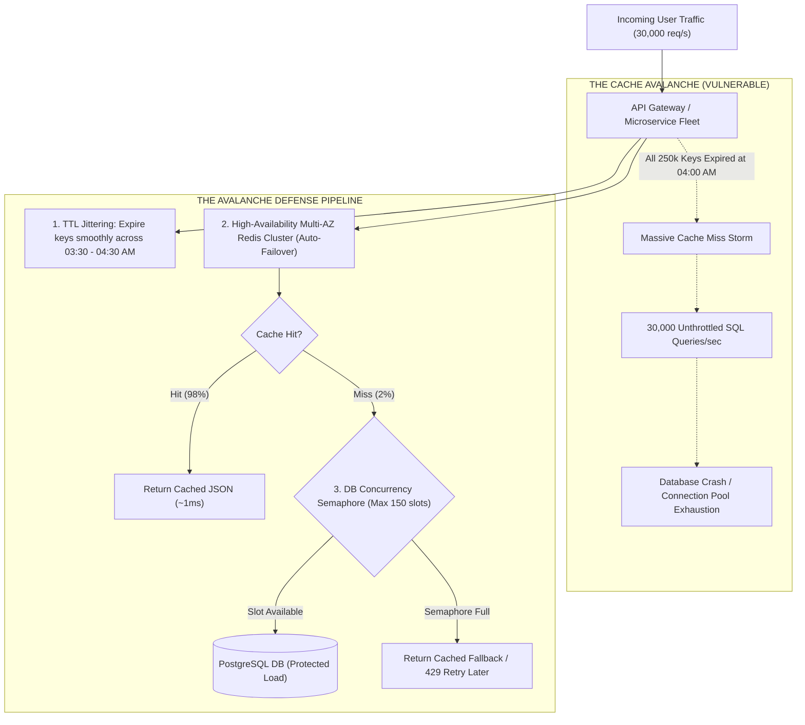

## Fast Revision (10-Second Recall)
A Cache Avalanche occurs when either a massive volume of cached keys expire at the exact same moment, or the entire Redis cluster crashes, causing an avalanche of requests to crash the underlying database. Prevent it by injecting random TTL jitter (Base $\pm 10-20\%$), deploying multi-AZ Redis high-availability clusters with Sentinel/Cluster failover, and using database admission control.

## The 30-Second Spoken Script
> "A Cache Avalanche is a catastrophic system failure where a massive surge of read traffic suddenly bypasses the caching layer and crushes the backend database. This happens in two main scenarios: first, when a large batch of cached keys share the exact same expiration time and expire simultaneously; second, when the Redis cluster itself crashes or experiences a network partition. In both cases, the database—which is typically sized to handle only 5% of read volume—suddenly receives 100% of the traffic, driving CPU to 100% and taking the entire platform down. To prevent a cache avalanche, we employ three architectural defenses: First, we always add randomized TTL jitter (like $\pm 15\%$) to every key so expirations are smoothly distributed over time. Second, we configure multi-AZ Redis high-availability clusters with automated Sentinel failover so single hardware failures do not kill the cache. Third, we place an admission control semaphore in front of the database to shed excess traffic gracefully rather than allowing the database to crash."

## Scenario / Problem Context
An online ticketing platform cached 250,000 concert event listings at midnight with a static 4-hour expiration TTL (`EX 14400`). At exactly 04:00 AM, all 250,000 keys expired in the same second. Early morning European traffic caused 30,000 requests per second to hit MySQL simultaneously. MySQL connection pools exhausted in 4 seconds, queries backed up, and the database crashed, cascading into a 2-hour downtime across all ticketing services.

## Architectural Workflow / Sequence


## Deep-Dive Analysis & Root Causes

### 1. Two Triggers of Cache Avalanche
1. **Simultaneous Key Expiration (Software Trigger)**:
   - Bulk database seeding scripts or cron jobs that write thousands of keys with identical static TTLs (e.g. `EX 3600`).
   - Every key expires at the same second.
2. **Cache Infrastructure Failure (Hardware/Network Trigger)**:
   - Out-of-memory crash, kernel panic, or cloud network partition taking down the Redis primary without a ready replica.
   - 100% of read traffic instantaneously shifts to the database.

### 2. The Multiplier Effect on Relational Databases
Consider an API with:
- Incoming traffic: $20,000\text{ req/sec}$.
- Normal Cache Hit Ratio: $98\%$.
- Normal Database Queries: $20,000 \times 0.02 = 400\text{ queries/sec}$ (easily handled by DB).
- During an Avalanche: Cache Hit Ratio drops to $0\%$.
- Resulting Database Queries: $20,000\text{ queries/sec}$ ($50\times$ surge).
The database queue overflows, query latency spikes from 5 ms to 30,000 ms, connection pools saturate, and applications experience total cascading timeout failures.

### 3. Prevention Pillars
1. **TTL Randomization (Jitter)**: Ensure keys expire across a bell curve rather than a single vertical drop.
2. **High-Availability Redis Architecture**: Multi-AZ replicas, automated failover (Redis Sentinel or AWS ElastiCache Multi-AZ with Auto-Failover).
3. **Database Admission Control (Semaphores / Rate Limiting)**: Cap concurrent database queries during an avalanche so the database processes at its maximum safe throughput while shedding or queuing excess requests.

## Practical Debugging Commands & Code

#### Resilient Cache Manager with Jitter and DB Semaphore (TypeScript)
```typescript
import Redis from 'ioredis';
import { db } from './database';

const redis = new Redis({
  host: process.env.REDIS_HOST,
  port: 6379,
  connectTimeout: 500,
  commandTimeout: 200,
});

// Simple in-memory concurrency semaphore to protect DB
class Semaphore {
  private current = 0;
  constructor(private max: number) {}

  async acquire(): Promise<boolean> {
    if (this.current >= this.max) return false;
    this.current++;
    return true;
  }

  release() {
    this.current = Math.max(0, this.current - 1);
  }
}

// Allow at most 100 concurrent DB queries per pod during an avalanche
const dbSemaphore = new Semaphore(100);

export async function getConcertEvent(eventId: string) {
  const cacheKey = `event:${eventId}`;

  // 1. Check Redis Cache
  try {
    const cached = await redis.get(cacheKey);
    if (cached) {
      return JSON.parse(cached);
    }
  } catch (err) {
    console.error('[Redis Error] Cache read failed; activating avalanche protection:', err);
  }

  // 2. Cache Miss / Redis Failure: Pass through database semaphore
  const acquired = await dbSemaphore.acquire();
  if (!acquired) {
    // Shed load gracefully rather than bringing down DB
    throw new Error('503 Service Unavailable: High database load during cache refresh. Please retry.');
  }

  try {
    // Query Database safely
    const event = await db.concertEvent.findUnique({ where: { id: eventId } });
    if (!event) return null;

    // 3. Store in Redis with JITTERED TTL (e.g. 4 hours +/- 20 minutes)
    const BASE_TTL = 14400; // 4 hours in seconds
    const JITTER_RANGE = 1200; // 20 minutes
    const randomJitter = Math.floor(Math.random() * (JITTER_RANGE * 2 + 1)) - JITTER_RANGE;
    const finalTtl = BASE_TTL + randomJitter; // Expire randomly between 3h40m and 4h20m

    try {
      await redis.set(cacheKey, JSON.stringify(event), 'EX', finalTtl);
    } catch (writeErr) {
      // Non-fatal if Redis is down
    }

    return event;
  } finally {
    dbSemaphore.release();
  }
}
```

#### Simulating and Monitoring Avalanche Recovery
```bash
# Check memory and eviction stats on Redis
redis-cli info memory | grep -E '(used_memory_human|maxmemory_human)'

# Inspect database active connection count on PostgreSQL during load spike
psql -c "SELECT count(*) FROM pg_stat_activity WHERE state = 'active';"
```

## Prevention & Senior Best Practices

### 1. Architectural Guardrails
- **Mandatory TTL Jitter on Batch Ingestion**: Whenever a batch script or worker seeds data into Redis, enforce programmatic jitter:
  $$\text{TTL} = \text{BaseTTL} + \text{Random}(-\Delta, +\Delta)$$
- **Multi-AZ Replication**: Deploy at least 1 primary and 2 replica nodes distributed across distinct availability zones.

### 2. Operational Hardening
- **Database Connection Limits via PgBouncer**: Place a connection pooler like PgBouncer or AWS RDS Proxy between applications and PostgreSQL to absorb connection spikes and queue transactions safely without crashing the database engine.
- **Circuit Breaker on Cache Misses**: If the rate of database fallbacks exceeds 1,000 queries per second, trip a circuit breaker to serve cached stale data or skeleton responses.

