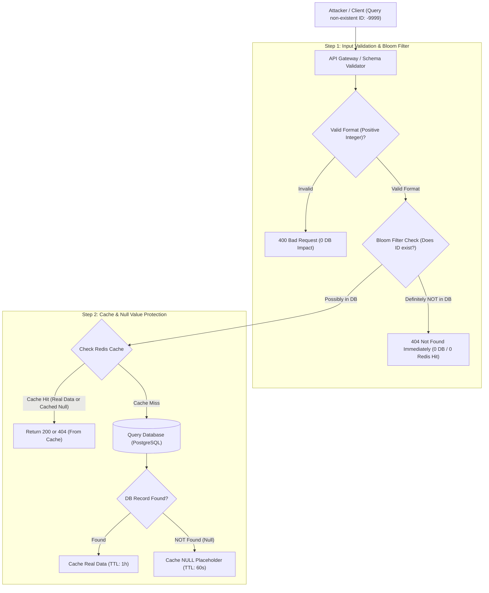

## Fast Revision (10-Second Recall)
Cache Penetration occurs when clients continuously query for keys that do not exist in either the cache or the database (e.g. ID -9999 or random UUIDs), completely bypassing the cache and hitting the database on every request. Prevent it by caching null values with a short TTL, validating input formats aggressively, and deploying probabilistic Bloom Filters in front of the cache.

## The 30-Second Spoken Script
> "Cache Penetration is a vulnerability where malicious actors or misconfigured clients request keys that do not exist anywhere in the system. Because the key does not exist in Redis, it generates a cache miss. The request drops down to the database, which also finds nothing. Because naive implementations only cache real results, nothing is written to Redis, meaning repeated queries for that non-existent key hit the database 100% of the time, easily leading to denial of service. We protect against cache penetration using two standard techniques: First, Null Value Caching—when the database returns null or not found, we store a `null` placeholder in Redis with a short TTL (like 30 to 60 seconds) so subsequent queries return instantly from cache. Second, for large datasets, we place a Bloom Filter in front of the cache. A Bloom Filter uses a compact bit array to determine with 100% certainty if an ID definitely does *not* exist, dropping malicious queries before they ever touch Redis or the database."

## Scenario / Problem Context
An online healthcare portal provides an endpoint `/api/v1/doctors/:id`. A botnet launched a coordinated Layer 7 attack generating 15,000 requests per second with random non-existent numeric IDs (e.g. `id=-48291`, `id=999999999`). Because these doctor IDs did not exist in PostgreSQL, the API never cached anything in Redis. Every single request executed `SELECT * FROM doctors WHERE id = ?` on the database, exhausting connection pools and causing an outage for legitimate patients.

## Architectural Workflow / Sequence


## Deep-Dive Analysis & Root Causes

### 1. Cache Penetration vs Stampede vs Avalanche
- **Cache Penetration**: The requested data does *not* exist in DB. Every request bypasses cache and hits DB.
- **Cache Stampede (Thundering Herd)**: The data *does* exist in DB, but the hot cache key expired and thousands query it simultaneously.
- **Cache Avalanche**: A massive quantity of distinct keys expire at the *exact same time*, overwhelming the database.

### 2. Defense Mechanism 1: Caching Null Values
When the database returns `null` (record not found):
- Write `key: JSON.stringify(null)` to Redis with a short TTL (e.g. 30 to 60 seconds).
- Subsequent identical invalid requests hit Redis and return `404 Not Found` in under 1 ms.
- *Caveat*: If an attacker uses completely randomized IDs (`id_1`, `id_2`, `id_3`...), caching nulls can consume significant Redis RAM. This is why Bloom Filters are necessary.

### 3. Defense Mechanism 2: Bloom Filters
A **Bloom Filter** is a space-efficient probabilistic data structure based on bit arrays and multiple hash functions:
- If the filter returns **false**: The element is **100% guaranteed not to exist**.
- If the filter returns **true**: The element **probably exists** (with a tiny, tunable false positive rate, e.g. 1%).
- A Bloom filter with 10 million items and a 1% error rate requires only **12 MB** of memory!
- Flow: Query Bloom Filter $\rightarrow$ If false, return 404 immediately. If true, query Redis and DB.

## Practical Debugging Commands & Code

#### Bloom Filter and Null-Caching Implementation (TypeScript & Redis)
```typescript
import Redis from 'ioredis';
import { BloomFilter } from 'bloomfilter';
import { db } from './database';

const redis = new Redis();

// Initialize Bloom Filter with 1,000,000 expected IDs, 1% false positive rate (approx 9.6M bits, 7 hashes)
const bloom = new BloomFilter(9600000, 7);

// Function to populate Bloom Filter on service startup
export async function initializeBloomFilter() {
  const allDoctorIds = await db.doctor.findMany({ select: { id: true } });
  for (const doc of allDoctorIds) {
    bloom.add(doc.id.toString());
  }
  console.log(`[Bloom Filter] Seeded ${allDoctorIds.length} valid doctor IDs into memory.`);
}

export async function getDoctorById(idParam: string) {
  // 1. Syntactic Schema Validation: Reject obvious junk
  const doctorId = parseInt(idParam, 10);
  if (isNaN(doctorId) || doctorId <= 0) {
    throw new Error('Invalid Doctor ID format');
  }

  const cacheKey = `doctor:${doctorId}`;

  // 2. Bloom Filter Check: Eliminate 99% of non-existent queries instantly
  if (!bloom.test(doctorId.toString())) {
    console.log(`[Bloom Filter Block] ID ${doctorId} definitely does not exist.`);
    return null; // Return 404 immediately; zero Redis or DB overhead!
  }

  // 3. Check Redis Cache
  const cached = await redis.get(cacheKey);
  if (cached !== null) {
    const parsed = JSON.parse(cached);
    if (parsed === '__NULL_MARKER__') {
      return null; // Cached negative response
    }
    return parsed;
  }

  // 4. Query Database
  const doctor = await db.doctor.findUnique({ where: { id: doctorId } });

  if (!doctor) {
    // Null Caching: Cache negative result with short 60s TTL to protect DB
    await redis.set(cacheKey, JSON.stringify('__NULL_MARKER__'), 'EX', 60);
    return null;
  }

  // Cache legitimate record with 1 hour TTL
  await redis.set(cacheKey, JSON.stringify(doctor), 'EX', 3600);
  return doctor;
}
```

#### Redis Bloom Module (RedisBloom) CLI Usage
```bash
# Using native RedisBloom module if installed on Redis server
# 1. Create a bloom filter with 0.01 error rate and 1M capacity
redis-cli BF.RESERVE doctors_bloom 0.01 1000000

# 2. Add an item
redis-cli BF.ADD doctors_bloom "doc_101"

# 3. Check existence (returns 1 for probably exists, 0 for definitely not)
redis-cli BF.EXISTS doctors_bloom "doc_999999"
```

## Prevention & Senior Best Practices

### 1. Architectural Guardrails
- **Strict Ingress Schema Validation**: Use schema libraries (Zod, Joi) at the API Gateway to enforce UUID or positive integer regexes, discarding malformed strings before they reach business logic.
- **Short TTL on Null Markers**: Never set long TTLs on cached nulls (keep between 30 and 120 seconds). If an entity is created immediately after being queried, a long null TTL causes the user to see "not found" for hours.

### 2. Operational Hardening
- **Add to Bloom Filter on Insert**: When a new record is created in the database, immediately add its ID to the in-memory or Redis Bloom Filter (`bloom.add(newRecord.id)`).
- **Monitor Null Cache Ratio**: Track Prometheus metrics on the proportion of cache hits that resolve to null markers to detect automated enumeration scanners.

