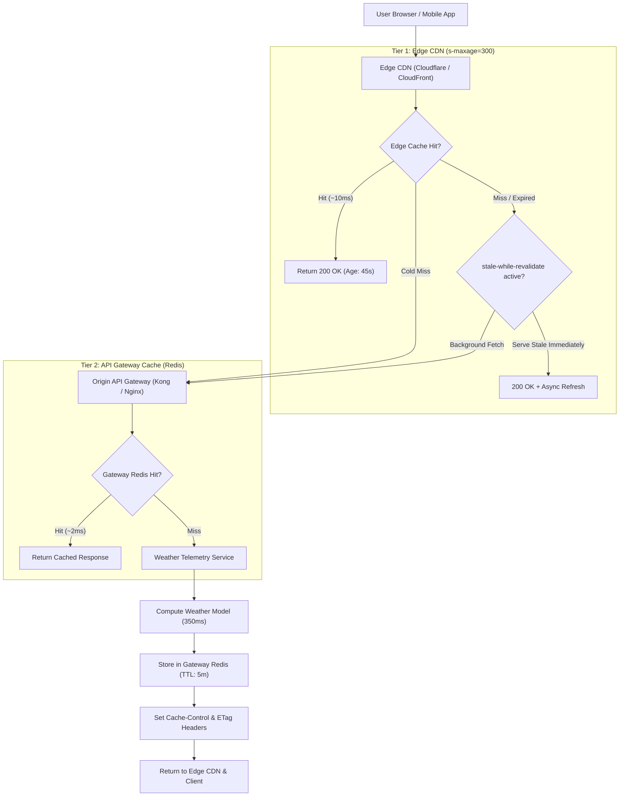

## Fast Revision (10-Second Recall)
Cache API responses across three tiers: Edge CDNs (Cloudflare/CloudFront) for public anonymous endpoints, API Gateways (Kong/API Gateway) for shared service responses, and client-side browsers using HTTP headers. Leverage `Cache-Control`, conditional `ETag` validation (304 Not Modified), and `stale-while-revalidate` for background refreshes.

## The 30-Second Spoken Script
> "Caching API responses effectively requires distinguishing between public anonymous data, shared tenant data, and private user-specific data. For public read endpoints like product catalogs or weather feeds, our primary tier is Edge CDN caching using HTTP headers like `Cache-Control: public, s-maxage=3600, stale-while-revalidate=60`. This serves 95% of traffic directly from edge data centers closest to the user, with sub-10ms latency and zero origin server load. For dynamic responses where full caching is risky, we use conditional requests with `ETags`: the client sends `If-None-Match`, and if the payload hasn't changed, the origin returns `304 Not Modified` with zero body payload. For authenticated or semi-dynamic data that shouldn't live on public CDNs, we cache pre-computed JSON responses inside an API Gateway Redis layer keyed by the HTTP method, route, and authorized tenant ID."

## Scenario / Problem Context
A weather telemetry platform provides an endpoint `GET /api/v1/forecast?city=Seattle`. The endpoint receives 80,000 requests per second globally. The meteorological backend takes 350 ms to compute complex weather models. Running this compute for every request requires 200 compute nodes costing $40,000 monthly. The team must design a multi-tier API response caching architecture to slash compute costs while serving global users in under 20 ms.

## Architectural Workflow / Sequence


## Deep-Dive Analysis & Root Causes

### 1. The Anatomy of Modern HTTP Caching Headers
- **`public` vs `private`**:
  - `public`: Any intermediary (CDN, proxy, ISP) can cache the response.
  - `private`: Only the end-user's browser can cache it (required for personal account data).
- **`max-age` vs `s-maxage`**:
  - `max-age=60`: Browser caches for 60 seconds.
  - `s-maxage=3600`: Shared proxies and CDNs cache for 1 hour, overriding `max-age`.
- **`stale-while-revalidate=120`**:
  - When the cache key expires, the CDN immediately serves the stale response to incoming requests while asynchronously fetching the updated version from the origin in the background. Users never experience origin latency spikes!

### 2. Conditional Requests via ETags
When data changes unpredictably:
1. Server returns `ETag: "hash_xyz"` with full JSON body.
2. Subsequent client request sends header `If-None-Match: "hash_xyz"`.
3. Origin computes payload hash or checks entity version in Redis:
   - If hash matches: return **`304 Not Modified`** with empty body!
   - Saves 98% of network bandwidth and serialization time.

### 3. API Gateway Response Caching (Fingerprinting)
For APIs where CDNs cannot be used (e.g. internal service-to-service calls or authenticated routes):
- Key formula:
  $$\text{CacheKey} = \text{MD5}(\text{HTTP\\_METHOD} + \text{PATH} + \text{SORTED\\_QUERY\\_PARAMS} + \text{TENANT\\_ID})$$
- Gateways like Kong or Nginx store the raw serialized HTTP response (status, headers, body) in Redis and short-circuit incoming requests before they touch application servers.

## Practical Debugging Commands & Code

#### Express Middleware for ETag and Edge Cache-Control Headers
```typescript
import { Request, Response, NextFunction } from 'express';
import crypto from 'crypto';

export function edgeCache(sMaxAgeSeconds = 300, swrSeconds = 60) {
  return (req: Request, res: Response, next: NextFunction) => {
    // Only cache safe GET and HEAD requests
    if (!['GET', 'HEAD'].includes(req.method)) {
      return next();
    }

    // Set modern CDN caching headers
    res.setHeader(
      'Cache-Control',
      `public, max-age=60, s-maxage=${sMaxAgeSeconds}, stale-while-revalidate=${swrSeconds}`
    );

    // Intercept res.json to compute ETag dynamically
    const originalJson = res.json;
    res.json = function (body) {
      const serialized = JSON.stringify(body);
      const etag = `"${crypto.createHash('md5').update(serialized).digest('hex')}"`;

      res.setHeader('ETag', etag);

      // Check conditional If-None-Match header from client
      if (req.headers['if-none-match'] === etag) {
        // Data has not changed! Return 304 without body
        return res.status(304).end();
      }

      return originalJson.call(this, body);
    };

    next();
  };
}
```

#### API Gateway Redis Response Cache Middleware
```typescript
import { Request, Response, NextFunction } from 'express';
import Redis from 'ioredis';

const redis = new Redis();

export async function apiGatewayResponseCache(req: Request, res: Response, next: NextFunction) {
  if (req.method !== 'GET') return next();

  // Create deterministic cache key
  const queryParams = new URLSearchParams(req.query as any).toString();
  const cacheKey = `api_cache:${req.path}?${queryParams}`;

  const cached = await redis.get(cacheKey);
  if (cached) {
    const { status, headers, body } = JSON.parse(cached);
    res.set(headers);
    res.setHeader('X-Cache-Status', 'GATEWAY_HIT');
    return res.status(status).send(body);
  }

  // Intercept response to store in Redis
  const originalSend = res.send;
  res.send = function (body) {
    if (res.statusCode === 200) {
      const payload = {
        status: res.statusCode,
        headers: { 'Content-Type': res.getHeader('Content-Type') },
        body,
      };
      // Store in Redis with 5-minute TTL
      redis.set(cacheKey, JSON.stringify(payload), 'EX', 300);
    }
    res.setHeader('X-Cache-Status', 'GATEWAY_MISS');
    return originalSend.apply(res, arguments as any);
  };

  next();
}
```

#### Inspecting Response Cache Headers with cURL
```bash
# Send conditional GET with ETag
curl -i -H 'If-None-Match: "a1b2c3d4e5f6"' https://api.weather.com/v1/forecast?city=Seattle

# Verify HTTP Response:
# HTTP/2 304 Not Modified
# ETag: "a1b2c3d4e5f6"
# Cache-Control: public, max-age=60, s-maxage=300, stale-while-revalidate=60
```

## Prevention & Senior Best Practices

### 1. Architectural Guardrails
- **Never Cache Authenticated Data Publicly**: If an endpoint inspects `Authorization` or `Cookie` headers, never return `Cache-Control: public`. Intermediary proxies will cache user A's private data and serve it to user B (severe privacy breach).
- **Vary Header Best Practice**: Always set `Vary: Accept-Encoding, Origin` so CDNs do not serve gzipped responses to clients that don't support it, or leak CORS origin headers.

### 2. Operational Hardening
- **Automate CDN Cache Invalidation**: Integrate CDN purge APIs (Cloudflare API / AWS CloudFront Invalidation) into administrative publishing tools so marketing or content teams can flush edge URLs in under 5 seconds.
- **Track Cache Offload Percentage**: Monitor CloudFront/Cloudflare metrics to verify that total edge cache hit ratio stays above 90% for public read endpoints.

