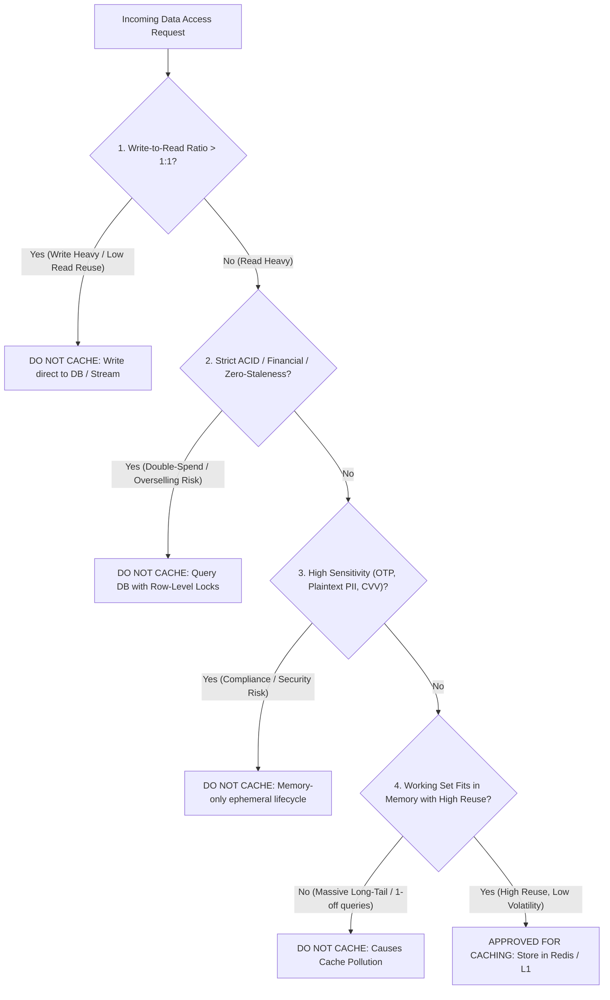

## Fast Revision (10-Second Recall)
Never cache highly volatile data where write rates exceed read rates, single-use authentication tokens (MFA/nonces), strictly consistent financial ledger balances, sensitive unencrypted PII/PCI-DSS data, or unbounded query results with low access frequencies (cache pollution).

## The 30-Second Spoken Script
> "While caching is a powerful optimization, applying it indiscriminately leads to severe data inconsistency, memory bloat, and compliance violations. We enforce a strict four-question framework to decide whether data should *never* be cached: First, is the write rate higher than the read rate? For IoT sensor telemetry or write-intensive logs where data is written once and rarely read, caching wastes expensive memory with near-zero hit ratios. Second, is absolute strong consistency required? In banking ledgers, stock trade executions, or concert seat reservation locks, even a 50 ms stale read can cause catastrophic double-spending or overselling. Third, is the data sensitive or ephemeral? Single-use OTPs, MFA codes, cryptographic nonces, and unencrypted credit card details must never sit in shared caches where memory dumps could expose them. Finally, is the access pattern long-tail? Caching millions of obscure, one-off search queries causes cache pollution, evicting truly valuable hot data."

## Scenario / Problem Context
A fintech platform cached user account balances and checkout inventory locks in Redis to achieve high benchmark scores. During an iPhone flash sale, two concurrent buyers read the cached inventory count of 1. Both were allowed to purchase the last phone, resulting in severe overselling. Concurrently, security auditors discovered unencrypted credit card numbers and single-use SMS OTP codes lingering in Redis dumps. The engineering team must establish rigorous architectural criteria for non-cacheable data.

## Architectural Workflow / Sequence


## Deep-Dive Analysis & Root Causes

### 1. The Five Categories of Data That Must Never Be Cached
1. **Financial Ledgers & Inventory Reservations**:
   - Double-spending risk. If Account A transfers $500, a cached balance of $1,000 read by a concurrent thread permits a second unauthorized withdrawal.
   - Requires `SELECT ... FOR UPDATE` row-level locks on the primary database.
2. **Ephemeral Security Primitives**:
   - One-Time Passwords (OTP), MFA challenges, cryptographic nonces, password reset tokens.
   - Storing these in long-lived or unencrypted caches violates PCI-DSS, SOC 2, and HIPAA regulations.
3. **Data with Write-to-Read Ratio > 1**:
   - If a record updates 10 times a second but is read once a minute:
     - 9 out of 10 cache writes are completely wasted.
     - Causes constant CPU churn serializing and deserializing JSON that no client ever reads.
4. **Unbounded Long-Tail Queries (Cache Pollution)**:
   - Full-text search queries like `"vintage wooden desk 1974 blue"` are almost never repeated by another user.
   - Caching long-tail search results fills Redis memory with garbage, forcing the LRU eviction policy to evict truly hot keys (e.g. site navigation or user profiles).
5. **Legally Protected PII (GDPR / Right to be Forgotten)**:
   - If a user invokes their GDPR "Right to Erasure", the company must purge all records within 30 days. If user records are scattered across dozens of distributed caches with complex keys, complying becomes an audit nightmare.

### 2. Cache Hit Ratio Economics
Memory in Redis or Memcached is expensive compared to SSD storage.
$$\text{Efficiency} = \frac{\text{Cache Hits}}{\text{Total Allocations}}$$
If a dataset maintains a cache hit ratio below 30%, the caching layer actually *degrades* overall system latency:
- Request latency = Redis Miss Latency (1-2 ms) + Database Query Latency (15 ms) = 17 ms.
- Direct Database Query = 15 ms.
- Caching low-reuse data slows down requests and wastes expensive RAM!

## Practical Debugging Commands & Code

#### Explicit Caching Policy Filter (TypeScript)
```typescript
interface CachePolicyDecision {
  shouldCache: boolean;
  reason: string;
}

export function evaluateCachePolicy(
  entityType: string,
  isSensitive: boolean,
  estimatedReadToWriteRatio: number
): CachePolicyDecision {
  // 1. Security Check: Never cache sensitive security tokens
  if (['mfa_token', 'password_reset', 'credit_card', 'ssn'].includes(entityType) || isSensitive) {
    return { shouldCache: false, reason: 'Security policy: Sensitive / single-use credentials must never be cached' };
  }

  // 2. Financial Consistency Check: Never cache inventory locks or ledger state
  if (['wallet_balance', 'inventory_lock', 'order_transaction'].includes(entityType)) {
    return { shouldCache: false, reason: 'Consistency policy: Financial state requires strict ACID database locking' };
  }

  // 3. Volatility Check: Never cache write-dominated entities
  if (estimatedReadToWriteRatio < 2.0) {
    return { shouldCache: false, reason: 'Efficiency policy: Write frequency exceeds read reuse ratio' };
  }

  return { shouldCache: true, reason: 'Approved for caching' };
}
```

#### Enforcing No-Cache Directives at Controller Layer
```typescript
import { Request, Response } from 'express';

export async function getAccountBalanceHandler(req: Request, res: Response) {
  // CRITICAL: Prevent browser and CDN intermediaries from ever caching balance
  res.setHeader('Cache-Control', 'no-store, no-cache, must-revalidate, proxy-revalidate');
  res.setHeader('Pragma', 'no-cache');
  res.setHeader('Expires', '0');

  // Query database primary directly with strict isolation
  const balance = await fetchLiveBalanceFromPrimary(req.user.id);
  return res.json({ balance });
}
```

## Prevention & Senior Best Practices

### 1. Architectural Guardrails
- **Automated Cache Bypass Headers**: Support `X-Bypass-Cache: true` in internal service frameworks (restricted to internal admin/debug roles) to facilitate testing against live database states.
- **Set `Cache-Control: no-store` on All Mutation & Financial Endpoints**: Ensure edge CDNs and web clients are explicitly forbidden from caching mutative, financial, or personal account responses.

### 2. Operational Hardening
- **Audit Redis Keys for Sensitive Data**: Schedule automated vulnerability sweeps (using scripts or tools like AWS Macie) to verify that Redis contains zero credit card or plain password hashes.
- **Track Cache Hit Ratio by Namespace**: Break down Prometheus metrics: `cache_hit_ratio{namespace="search"}` vs `cache_hit_ratio{namespace="catalog"}`. Immediately decommission caching for any namespace falling below 40% hit efficiency.

