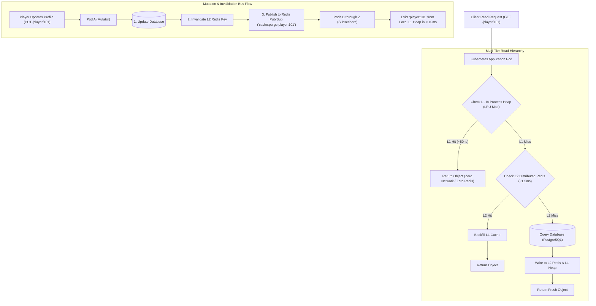

## Fast Revision (10-Second Recall)
Multi-tier caching combines the ultra-low nanosecond speed of local in-process memory (L1 heap cache) with the cross-pod consistency of a centralized distributed cache (L2 Redis). Solve the multi-node inconsistency challenge by broadcasting L1 invalidation messages across all pods using a Redis Pub/Sub or Kafka invalidation bus whenever data mutates.

## The 30-Second Spoken Script
> "At extreme scale—handling hundreds of thousands of requests per second—even a distributed Redis cluster can become a network bottleneck, saturating network interfaces and incurring 1 to 2 milliseconds of latency per call. The industry solution is a Multi-Tier Caching Architecture. Tier 1 (L1) is an in-process, memory-bounded LRU cache living directly on the application container's heap, providing near-instantaneous microsecond responses with zero network serialization. Tier 2 (L2) is a distributed Redis cluster acting as the shared source of truth across all 50 or 100 container pods. When a read arrives, the app checks L1 first; on a miss, it checks L2; on a secondary miss, it queries the database and backfills both tiers. The core architectural challenge is L1 cache drift across pods: when Pod A updates a record, Pods B through Z must not serve stale data. We solve this by broadcasting an invalidation event over a Redis Pub/Sub channel, prompting all pods to evict the key from their local L1 memory within milliseconds."

## Scenario / Problem Context
A gaming platform serves 500,000 real-time player profile reads per second across 80 Kubernetes pods. While Redis handles the load, the Redis cluster network bandwidth reached 95% saturation (over 8 Gbps of traffic), and Redis CPU hit 88%, causing tail latencies to spike from 1 ms to 45 ms. The engineering team must implement a multi-tier L1/L2 caching topology to reduce Redis network traffic by 80% while ensuring strong data consistency across all 80 pods.

## Architectural Workflow / Sequence


## Deep-Dive Analysis & Root Causes

### 1. Why Single-Tier Redis Reaches Physical Limits
At 500,000 reads/sec with a 2 KB average JSON payload:
$$\text{Egress Bandwidth} = 500,000 \times 2\text{ KB} = 1,000,000\text{ KB/sec} \approx 1\text{ GB/sec} = 8\text{ Gbps}$$
Single AWS EC2 or ElastiCache node network cards become saturated. Adding more Redis cluster shards adds cost and operational complexity.
By placing a small local L1 cache on each pod that absorbs **80% of repeat reads**, Redis network traffic plummets from 8 Gbps to 1.6 Gbps.

### 2. The Invalidation Bus Architecture
How to keep 80 isolated pods synchronized:
1. Every pod runs a lightweight Redis Pub/Sub listener on startup:
   ```typescript
   subRedis.subscribe('l1:invalidation:channel');
   ```
2. When any pod performs a database write:
   - It updates the database.
   - It evicts the key from L2 Redis (`DEL key`).
   - It publishes the key name to the channel: `PUBLISH l1:invalidation:channel "player:101"`.
3. All 80 pods receive the message in under 10 milliseconds and call `l1Cache.delete("player:101")`.

### 3. Graceful Degradation on Invalidation Bus Disconnect
What if a pod temporarily loses connection to Redis Pub/Sub?
- It might miss invalidation broadcasts and serve stale data.
- **Safety Rule**: Keep L1 TTLs short (e.g. 15 to 60 seconds). Even if an invalidation message is dropped by the network, stale data survives for at most 60 seconds.

## Practical Debugging Commands & Code

#### Enterprise Multi-Tier Cache Manager with Pub/Sub (TypeScript)
```typescript
import { LRUCache } from 'lru-cache';
import Redis from 'ioredis';
import { db } from './database';

const redis = new Redis();
const subRedis = new Redis(); // Dedicated connection for Pub/Sub listener

const INVALIDATION_CHANNEL = 'l1:invalidation:events';

// Tier 1: In-process heap cache (max 10,000 items, short 60s TTL)
const l1Cache = new LRUCache<string, any>({
  max: 10000,
  ttl: 1000 * 60, // 60 seconds safety TTL
});

// Subscribe to invalidation channel on pod startup
subRedis.subscribe(INVALIDATION_CHANNEL, (err) => {
  if (err) console.error('Failed to subscribe to invalidation bus:', err);
  else console.log('[Multi-Tier] Subscribed to L1 invalidation bus.');
});

subRedis.on('message', (channel, keyToEvict) => {
  if (channel === INVALIDATION_CHANNEL) {
    l1Cache.delete(keyToEvict);
    console.log(`[L1 Bus] Evicted local key: ${keyToEvict}`);
  }
});

export class MultiTierCache {
  // Read Path
  static async get<T>(key: string, fetchDb: () => Promise<T>): Promise<T> {
    // 1. Check L1 Heap Cache (Nanoseconds)
    const l1Hit = l1Cache.get(key);
    if (l1Hit !== undefined) {
      return l1Hit as T;
    }

    // 2. Check L2 Distributed Redis (1-2 ms)
    const l2Raw = await redis.get(key);
    if (l2Raw) {
      const parsed = JSON.parse(l2Raw);
      l1Cache.set(key, parsed); // Backfill L1
      return parsed as T;
    }

    // 3. Fallback to Database
    const freshData = await fetchDb();
    if (freshData !== null) {
      // Store in L2 Redis with 1 hour TTL
      await redis.set(key, JSON.stringify(freshData), 'EX', 3600);
      // Store in L1 Heap with 60s TTL
      l1Cache.set(key, freshData);
    }

    return freshData;
  }

  // Write Path: Coordinates DB, L2 eviction, and L1 cross-pod broadcast
  static async mutate<T>(key: string, dbMutation: () => Promise<T>): Promise<T> {
    // Step 1: Execute Database Mutation
    const result = await dbMutation();

    // Step 2: Delete L2 Redis key
    await redis.del(key);

    // Step 3: Evict own L1 cache immediately
    l1Cache.delete(key);

    // Step 4: Broadcast invalidation to all other pods via Pub/Sub bus
    await redis.publish(INVALIDATION_CHANNEL, key);

    return result;
  }
}
```

#### Monitoring Pub/Sub Channels and Active Subscribers
```bash
# Check number of active subscribers listening on the invalidation channel
redis-cli pubsub numsub l1:invalidation:events

# Publish a test eviction event manually
redis-cli publish l1:invalidation:events "player:test_123"
```

## Prevention & Senior Best Practices

### 1. Architectural Guardrails
- **Strict Size Limits on L1**: Always configure `max` item limits on local LRU caches to prevent memory leaks. A single pod should not allocate more than 20% of its available heap to L1 caching.
- **Circuit Breaker on Pub/Sub Reconnect**: If a pod's Redis subscription socket drops, flush its entire local L1 cache (`l1Cache.clear()`) upon reconnect to guarantee no stale mutations occurred during the disconnect window.

### 2. Operational Hardening
- **Track L1 vs L2 Hit Ratios**: Instrument separate Prometheus metrics: `cache_hits_total{tier="L1"}` and `cache_hits_total{tier="L2"}`. Target 70-80% of reads served by L1, eliminating Redis network saturation.
- **Use Efficient Binary Serialization**: For ultra-high throughput, serialize cached objects using Protocol Buffers or MessagePack rather than JSON to reduce RAM footprint and CPU parsing overhead by 50%.

