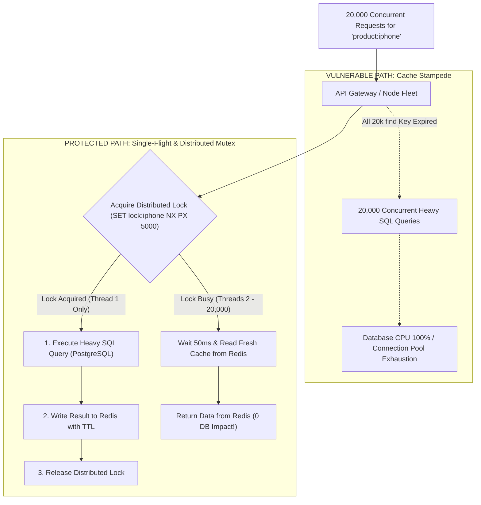

## Fast Revision (10-Second Recall)
A cache stampede (thundering herd / dog-piling) happens when a high-traffic cache key expires, causing hundreds of concurrent requests to discover a cache miss simultaneously and hammer the database with identical queries. Prevent it using Single-Flight in-flight request deduplication, distributed mutex locks (Redis SETNX), or Probabilistic Early Expiration (XFetch).

## The 30-Second Spoken Script
> "A cache stampede occurs when an intensely popular cache key—such as the homepage catalog or a celebrity's profile—expires during peak traffic. If an endpoint receives 5,000 requests per second for that key, the moment the TTL expires, all 5,000 concurrent threads discover a cache miss at the exact same millisecond. Each thread independently executes the expensive database query, creating a massive spike in database connections and CPU that can crash the database cluster. We resolve this using three complementary techniques: In-memory Single-Flight coalescing within a single process to ensure only one thread queries the database while others wait; distributed mutex locks using Redis `SET key token NX PX 5000` to coordinate across multiple container pods; or Probabilistic Early Expiration (the XFetch algorithm), which re-computes and refreshes the key in the background before the TTL ever reaches zero."

## Scenario / Problem Context
During a national flash sale, a popular smartphone product page receives 20,000 requests per second. The product details were cached with a 10-minute TTL. At 12:10 PM, the key expired. In less than 500 ms, 8,000 concurrent Node.js processes attempted to execute an intensive 14-table join on PostgreSQL. PostgreSQL connection pools filled immediately, queries queued past timeout limits, and the entire checkout platform became unresponsive.

## Architectural Workflow / Sequence


## Deep-Dive Analysis & Root Causes

### 1. Anatomy of the Thundering Herd
The mathematical likelihood of a cache stampede is proportional to the read frequency ($R$) and database query latency ($L$):
$$\text{Simultaneous DB Hits} \approx R \times L$$
If an endpoint receives $R = 5,000\text{ req/sec}$ and the database query takes $L = 0.4\text{ seconds}$ to execute:
$$\text{Concurrent Queries} = 5,000 \times 0.4 = 2,000\text{ simultaneous heavy queries}$$
No standard production database can absorb 2,000 simultaneous 14-table joins without degrading.

### 2. Solution 1: Distributed Mutex (Redis SETNX)
Only the thread that acquires the lock queries the database:
1. Thread discovers cache miss for key $K$.
2. Attempt to acquire lock: `SET lock:K token NX PX 5000` (expires in 5s to prevent deadlocks).
3. If lock acquired: query DB, populate cache, release lock.
4. If lock denied: sleep for 50-100 ms and re-read $K$ from Redis. The first thread will have populated the cache by then.

### 3. Solution 2: In-Process Single-Flight Coalescing
Before even touching Redis distributed locks:
- In Go (`golang.org/x/sync/singleflight`) or Node.js promise memoization:
- If 100 requests arrive at *Node Pod 1* for the same key, Single-Flight deduplicates them into a single shared promise.
- Only 1 request leaves the pod.

### 4. Solution 3: Probabilistic Early Expiration (XFetch)
Never let the key expire in the first place:
- As the key ages toward its expiration deadline, calculate a probabilistic threshold.
- A background worker re-fetches the database and extends the TTL *before* the key expires.
- Zero user requests ever experience a cache miss.

## Practical Debugging Commands & Code

#### Distributed Mutex Cache-Aside Implementation (TypeScript & Redis)
```typescript
import Redis from 'ioredis';
import crypto from 'crypto';
import { db } from './database';

const redis = new Redis();

export async function fetchWithStampedeProtection<T>(
  cacheKey: string,
  fetchFn: () => Promise<T>,
  ttlSeconds = 600
): Promise<T> {
  // 1. Check cache first
  const cached = await redis.get(cacheKey);
  if (cached) {
    return JSON.parse(cached) as T;
  }

  const lockKey = `lock:${cacheKey}`;
  const lockToken = crypto.randomUUID();
  const lockTtlMs = 5000; // 5 second lock safety timeout

  // 2. Attempt to acquire distributed lock atomically via NX
  const acquired = await redis.set(lockKey, lockToken, 'PX', lockTtlMs, 'NX');

  if (acquired === 'OK') {
    try {
      // Sole Winner: Query DB and populate cache
      console.log(`[Stampede Defense] Lock acquired for ${cacheKey}. Querying DB.`);
      const freshData = await fetchFn();
      await redis.set(cacheKey, JSON.stringify(freshData), 'EX', ttlSeconds);
      return freshData;
    } finally {
      // Safe lock release via Lua script (verifies token ownership)
      const releaseLua = `
        if redis.call("get", KEYS[1]) == ARGV[1] then
          return redis.call("del", KEYS[1])
        else
          return 0
        end
      `;
      await redis.eval(releaseLua, 1, lockKey, lockToken);
    }
  } else {
    // 3. Other callers: Wait briefly and retry reading from cache
    console.log(`[Stampede Defense] Lock busy for ${cacheKey}. Waiting for winner.`);
    await new Promise((resolve) => setTimeout(resolve, 60)); // Sleep 60ms

    // Re-check cache after winner populated it
    const recheck = await redis.get(cacheKey);
    if (recheck) {
      return JSON.parse(recheck) as T;
    }

    // Fallback: If still not ready, call DB directly as a last resort
    return fetchFn();
  }
}
```

#### Monitoring Stampede Spikes on PostgreSQL
```sql
-- Check for identical running queries piling up on PostgreSQL during a stampede
SELECT pid, age(clock_timestamp(), query_start), usename, state, query 
FROM pg_stat_activity 
WHERE query ILIKE '%products%' AND state != 'idle'
ORDER BY query_start ASC;
```

## Prevention & Senior Best Practices

### 1. Architectural Guardrails
- **Pre-Warm Hot Caches Before Major Events**: For scheduled flash sales or product drops, pre-warm caches using automated cron scripts 15 minutes before the public event goes live.
- **Set Safe Lock Expirations**: Always attach a lease time (`PX 5000`) to distributed locks so that if the winning thread crashes mid-query, the lock naturally expires and does not deadlock all future reads.

### 2. Operational Hardening
- **Alert on Cache Miss Surges**: Create Datadog/Prometheus alerts that trigger when the cache miss rate on high-priority keys exceeds 50 misses per second.
- **Implement Read-Through Microservice Proxies**: For ultra-hot master catalogs, place an intermediate caching proxy (e.g. Envoy or local Go sidecar) in front of the data layer to coalesce queries at the network ingress level.

