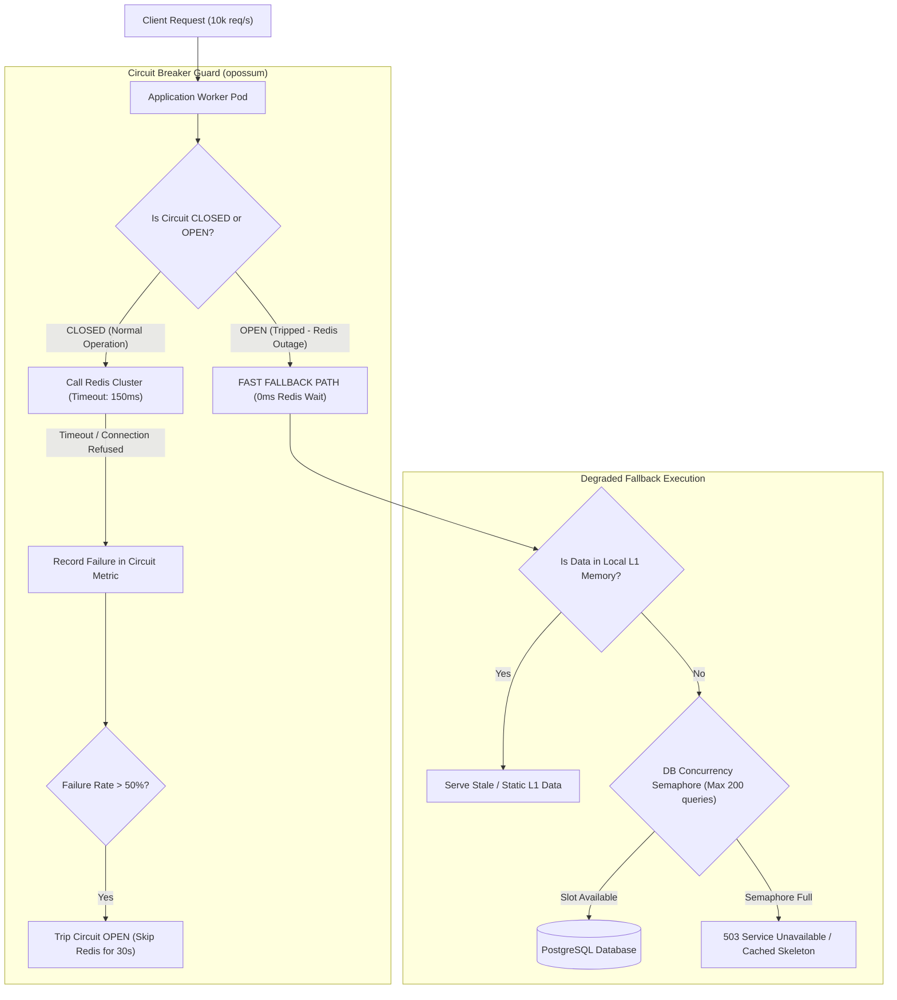

## Fast Revision (10-Second Recall)
When Redis goes down, a naive system crashes due to connection timeouts or crushes the database with 100% cache-miss traffic. Defend against outages using Circuit Breakers, aggressive connection timeouts (under 200 ms), fail-soft degradation (serving stale L1 data or reduced features), rate limiting to protect the database, and multi-AZ Redis Sentinel or Cluster auto-failover.

## The 30-Second Spoken Script
> "When Redis goes down, the impact depends entirely on whether your architecture treats the cache as a critical dependency or a performance optimization. In poorly architected systems, when Redis becomes unreachable, threads hang for 10 to 30 seconds waiting for connection timeouts, saturating application thread pools and crashing the API. If the code simply catches the error and queries the database, 100% of traffic instantly shifts to the database, causing a secondary catastrophic database outage. In our resilient architecture, we enforce three lines of defense: First, strict, sub-second Redis connection and command timeouts (like 150 ms) to prevent thread starvation. Second, an automated Circuit Breaker pattern (using Netflix Hystrix or opossum): when Redis failure rates spike above 50%, the circuit trips OPEN, immediately skipping Redis calls. Third, defensive load shedding and local in-memory fallback degradation, allowing the application to serve essential responses while protecting the primary database from collapse until Redis Sentinel promotes a replica."

## Scenario / Problem Context
A Redis cluster hosted on AWS ElastiCache experienced an unexpected network partition, rendering the primary node unreachable for 4 minutes before failover completed. Because the backend application had a default 10-second socket timeout and no circuit breaker, 25,000 incoming requests per second queued up, consuming all Node.js and Go worker threads. Concurrently, workers that timed out on Redis fell back to MySQL, causing MySQL CPU to hit 100% and taking the entire platform down for 45 minutes.

## Architectural Workflow / Sequence


## Deep-Dive Analysis & Root Causes

### 1. Two Killers During a Cache Outage
1. **Thread Pool Exhaustion (Latency Contagion)**:
   - Default Redis client timeouts are often infinite or set to 10-30 seconds.
   - When Redis freezes, all application threads freeze waiting for a TCP FIN or RST that never arrives.
2. **Database Overload (The Waterfall Collapse)**:
   - If Redis normally absorbs 95% of read volume, a Redis outage increases database traffic by **$20\times$** overnight.
   - No relational database sized for normal operations can withstand a $20\times$ load spike without queuing.

### 2. High-Availability Topologies: Sentinel vs Cluster
- **Redis Sentinel**: Provides automated monitoring and failover for primary/replica setups. Failover time is typically 3 to 10 seconds.
- **Redis Cluster**: Shards data across multiple master nodes using 16,384 hash slots. If one master fails, its replica automatically promotes within 2 to 5 seconds without full cluster downtime.

### 3. Graceful Degradation Strategies
When the circuit breaker trips OPEN:
- **Degraded Mode**: Disable expensive features (e.g. personalized recommendations, dynamic trending widgets).
- **Serve Stale from L1**: Serve data from an in-process heap cache with a relaxed TTL.
- **Concurrency Limiting (Admission Control)**: Use a token bucket or semaphore to cap the number of concurrent database queries during an active cache outage.

## Practical Debugging Commands & Code

#### Resilient Redis Client with Circuit Breaker (TypeScript & Opossum)
```typescript
import Redis from 'ioredis';
import CircuitBreaker from 'opossum';

// 1. Configure aggressive Redis connection and command timeouts
const redis = new Redis({
  host: process.env.REDIS_HOST,
  port: 6379,
  connectTimeout: 500,     // 500 ms to establish TCP socket
  commandTimeout: 150,     // 150 ms max per Redis command (prevents thread starvation)
  enableOfflineQueue: false, // Drop commands immediately if disconnected rather than buffering in RAM
  maxRetriesPerRequest: 1,
});

// 2. Wrap Redis read in a Circuit Breaker
async function rawRedisGet(key: string): Promise<string | null> {
  return redis.get(key);
}

const breakerOptions = {
  timeout: 200,             // Trip timeout if execution takes > 200ms
  errorThresholdPercentage: 50, // Trip OPEN if 50% of requests fail
  resetTimeout: 10000,      // Try HALF-OPEN probe after 10 seconds
};

export const redisBreaker = new CircuitBreaker(rawRedisGet, breakerOptions);

// Fallback behavior when circuit is OPEN or Redis call fails
redisBreaker.fallback(() => {
  console.warn('[Circuit Breaker] Redis is unavailable or failing; activating fallback.');
  return null; // Signals cache miss to fallback pipeline
});

// 3. Application Data Retrieval with Resilient Fallback
export async function getProductSafe(productId: string) {
  let cachedData: string | null = null;

  try {
    // Executes via Circuit Breaker
    cachedData = await redisBreaker.fire(`product:${productId}`);
  } catch (err) {
    // Circuit breaker handles fallback cleanly
  }

  if (cachedData) {
    return JSON.parse(cachedData);
  }

  // Graceful degradation: Query DB through a bounded concurrency limiter
  return fetchFromDbWithAdmissionControl(productId);
}

async function fetchFromDbWithAdmissionControl(productId: string) {
  // DB query implementation protected by semaphore ...
  return { id: productId, name: 'Sample Product (Degraded View)' };
}
```

#### Redis Sentinel Failover Verification CLI
```bash
# Query Sentinel to check who Sentinel considers the current Master
redis-cli -p 26379 SENTINEL get-master-addr-by-name mymaster

# Force a manual failover in staging to test application circuit breakers
redis-cli -p 26379 SENTINEL failover mymaster
```

## Prevention & Senior Best Practices

### 1. Architectural Guardrails
- **Disable `enableOfflineQueue` in Redis Clients**: By default, libraries like `ioredis` buffer commands in application RAM when disconnected. During an outage, this triggers out-of-memory (OOM) crashes across your application pods. Always set `enableOfflineQueue: false`.
- **Database Connection Pool Caps**: Ensure the total database pool size across all pods does not exceed the database engine's maximum allowed connections (`max_connections`).

### 2. Operational Hardening
- **Chaos Engineering Game Days**: Use Chaos Mesh or AWS Fault Injection Simulator (FIS) to terminate the Redis primary pod in staging and measure whether the application maintains a 99.9% success rate during failover.
- **Multi-AZ Deployments**: Ensure Redis primary and replica nodes reside in distinct physical availability zones with automatic failover enabled.

