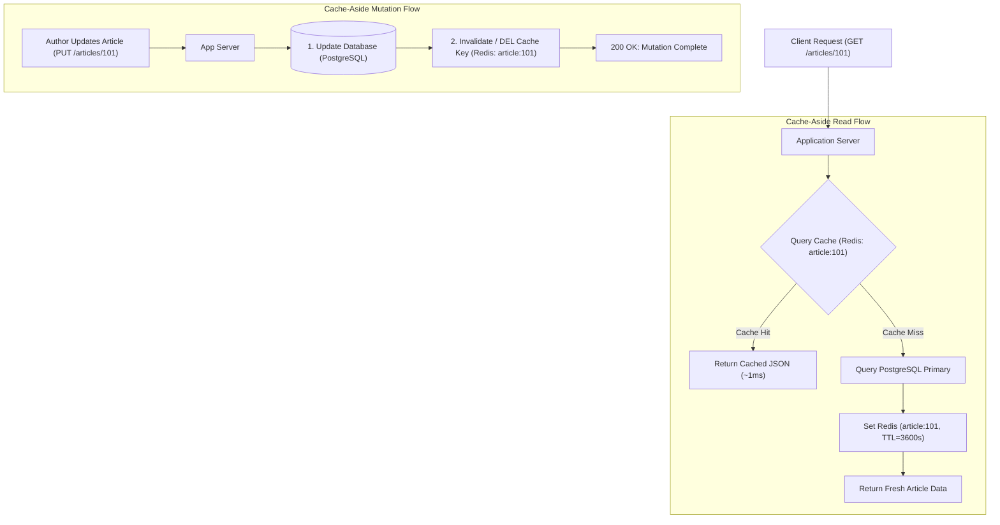

## Fast Revision (10-Second Recall)
In Cache-Aside (Lazy Loading), the application code coordinates directly between the cache and the primary database. On reads: check the cache; on hit, return data; on miss, query the database, populate the cache with a TTL, and return. On updates: write to the database first, then evict (delete) the cache entry rather than updating it in place.

## The 30-Second Spoken Script
> "Cache-Aside—also known as Lazy Loading—is the most widely adopted caching pattern in modern cloud architectures because it is resilient and decoupled. The application is solely responsible for reading from and writing to both the cache and the database. When a read arrives, the app queries the cache first. If found, it returns immediately with sub-millisecond response times. On a cache miss, the application falls back to the database, serializes the resulting record, stores it in the cache with an expiration TTL, and returns the response. For write operations, the golden rule of Cache-Aside is: write to the database first, and then *delete* the cache key rather than updating it. Deleting the key avoids race conditions between concurrent writes and ensures the next read dynamically fetches fresh data."

## Scenario / Problem Context
An online publishing platform serves 50 million monthly article views. The article details endpoint `/api/v1/articles/:id` is hitting PostgreSQL directly for every request, causing database connection pool exhaustion during breaking news spikes. The team must implement the Cache-Aside pattern to cache hot articles, manage memory bounds gracefully, and guarantee data consistency when authors edit article copy.

## Architectural Workflow / Sequence


## Deep-Dive Analysis & Root Causes

### 1. Core Advantages of Cache-Aside
- **Resilience to Cache Failure**: If Redis crashes or undergoes a cluster failover, the application gracefully degrades by querying the database directly (fail-soft).
- **Lazy Allocation (Cost Efficiency)**: Only data that is actually requested by users consumes expensive cache RAM. Unread records never waste memory.
- **Data Model Independence**: The cache representation can differ from the relational database schema (e.g. denormalized pre-computed JSON payloads ready for client rendering).

### 2. Why Eviction (DEL) Beats In-Place Updates (SET)
When an author updates an article:
- **Flawed Approach (Updating Cache In-Place)**:
  - Thread 1 writes Update A to DB.
  - Thread 2 writes Update B to DB.
  - Thread 2 writes Update B to Cache.
  - Thread 1 writes Update A to Cache (delayed network packet).
  - *Result*: The cache now permanently holds stale data from Update A even though the DB holds Update B!
- **Senior Solution (Eviction / Invalidation)**:
  - Both threads simply execute `DEL article:101`. The next read naturally reloads the newest record from the database.

### 3. Edge Case: The Stale Read Race Window
Could a read thread race with a write thread during eviction?
1. Thread A: Cache miss, reads DB (value $V_1$).
2. Thread B: Writes DB (value $V_2$), deletes cache.
3. Thread A: Writes $V_1$ to cache.
*Why this is rare in practice*: In relational databases, database writes (taking locks, writing WAL) are significantly slower than reads. By the time Thread B finishes writing and deleting, Thread A has almost always already populated the cache. Adding a reasonable TTL (e.g. 15-60 minutes) provides a safety net.

## Practical Debugging Commands & Code

#### Production Cache-Aside Helper Function (TypeScript & Redis)
```typescript
import Redis from 'ioredis';
import { db } from './database';

const redis = new Redis();

interface CacheAsideOptions {
  ttlSeconds: number;
}

export async function fetchWithCacheAside<T>(
  cacheKey: string,
  fetchFromDb: () => Promise<T | null>,
  options: CacheAsideOptions = { ttlSeconds: 3600 }
): Promise<T | null> {
  // 1. Attempt reading from cache
  const cachedData = await redis.get(cacheKey);
  if (cachedData) {
    return JSON.parse(cachedData) as T;
  }

  // 2. Cache Miss: Fetch from source database
  const dbData = await fetchFromDb();
  if (dbData === null) {
    // Cache nulls with short TTL (e.g. 60s) to prevent Cache Penetration
    await redis.set(cacheKey, JSON.stringify(null), 'EX', 60);
    return null;
  }

  // 3. Populate cache with data and TTL
  await redis.set(cacheKey, JSON.stringify(dbData), 'EX', options.ttlSeconds);

  return dbData;
}

// Example: Article Retrieval
export async function getArticle(articleId: string) {
  return fetchWithCacheAside(`article:${articleId}`, async () => {
    return db.article.findUnique({ where: { id: articleId } });
  });
}

// Example: Article Mutation with Safe Invalidation
export async function updateArticle(articleId: string, updates: Partial<{ title: string; content: string }>) {
  // Step 1: Update persistent database
  const updated = await db.article.update({
    where: { id: articleId },
    data: updates,
  });

  // Step 2: Invalidate cache key
  await redis.del(`article:${articleId}`);

  return updated;
}
```

#### Redis Key TTL and Expiration Inspection
```bash
# Check remaining TTL of a cache key in seconds (-1 means no TTL, -2 means key doesn't exist)
redis-cli ttl article:101

# Force manual eviction of cache key during triage
redis-cli del article:101
```

## Prevention & Senior Best Practices

### 1. Architectural Guardrails
- **Always Attach TTLs**: Never set a cache key without an expiration TTL (`EX` or `PX`). Unbounded keys lead to memory exhaustion and permanently retain stale data if invalidation bugs occur.
- **Cache Negative Results (Nulls)**: When the database returns no record for an ID, store a `null` marker in Redis with a short TTL (30-60s) to protect the database from malicious brute-force enumeration.

### 2. Operational Hardening
- **Cache Hit Ratio Monitoring**: Measure `cache_hits / (cache_hits + cache_misses)` in Prometheus. A healthy Cache-Aside system should maintain a hit ratio above 85-95%.
- **Use Multi-Region Replication for Read Heavy Workloads**: Deploy Redis read replicas in multiple availability zones to prevent single-instance read saturation.

