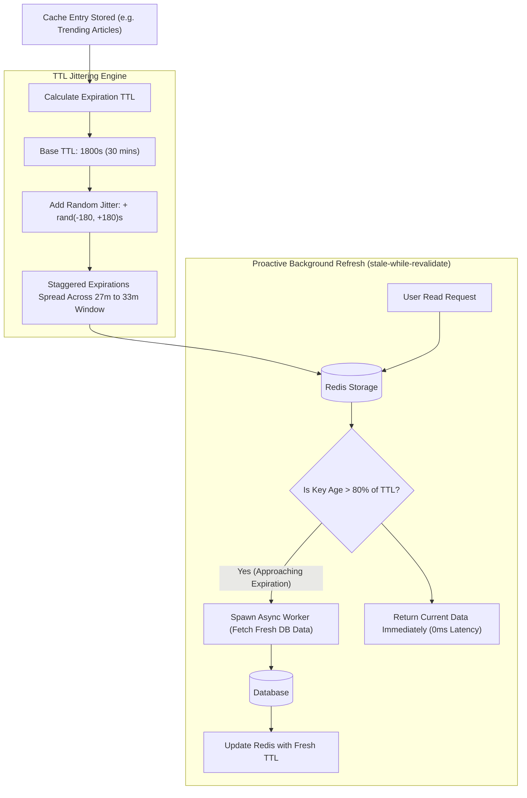

## Fast Revision (10-Second Recall)
Never use fixed, identical TTLs across keys to avoid synchronized cache expirations. Apply random TTL jitter (e.g. Base TTL $\pm 10-20\%$), calibrate TTL duration against data volatility and staleness tolerance, and implement proactive background refreshing (Probabilistic Early Expiration or stale-while-revalidate) for ultra-hot keys.

## The 30-Second Spoken Script
> "Cache expiration via Time-To-Live (TTL) is our primary defense against memory exhaustion and eventual data drift. However, handling TTLs incorrectly causes severe production outages. If a developer sets an identical 1-hour TTL across 100,000 product keys seeded at midnight, all 100,000 keys will expire simultaneously at 1:00 AM, triggering a catastrophic cache avalanche that crushes the database. We prevent this by applying TTL Jitter—injecting a random entropy offset like $\pm 15\%$ into every expiration calculation. For mission-critical hot keys where we cannot afford even a single synchronous cache miss, we implement probabilistic early expiration (the XFetch algorithm) or the stale-while-revalidate pattern: when a key approaches 80% of its lifetime, a background worker proactively refreshes the cache before it ever expires."

## Scenario / Problem Context
A news portal warms its homepage cache at 06:00 AM with a fixed 30-minute TTL on all trending stories. At exactly 06:30 AM, 50,000 cached records expired simultaneously in the same second. The subsequent traffic surge of 12,000 requests per second hit MySQL directly, causing thread pool exhaustion, query timeouts, and a 15-minute complete site outage. The team must redesign their cache expiration strategy.

## Architectural Workflow / Sequence


## Deep-Dive Analysis & Root Causes

### 1. The Peril of Static TTLs (The Synchronized Avalanche)
When bulk loaders, batch jobs, or deployment scripts write keys with uniform TTLs:
```typescript
// DANGEROUS: All 50,000 keys expire at exactly T + 1800 seconds
await redis.set(key, value, 'EX', 1800);
```
At expiration time, cache hit ratio drops from 99% to 0% in a single second.

### 2. TTL Jitter Formula
To spread expirations smoothly across a normal distribution:
$$\text{Effective\\_TTL} = \text{Base\\_TTL} + \text{UniformRandom}(-\Delta, +\Delta)$$
Where $\Delta = \text{Base\\_TTL} \times 0.15$ (a 15% variance).
For a 30-minute base TTL (1,800s), keys expire randomly between 1,530s and 2,070s, smoothing database reload traffic across a 9-minute window.

### 3. Probabilistic Early Expiration (The XFetch Algorithm)
In high-concurrency systems, waiting for a key to expire guarantees that at least one incoming user request will suffer the slow database read latency.
- **The XFetch Algorithm (Optimal Probabilistic Cache Refresh)**:
  $$-\beta \times \delta \times \ln(\text{rand}()) > \text{TTL}_{\text{remaining}}$$
  Where $\delta$ is the compute time of the database query and $\beta > 0$ is an aggressiveness factor.
  As the key approaches expiration, the probability that a read will trigger an asynchronous background refresh increases smoothly from 0 to 1.
  *Result*: The key is refreshed in the background before expiring; users enjoy a 100% cache hit rate.

### 4. Sliding Expiration vs Absolute Expiration
- **Absolute Expiration**: The key dies at a fixed time regardless of access (ideal for time-sensitive data like daily prices or news).
- **Sliding Expiration**: The TTL resets on every read (`EXPIRE key 1800`) as long as it is actively accessed (ideal for user sessions or active shopping carts).

## Practical Debugging Commands & Code

#### Production TTL Calculator with Jitter & Probabilistic Early Refresh
```typescript
import Redis from 'ioredis';
import { db } from './database';

const redis = new Redis();

// 1. Calculate Jittered TTL
export function calculateJitteredTtl(baseSeconds: number, variancePercent = 0.15): number {
  const maxDelta = Math.floor(baseSeconds * variancePercent);
  const randomOffset = Math.floor(Math.random() * (maxDelta * 2 + 1)) - maxDelta;
  return Math.max(10, baseSeconds + randomOffset);
}

// 2. Probabilistic Early Refresh Cache Getter
interface CachedPayload<T> {
  data: T;
  storedAt: number;
  deltaMs: number; // Duration it took to compute from DB
  ttlMs: number;
}

export async function getWithProbabilisticRefresh<T>(
  key: string,
  baseTtlSeconds: number,
  fetchFn: () => Promise<T>,
  beta = 1.0 // Aggressiveness parameter
): Promise<T> {
  const raw = await redis.get(key);

  if (raw) {
    const payload: CachedPayload<T> = JSON.parse(raw);
    const remainingTtlSeconds = await redis.ttl(key);
    const remainingMs = remainingTtlSeconds * 1000;

    // XFetch Probabilistic Check: -beta * delta * ln(random) > remaining
    const shouldRefreshEarly =
      remainingMs > 0 &&
      -beta * payload.deltaMs * Math.log(Math.random()) > remainingMs;

    if (shouldRefreshEarly) {
      // Trigger non-blocking asynchronous refresh in background
      process.nextTick(async () => {
        try {
          console.log(`[Proactive Refresh] Refreshing key early: ${key}`);
          const start = Date.now();
          const freshData = await fetchFn();
          const duration = Date.now() - start;

          const jitteredTtl = calculateJitteredTtl(baseTtlSeconds);
          const newPayload: CachedPayload<T> = {
            data: freshData,
            storedAt: Date.now(),
            deltaMs: duration,
            ttlMs: jitteredTtl * 1000,
          };
          await redis.set(key, JSON.stringify(newPayload), 'EX', jitteredTtl);
        } catch (e) {
          console.error(`Background refresh failed for ${key}:`, e);
        }
      });
    }

    return payload.data;
  }

  // Synchronous Cache Miss: Compute from DB
  const start = Date.now();
  const freshData = await fetchFn();
  const duration = Date.now() - start;

  const jitteredTtl = calculateJitteredTtl(baseTtlSeconds);
  const payload: CachedPayload<T> = {
    data: freshData,
    storedAt: Date.now(),
    deltaMs: duration,
    ttlMs: jitteredTtl * 1000,
  };

  await redis.set(key, JSON.stringify(payload), 'EX', jitteredTtl);
  return freshData;
}
```

#### Inspecting Redis Expiration Distribution
```bash
# Sample 100 keys and inspect TTL distribution in seconds
redis-cli --scan --pattern "article:*" | head -n 100 | while read key; do
  redis-cli ttl "$key"
done | sort -n
```

## Prevention & Senior Best Practices

### 1. Architectural Guardrails
- **Mandate Jitter in Cache Wrappers**: Enforce all caching helper functions to apply $\pm 10-20\%$ jitter by default. Never allow developers to pass raw static integers directly to `redis.set(..., 'EX', seconds)`.
- **Set Active Eviction Policies**: Ensure Redis `maxmemory` is configured alongside an eviction policy (e.g., `volatile-lru` or `allkeys-lru`) so Redis can reclaim memory even if keys have not reached their TTL.

### 2. Operational Hardening
- **Monitor Expired Keys Metric**: Track Prometheus metric `redis_expired_keys_total`. A healthy system shows a smooth, steady rate of expirations rather than massive vertical step spikes.
- **Differentiate Hot vs Cold TTLs**: Assign aggressive short TTLs (1-5 mins) to rapidly changing user states, and long TTLs (12-24 hours) with explicit event-driven invalidation to catalog and content data.

