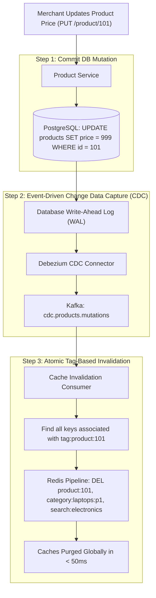

## Fast Revision (10-Second Recall)
Phil Karlton famously noted that cache invalidation is one of computer science's hardest problems. Always prefer explicit key eviction (`DEL`) over in-place updating upon data mutations. For complex relational or aggregate views, use Cache Tags (tagging keys by entity), pub/sub message brokers, or event-driven Change Data Capture (CDC via Debezium) to broadcast invalidations globally.

## The 30-Second Spoken Script
> "Invalidating cached data after an update is where most subtle data inconsistency bugs originate. The fundamental rule is: upon any mutation, invalidate (delete) the cache rather than updating it in-place to avoid race conditions. For simple single-record lookups, direct key deletion like `DEL user:101` works cleanly. However, in real-world systems, an update to a product record invalidates multiple derivative caches: the product detail page, category listings, search filters, and the home page carousel. To solve this at scale without hardcoding hundreds of delete statements, we use Cache Tagging: every cached item is tagged with its constituent entity IDs (like `tag:product:5` or `tag:category:12`). When product 5 is updated, we issue a tag purge that atomically wipes every associated view. For decoupled microservice architectures, we decouple invalidation entirely by using Change Data Capture (CDC) via Debezium and Kafka, emitting cache purge events directly from the database write-ahead log."

## Scenario / Problem Context
An online electronics retailer allows merchants to update product prices. When a merchant updated a laptop price from $1,200 to $999, the product details page updated, but the category page, search results, and checkout cart still showed $1,200 for 4 hours because the developer only invalidated the single product key `product:101`, forgetting the dozens of aggregated list keys. Customers filed hundreds of complaints over pricing discrepancies.

## Architectural Workflow / Sequence


## Deep-Dive Analysis & Root Causes

### 1. Three Primary Invalidation Strategies
1. **Explicit Direct Key Eviction**:
   - Best for simple 1:1 entity lookups (`user:101`, `order:502`).
   - Fragile for 1:N or aggregate lists (e.g. `products:category:electronics:sort_price`).
2. **Tag-Based Invalidation (Cache Tagging / Groups)**:
   - When storing a key in Redis, register it into one or more sets:
     ```text
     SADD tag:product:101 "products:page:1" "category:laptops" "product:101"
     ```
   - On update to Product 101: fetch members of `tag:product:101`, delete all associated keys, and delete the tag set.
3. **Change Data Capture (CDC) via Database WAL**:
   - Removes invalidation responsibility from application code entirely.
   - Debezium monitors the PostgreSQL WAL (or MySQL binlog). Any `UPDATE` or `DELETE` triggers a Kafka event that dedicated invalidation workers consume, guaranteeing that direct DB edits by administrators also purge the cache.

### 2. The Pitfalls of Pattern-Based Invalidation (`KEYS *`)
Never use `redis-cli KEYS "product:*"` in production!
- `KEYS` blocks the single-threaded Redis event loop while scanning every key in RAM. On a database with 10 million keys, `KEYS` freezes the entire platform for seconds.
- Always use **Cache Tags with Sets**, or `SCAN` with `COUNT 100` if cursor iteration is unavoidable.

### 3. Dual-Tier Distributed Cache Clearing (Redis Pub/Sub)
If microservice pods maintain local L1 memory caches alongside Redis L2:
- Pod A updates the database and deletes the Redis L2 key.
- Pod B and Pod C still hold the old value in their local L1 heap!
- **Solution**: Broadcast an invalidation event over a Redis Pub/Sub channel (`PUBLISH cache:evict "product:101"`). All subscribing pods immediately clear their local L1 LRU memory.

## Practical Debugging Commands & Code

#### Tag-Based Invalidation System (TypeScript & Redis)
```typescript
import Redis from 'ioredis';

const redis = new Redis();

export class TaggedCache {
  // Store value and associate with entity tags
  static async set(key: string, value: any, tags: string[], ttlSeconds = 3600): Promise<void> {
    const serialized = JSON.stringify(value);
    const pipeline = redis.pipeline();

    // 1. Store the primary cache key
    pipeline.set(key, serialized, 'EX', ttlSeconds);

    // 2. Add key to each tag set
    for (const tag of tags) {
      const tagKey = `tag:${tag}`;
      pipeline.sadd(tagKey, key);
      // Give tag set TTL slightly longer than items
      pipeline.expire(tagKey, ttlSeconds + 300);
    }

    await pipeline.exec();
  }

  // Invalidate all keys tagged with an entity
  static async invalidateTag(tag: string): Promise<number> {
    const tagKey = `tag:${tag}`;

    // 1. Get all cache keys mapped to this tag
    const keysToDelete = await redis.smembers(tagKey);
    if (!keysToDelete || keysToDelete.length === 0) {
      return 0;
    }

    // 2. Atomically delete all mapped keys and the tag set
    const pipeline = redis.pipeline();
    pipeline.del(...keysToDelete);
    pipeline.del(tagKey);

    await pipeline.exec();
    console.log(`[Cache Invalidation] Purged ${keysToDelete.length} keys for tag ${tag}`);
    return keysToDelete.length;
  }
}

// Usage Example: Storing a complex product listing
await TaggedCache.set(
  'view:category:laptops:page:1',
  laptopListingData,
  ['product:101', 'product:102', 'category:laptops']
);

// When product 101 updates, wipe all pages featuring it:
await TaggedCache.invalidateTag('product:101');
```

#### Safe Non-Blocking Key Scanning
```bash
# Safely iterate through keys matching a pattern without blocking Redis
redis-cli --scan --pattern "product:*" | head -n 20
```

## Prevention & Senior Best Practices

### 1. Architectural Guardrails
- **Ban `KEYS` in Production**: Disable dangerous commands in `redis.conf`:
  ```text
  rename-command KEYS ""
  rename-command FLUSHALL ""
  rename-command FLUSHDB ""
  ```
- **Pair Invalidation with Fallback TTLs**: Even with automated invalidation, always set a maximum safety TTL (e.g., 2 hours). If an unexpected exception aborts an invalidation flow, the stale data naturally self-heals when the TTL expires.

### 2. Operational Hardening
- **Publish Invalidation Metrics**: Increment Prometheus counter `cache_invalidations_total{tag="product"}` to monitor invalidation velocity and detect runaway invalidation loops.
- **Trace Invalidation Latency**: Instrument CDC lag monitoring from database commit to Redis key deletion; target under 100 ms global propagation.

