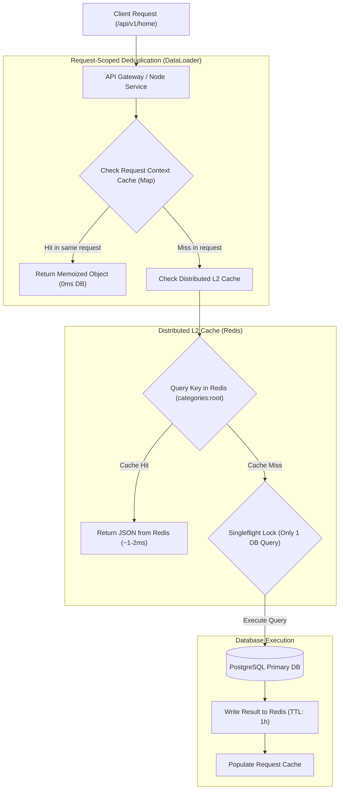

## Fast Revision (10-Second Recall)
When identical database queries execute repeatedly, introduce a two-tier caching architecture: request-scoped memoization (DataLoader pattern) within a single HTTP request lifecycle, and distributed Redis caching with TTLs for cross-request reads. Always fingerprint queries deterministically and ensure invalidation hooks trigger upon data mutations.

## The 30-Second Spoken Script
> "When an API slows down due to repeated database queries, the first step is analyzing whether the duplication occurs within a single request lifecycle or across multiple independent requests. Within a single request—such as an N+1 query problem in GraphQL or ORMs—we implement batching and in-memory deduplication using DataLoader or request-scoped memoization caches. Across concurrent client requests, we implement a distributed Cache-Aside pattern backed by Redis. We compute a deterministic cache key from the query parameters, check Redis with single-digit millisecond latency, and fall back to the database only on a cache miss. Furthermore, to prevent multiple identical concurrent queries from overwhelming the database during a miss, we use single-flight coalescing to ensure only one database query executes while other concurrent promises wait for the shared result."

## Scenario / Problem Context
An e-commerce homepage API `/api/v1/home` takes 1,400 ms to respond under normal traffic. Profiling with OpenTelemetry traces revealed that a single page load executes the identical query: `SELECT * FROM categories WHERE parent_id = 0 AND active = true` 18 times across different UI rendering widgets, and executes it 8,000 times per second across all users. The database CPU sits at 92% running the exact same read operation repeatedly.

## Architectural Workflow / Sequence


## Deep-Dive Analysis & Root Causes

### 1. Two Levels of Query Repetition
1. **Intra-Request Duplication (The N+1 & Widget Anti-Pattern)**:
   - Different microservices, decorators, or frontend widgets within the *same* HTTP request trigger the same database query independently (e.g., header, sidebar, and footer all querying categories).
   - *Fix*: Request-scoped memoization.
2. **Inter-Request Duplication (High Read-to-Write Ratio)**:
   - Thousands of distinct users querying identical, rarely changing catalog or configuration data.
   - *Fix*: Distributed cache (Redis/Memcached) with reasonable TTL and pub/sub invalidation.

### 2. Singleflight Request Coalescing
When a popular cache key expires, 500 concurrent threads might simultaneously discover a cache miss and execute the exact same query against the database.
- **Singleflight Pattern**: Merges concurrent identical in-flight executions so that only one worker runs the database query while the other 499 await the single promise.

### 3. Query Fingerprinting & Deterministic Cache Keys
To reliably cache dynamic database queries:
- Normalize query parameters: sort object keys, trim whitespace, lowercase filter terms.
- Cache key convention:
  ```text
  cache:products:list:cat_12:sort_price_asc:page_1
  ```
- Alternatively, compute a 64-bit cryptographic hash of the normalized query string and parameter array.

## Practical Debugging Commands & Code

#### Request-Scoped DataLoader & Redis Cache-Aside Implementation
```typescript
import DataLoader from 'dataloader';
import Redis from 'ioredis';
import { db } from './database';

const redis = new Redis();

// 1. Request-scoped batching & deduplication for categories
export function createCategoryLoader() {
  return new DataLoader(async (categoryIds: readonly string[]) => {
    // 2. Try fetching from Redis first
    const redisKeys = categoryIds.map((id) => `category:${id}`);
    const cachedItems = await redis.mget(redisKeys);

    const missingIds: string[] = [];
    const resultMap = new Map<string, any>();

    cachedItems.forEach((item, index) => {
      const id = categoryIds[index];
      if (item) {
        resultMap.set(id, JSON.parse(item));
      } else {
        missingIds.push(id);
      }
    });

    // 3. Batch query only the missing IDs from DB
    if (missingIds.length > 0) {
      const dbRecords = await db.category.findMany({
        where: { id: { in: missingIds } },
      });

      // Populate Redis in pipeline
      const pipeline = redis.pipeline();
      for (const record of dbRecords) {
        resultMap.set(record.id, record);
        pipeline.set(`category:${record.id}`, JSON.stringify(record), 'EX', 3600); // 1 hour TTL
      }
      await pipeline.exec();
    }

    // Return records in the exact order of input IDs
    return categoryIds.map((id) => resultMap.get(id) || null);
  });
}
```

#### Identifying Duplicate Queries via pg_stat_statements (PostgreSQL)
```sql
-- Identify the most frequently repeated identical queries in PostgreSQL
SELECT 
    query, 
    calls, 
    total_exec_time / calls AS avg_exec_time_ms, 
    rows / calls AS avg_rows,
    100.0 * shared_blks_hit / nullif(shared_blks_hit + shared_blks_read, 0) AS cache_hit_pct
FROM pg_stat_statements
WHERE calls > 500
ORDER BY calls DESC
LIMIT 10;
```

## Prevention & Senior Best Practices

### 1. Architectural Guardrails
- **Mandatory Request Context Store**: In Node.js or Go, use `AsyncLocalStorage` or request `context.Context` to attach scoped DataLoaders to each request, ensuring zero cross-request memory leaks while deduplicating intra-request fetches.
- **Cache Invalidation Hooks**: Pair every ORM mutation (`update`, `create`, `delete`) with automatic cache eviction hooks or PostgreSQL Change Data Capture (CDC via Debezium) to prevent stale reads.

### 2. Operational Hardening
- **Alert on pg_stat_statements Call Spikes**: Set alerts when total database query executions spike by $>200\%$ without a corresponding increase in incoming edge HTTP traffic.
- **Set Global Statement Timeouts**: Enforce `SET statement_timeout = '3s'` to prevent un-cached repeated slow queries from exhausting database connection pools.

