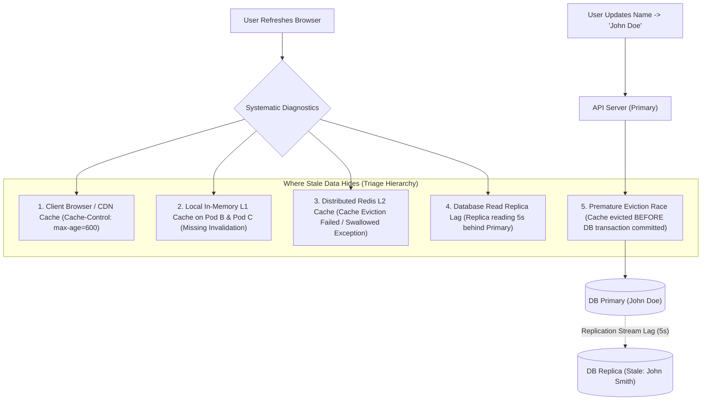

## Fast Revision (10-Second Recall)
When applications display stale data after database updates, systematically isolate the caching layer responsible: check browser/CDN HTTP `Cache-Control` headers, verify database read replica lag, inspect local L1 heap caches across individual pods, check for missed Redis eviction hooks, and audit transaction commit ordering.

## The 30-Second Spoken Script
> "When a user reports seeing stale data after successfully updating a record, jumping straight to restarting Redis is a common mistake. Stale data can hide in five distinct layers. First, we inspect client and edge HTTP caching: did CloudFront or the browser cache a `200 OK` response because of missing `no-store` or stale `ETag` headers? Second, we check the database replication topology: did the write commit to the primary database, while the subsequent read routed to a read-replica that is suffering 5 seconds of replication lag? Third, we check multi-tier application caches: did our service update Redis, but forget to broadcast an invalidation message to the local in-process L1 heap caches living on other pods? Finally, we check transactional race conditions: was the cache evicted *before* the database transaction committed, allowing a concurrent read to fetch the old uncommitted database state and re-populate the cache with stale data?"

## Scenario / Problem Context
A profile management service allows users to update their display name and profile picture. A user saves their new name: the database `users` table immediately updates to `John Doe`. However, refreshing the page displays `John Smith` for 10 minutes. Different users or devices report seeing different names simultaneously. The engineering team must diagnose the root cause of this multi-layer cache desynchronization.

## Architectural Workflow / Sequence


## Deep-Dive Analysis & Root Causes

### 1. Root Cause 1: Premature Eviction in Database Transactions
The classic database transaction race condition:
```typescript
// ANTI-PATTERN: Evicting cache inside the transaction block
await db.$transaction(async (tx) => {
  await tx.user.update({ where: { id }, data: { name: 'John Doe' } });
  await redis.del(`user:${id}`); // Cache evicted here!
  // ... slow operations / complex triggers ...
}); // DB transaction commits here!
```
*What goes wrong*:
1. Thread A evicts `user:id` from Redis.
2. Thread B (concurrent read) discovers a cache miss.
3. Thread B reads from DB. Because Thread A's transaction has *not committed yet*, Thread B reads the old name `John Smith` under standard `READ COMMITTED` isolation.
4. Thread B writes `John Smith` back into Redis!
5. Thread A's transaction finally commits. The cache now holds stale data permanently until the TTL expires!
*Fix*: Always evict the cache **after** the transaction commits successfully.

### 2. Root Cause 2: Read Replica Lag
In CQRS or read-heavy systems, writes go to Primary, but reads go to Read Replicas:
- If replication lag is $2.5\text{ seconds}$, a read executing 200 ms after write will read stale data from the replica and populate the cache with stale data.
- *Fix*: "Read-your-own-writes" pattern. Route reads from the mutating user to Primary for 5 seconds after a write, or use GTID (Global Transaction Identifier) / LSN tracking.

### 3. Root Cause 3: In-Memory L1 Desynchronization
When horizontally scaled across 20 pods:
- Pod 1 processes the write and invalidates its local memory.
- Pods 2 through 20 know nothing about the update and continue serving the stale object from their in-memory heap until their local TTL elapses.
- *Fix*: Connect local caches via Redis Pub/Sub invalidation channels.

### 4. Root Cause 4: HTTP & CDN Headers
The API response might have returned `Cache-Control: public, max-age=600`.
- The user's browser or Cloudflare CDN edge serves the cached HTTP response directly without ever making a network request to your backend.
- *Fix*: Add `Cache-Control: no-cache, no-store, must-revalidate` on personalized user profile endpoints.

## Practical Debugging Commands & Code

#### Step-by-Step Triage Script (Diagnostic CLI)
```bash
# 1. Bypass CDN and browser: Query API origin directly with curl inspecting headers
curl -v -H "Authorization: Bearer $TOKEN" https://api.company.com/v1/users/me

# Look for HTTP response headers:
# < Cache-Control: max-age=600  <-- BROWSER/CDN CACHING BUG!
# < X-Cache: HIT from cloudfront <-- CDN SERVING STALE RESPONSE!

# 2. Inspect Redis Key Directly
redis-cli get user:101
# Compare Redis payload against DB Primary:

# 3. Query PostgreSQL Primary directly
psql -h db-primary.internal -c "SELECT id, name, updated_at FROM users WHERE id = 101;"

# 4. Query PostgreSQL Read Replica directly to check for lag
psql -h db-replica.internal -c "SELECT id, name, updated_at FROM users WHERE id = 101;"

# Check replication lag in seconds on replica
psql -h db-replica.internal -c "SELECT EXTRACT(EPOCH FROM (now() - pg_last_xact_replay_timestamp())) AS lag_seconds;"
```

#### Safe Post-Commit Cache Invalidation Pattern
```typescript
import { PrismaClient } from '@prisma/client';
import Redis from 'ioredis';

const prisma = new PrismaClient();
const redis = new Redis();

export async function updateUserProfile(userId: string, newName: string) {
  // Step 1: Execute database mutation inside transaction
  const updatedUser = await prisma.$transaction(async (tx) => {
    return tx.user.update({
      where: { id: userId },
      data: { name: newName },
    });
  });

  // Step 2: Crucial - Evict cache strictly AFTER transaction commits!
  try {
    await redis.del(`user:${userId}`);
    // Broadcast invalidation to all microservice pods for local L1 eviction
    await redis.publish('cache:invalidate', `user:${userId}`);
  } catch (err) {
    console.error('Failed to evict Redis cache post-commit:', err);
  }

  return updatedUser;
}
```

## Prevention & Senior Best Practices

### 1. Architectural Guardrails
- **Post-Commit Lifecycle Hooks**: In ORMs (ActiveRecord, TypeORM, Hibernate), always bind cache eviction to `after_commit` hooks, never `after_save` or `before_commit`.
- **Read-Your-Own-Writes Consistency**: After a user updates their profile, set a short cookie (`just_updated=1; Max-Age=5`). The API Gateway routes requests with this cookie directly to the database Primary rather than replicas or stale caches.

### 2. Operational Hardening
- **Alert on Replication Lag**: Set alerts when PostgreSQL replica lag (`pg_stat_replication.write_lag`) exceeds 1,000 ms.
- **Strict Anti-Caching on Mutative Read Endpoints**: Ensure all authenticated user profile and account endpoints return `Cache-Control: private, no-cache, no-store`.

