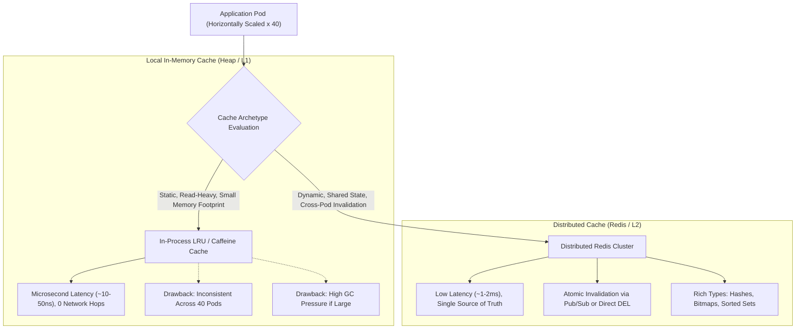

## Fast Revision (10-Second Recall)
Use local in-memory caches (Caffeine, Go sync.Map, Node lru-cache) when latency must be microsecond-level and data is small, static, or immutable across single instances. Use distributed Redis when data must be shared across horizontally scaled pods, requires centralized invalidation, or exceeds single-node memory bounds.

## The 30-Second Spoken Script
> "The choice between local in-memory caching and distributed Redis comes down to four architectural dimensions: scale, consistency, network overhead, and memory limits. Local in-process caching provides near-instant microsecond reads because data lives directly on the process heap with zero network serialization. However, when you scale out to 20 or 50 microservice instances, local caches create severe cache inconsistency: Instance A might update a record while Instance B serves stale data, and cache warming overhead multiplies across every pod. Redis solves this by acting as a single, centralized source of truth accessible to all nodes with low millisecond latency. It provides rich data structures, atomic operations like Lua scripts and HyperLogLogs, pub/sub invalidation, and data persistence across pod restarts. In high-scale architectures, we often combine both into a two-tier L1/L2 cache."

## Scenario / Problem Context
A high-throughput ride-sharing platform needs to cache two distinct datasets: static city zone boundary geometries (rarely updated, read 100,000 times/second), and dynamic driver location coordinates (updated every 3 seconds, queried concurrently by booking services across 40 container pods). The engineering team must establish strict architectural criteria for when to use in-process heap caching versus distributed Redis.

## Architectural Workflow / Sequence


## Deep-Dive Analysis & Root Causes

### 1. Comparative Architectural Matrix
| Feature | Local In-Memory (Heap / L1) | Distributed Redis (L2) |
|---|---|---|
| **Latency** | 10 to 100 nanoseconds | 0.8 to 3.0 milliseconds |
| **Network Hop** | 0 (direct memory pointer dereference) | 1 round-trip network hop (TCP/Unix socket) |
| **Consistency Across Pods** | Eventual / Weak (nodes get out of sync) | Immediate / Strong (shared single state) |
| **Memory Capacity** | Limited by process heap (e.g. 1.5 GB in Node) | Gigabytes to Terabytes (Redis Cluster) |
| **Garbage Collection (GC)** | High GC pause risk with millions of objects | Zero GC impact on app process |
| **Survives Pod Restart** | No (cleared on every pod deployment) | Yes (independent memory and persistence) |
| **Advanced Features** | Basic Key/Value Maps | Bitmaps, HyperLogLog, Pub/Sub, Lua scripts |

### 2. When to Choose Local In-Memory Caching
- **Immutable or Near-Static Data**: Country codes, currency symbols, tax rate tables, feature flags.
- **Microsecond SLA Requirements**: Algorithmic trading or high-frequency telemetry where 1-2 ms network hops violate latency budgets.
- **Small Working Set**: Datasets under 50 MB that do not cause JVM or V8 heap exhaustion or long GC pauses.

### 3. When to Choose Redis
- **Distributed Microservice Fleet**: Multiple pods requiring identical, consistent view of user sessions, shopping carts, or rate-limiting quotas.
- **Complex Data Structures**: Needing atomic leaderboards (`ZADD`, `ZRANGE`), set intersections (`SINTER`), or sliding window rate limiting.
- **Fast Rolling Restarts**: Deploying new application code several times daily without blowing away warmed caches and thundering the database.

## Practical Debugging Commands & Code

#### Hybrid L1 (Local LRU) + L2 (Redis) Two-Tier Cache Pattern
```typescript
import { LRUCache } from 'lru-cache';
import Redis from 'ioredis';

const redis = new Redis();

// L1: In-process heap cache (max 1,000 items, 30-second TTL)
const l1Cache = new LRUCache<string, string>({
  max: 1000,
  ttl: 1000 * 30, // 30 seconds
});

export async function getCityZone(zoneId: string): Promise<string> {
  const cacheKey = `zone:${zoneId}`;

  // 1. Check L1 local heap (nanoseconds)
  const l1Hit = l1Cache.get(cacheKey);
  if (l1Hit) {
    return l1Hit;
  }

  // 2. Check L2 distributed Redis (1-2 ms)
  const l2Hit = await redis.get(cacheKey);
  if (l2Hit) {
    l1Cache.set(cacheKey, l2Hit); // Backfill L1
    return l2Hit;
  }

  // 3. Fallback to Database
  const dbData = await fetchFromDatabase(zoneId);
  const serialized = JSON.stringify(dbData);

  // Populate both tiers
  l1Cache.set(cacheKey, serialized);
  await redis.set(cacheKey, serialized, 'EX', 3600); // 1 hour in Redis

  return serialized;
}

async function fetchFromDatabase(zoneId: string) {
  // DB query implementation ...
  return { id: zoneId, name: 'Downtown Metropark', coordinates: [[12.9, 77.5]] };
}
```

#### Redis CLI Profiling & Memory Inspection
```bash
# Check instantaneous Redis operations per second and connected clients
redis-cli info stats | grep -E '(instantaneous_ops_per_sec|total_connections_received)'

# Analyze top memory-consuming keys in Redis
redis-cli --bigkeys

# Monitor real-time commands touching Redis in staging
redis-cli monitor | grep -E '(GET|SET|DEL)'
```

## Prevention & Senior Best Practices

### 1. Architectural Guardrails
- **Bound All Local Caches**: Never use raw, unbounded JavaScript objects (`const cache = {}`) or Go maps (`map[string]any`) as caches. Without an eviction policy (LRU/LFU) and max-size caps, process memory will leak until the OS triggers an Out-Of-Memory (OOM) killer.
- **Avoid Storing Blobs in Redis**: Restrict Redis value sizes to under 100 KB. Values exceeding 1 MB block single-threaded Redis event loops, spiking latency across all microservices.

### 2. Operational Hardening
- **Heap Monitoring for Local Caches**: Configure Prometheus alerts on container memory usage (`container_memory_working_set_bytes`) to ensure in-memory caches do not breach 75% of Kubernetes pod limits.
- **Redis Connection Pooling**: Use persistent connection pooling (`ioredis` or Go `redis.Options{PoolSize: 50}`) instead of opening new TCP connections per request.

