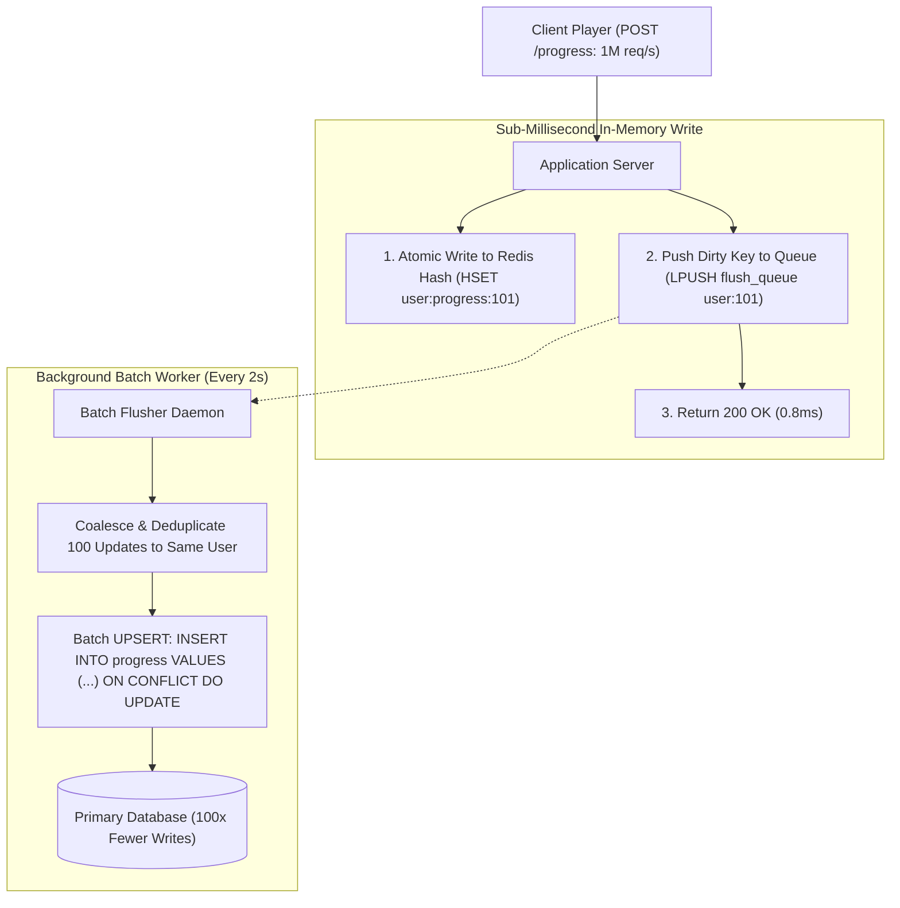

## Fast Revision (10-Second Recall)
In Write-Behind (Write-Back) caching, applications write data immediately to the in-memory cache and acknowledge success to the client with sub-millisecond latency. A background worker or queue asynchronously flushes the buffered writes to the primary database, coalescing multiple updates into high-throughput batch inserts.

## The 30-Second Spoken Script
> "Write-Behind—also referred to as Write-Back caching—is the ultimate pattern for write-heavy workloads where relational databases become the primary write bottleneck. Unlike Write-Through where we synchronously wait for disk persistence, Write-Behind writes directly to the in-memory cache and acknowledges the HTTP request immediately. In the background, an asynchronous worker or streaming queue reads the dirty cache entries, batches them, and flushes them to the relational database every few seconds. This provides two massive advantages: blazing sub-millisecond write latency, and write coalescing—where 100 consecutive updates to the same user view counter collapse into a single SQL update. The critical architectural risk is data loss: if the cache crashes before dirty writes reach disk, data is lost. We mitigate this using persistent append-only logs in Redis (AOF) or pairing the cache with Kafka or AWS SQS."

## Scenario / Problem Context
A video streaming platform tracks real-time video playback timestamps every 5 seconds for 5 million concurrent viewers. Directly writing 1,000,000 updates per second to PostgreSQL locks the `video_progress` table and exhausts disk IOPS. The team must implement a Write-Behind architecture to absorb massive write bursts in memory and coalesce updates into batched database writes without losing viewer progress.

## Architectural Workflow / Sequence


## Deep-Dive Analysis & Root Causes

### 1. The Core Benefits of Write-Behind
- **Ultra-Low Write Latency**: Write latencies drop from 15-50 ms (database commit) to under 1 ms (memory write).
- **Write Coalescing (Deduplication)**: If an IoT sensor or user progress sends 50 updates over 10 seconds:
  - Synchronous writes: 50 SQL statements.
  - Write-Behind: The worker flushes only the *latest* state in 1 SQL statement.
- **Database Load Leveling**: Spiky write traffic is smoothed out; the background worker flushes to the database at a controlled, constant rate.

### 2. The Data Loss Trade-Off & Mitigations
If the cache node experiences a kernel panic or hardware failure before the background worker flushes dirty keys, recent writes are permanently lost.
- **Mitigation 1: Redis AOF (Append-Only File)**: Configure `appendfsync everysec` so at most 1 second of data is exposed to hardware failure.
- **Mitigation 2: Dual-Write to Reliable Stream (Kafka / SQS)**: Instead of keeping dirty state only in Redis RAM, the application publishes to an encrypted Kafka topic while updating the cache. Kafka guarantees durability while Redis serves reads.

### 3. Concurrency and Conflict Resolution
When multiple background workers process the queue:
- Workers might write stale snapshots if older queue messages are processed after newer ones.
- **Solution**: Use atomic versioning (`updated_at` timestamps or sequence numbers) in the database `ON CONFLICT DO UPDATE WHERE excluded.version > target.version`.

## Practical Debugging Commands & Code

#### Write-Behind Buffer and Batch Flusher Worker (Node.js & Redis)
```typescript
import Redis from 'ioredis';
import { db } from './database';

const redis = new Redis();
const QUEUE_KEY = 'dirty_progress_queue';

// 1. Client Endpoint: Blazing fast write to Redis buffer
export async function recordPlaybackProgress(userId: string, videoId: string, timestampSeconds: number) {
  const compositeKey = `${userId}:${videoId}`;
  const now = Date.now();

  const pipeline = redis.pipeline();
  // Store latest progress in Redis hash
  pipeline.hset(`progress:${compositeKey}`, {
    userId,
    videoId,
    timestampSeconds: timestampSeconds.toString(),
    updatedAt: now.toString(),
  });
  // Add key to flush queue set (SADD prevents duplicate queue entries)
  pipeline.sadd(QUEUE_KEY, compositeKey);
  await pipeline.exec();

  return { status: 'recorded' }; // Returns in ~1ms
}

// 2. Background Batch Flusher Worker (Runs continuously or on interval)
export async function startWriteBehindFlusher(batchSize = 500, intervalMs = 2000) {
  setInterval(async () => {
    // Pop batch of dirty keys from set
    const dirtyKeys = await redis.spop(QUEUE_KEY, batchSize);
    if (!dirtyKeys || dirtyKeys.length === 0) return;

    // Fetch latest coalesced state for all keys in parallel
    const pipeline = redis.pipeline();
    dirtyKeys.forEach((key) => pipeline.hgetall(`progress:${key}`));
    const results = await pipeline.exec();

    const recordsToFlush = results
      ? results
          .map(([err, data]) => data as any)
          .filter((d) => d && d.userId)
      : [];

    if (recordsToFlush.length === 0) return;

    try {
      // Bulk Upsert into database in a single round-trip
      await db.videoProgress.createMany({
        data: recordsToFlush.map((r) => ({
          userId: r.userId,
          videoId: r.videoId,
          timestampSeconds: parseInt(r.timestampSeconds, 10),
          updatedAt: new Date(parseInt(r.updatedAt, 10)),
        })),
        skipDuplicates: false,
      });

      console.log(`[Write-Behind] Flushed ${recordsToFlush.length} coalesced records to DB.`);
    } catch (err) {
      console.error('[Write-Behind Error] DB flush failed, pushing keys back to queue:', err);
      // Re-queue keys so data is not lost on transient DB failure
      await redis.sadd(QUEUE_KEY, ...dirtyKeys);
    }
  }, intervalMs);
}
```

#### Monitoring Queue Backlog
```bash
# Check how many dirty items are pending flush in Redis set
redis-cli scard dirty_progress_queue
```

## Prevention & Senior Best Practices

### 1. Architectural Guardrails
- **Graceful Shutdown Hooks**: In Kubernetes pods, listen for `SIGTERM` and pause incoming traffic while flushing all dirty in-memory buffers to the database before the container exits.
- **Re-Queue on Database Exceptions**: Always catch database exceptions during background batch flushes and re-queue failed keys to ensure transient database connection hiccups do not discard dirty data.

### 2. Operational Hardening
- **Alert on Queue Lag**: Alert on PagerDuty if the dirty queue size grows beyond 50,000 items, which indicates the database is failing to keep up with the incoming write rate.
- **Never Use Write-Behind for High-Value Financial Transactions**: Use Write-Behind for metrics, view counts, telemetry, and cart drafts. Never use Write-Behind for credit card processing or ledger account balances where zero data loss is mandatory.

