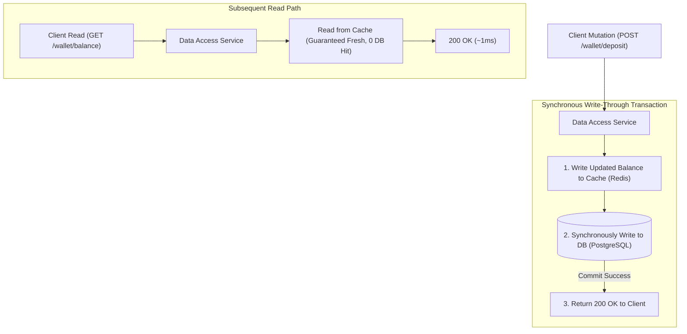

## Fast Revision (10-Second Recall)
In Write-Through caching, the application writes directly to the cache, and the cache (or data access layer) synchronously writes to the primary database before acknowledging success. Reads are served directly from the cache with 100% data freshness, at the cost of higher write latency and storage overhead for infrequently read data.

## The 30-Second Spoken Script
> "Write-Through caching is designed for workloads where read consistency is paramount and stale reads cannot be tolerated. Unlike Cache-Aside where the application manually updates the database and deletes the cache, in a Write-Through architecture the cache acts as the main data store interface. When an application mutates a record, it writes to the cache, which synchronously writes the updated record to the primary database within the same transaction before returning a success response to the client. The primary advantage is that the cache is always fresh and warmed; cache misses are minimized. The core trade-off is higher write latency—because every write incurs two round-trip network hops—and potential cache bloat if data written to the cache is never read again."

## Scenario / Problem Context
A banking ledger platform manages user wallet balances. Reads occur at 50,000 requests per second, while fund transfers occur at 3,000 transactions per second. The business requires that any balance update must be immediately visible to subsequent read requests without the possibility of stale data. The engineering team must evaluate and implement a Write-Through caching mechanism to guarantee immediate read consistency.

## Architectural Workflow / Sequence


## Deep-Dive Analysis & Root Causes

### 1. Write-Through vs Cache-Aside: Architectural Differences
| Feature | Write-Through | Cache-Aside (Lazy Loading) |
|---|---|---|
| **Write Coordination** | Synchronous write to Cache + DB in one flow | Write to DB, delete cache key |
| **Read Consistency** | Immediate (cache is always 100% synchronized) | Eventual (requires read on cache miss) |
| **Write Latency** | Higher (latency of Cache + DB combined) | Lower (DB write + quick cache eviction) |
| **Cache Warming** | Always warmed upon creation | Cold until first read |
| **Memory Utilization** | Higher (all written data is cached, even if never read) | Optimal (only actively queried data cached) |

### 2. Dual-Write Atomicity and Failure Scenarios
The primary operational risk in Write-Through caching is partial write failure:
- What happens if the write to Redis succeeds, but the database write fails due to a unique constraint violation or network timeout?
- **Remediation**:
  1. Wrap the operations in a two-phase commit or transactional compensating action.
  2. If the database write fails, immediately roll back or evict the corresponding key from the cache to prevent dirty reads.

### 3. Pairing Write-Through with Read-Through
In enterprise frameworks (like Hibernate 2nd Level Cache or Spring `@Cacheable`), Write-Through is paired with **Read-Through**:
- The application never touches the database directly.
- The cache library intercepts all read/write calls, executing SQL updates under the hood.

## Practical Debugging Commands & Code

#### Resilient Write-Through Repository Pattern (TypeScript)
```typescript
import Redis from 'ioredis';
import { db } from './database';

const redis = new Redis();

interface Wallet {
  userId: string;
  balanceCents: number;
  updatedAt: string;
}

export class WalletRepository {
  // Read Path: Always reads from cache; falls back to DB if cache evicted
  static async getWallet(userId: string): Promise<Wallet | null> {
    const cached = await redis.get(`wallet:${userId}`);
    if (cached) {
      return JSON.parse(cached) as Wallet;
    }

    // Fallback if key expired or evicted under memory pressure
    const record = await db.wallet.findUnique({ where: { userId } });
    if (record) {
      await redis.set(`wallet:${userId}`, JSON.stringify(record), 'EX', 86400);
    }
    return record;
  }

  // Write-Through: Synchronously updates both Cache and Database
  static async updateBalance(userId: string, newBalanceCents: number): Promise<Wallet> {
    const now = new Date().toISOString();
    const updatedPayload: Wallet = {
      userId,
      balanceCents: newBalanceCents,
      updatedAt: now,
    };

    // Step 1: Update persistent Database in transaction
    const dbRecord = await db.wallet.update({
      where: { userId },
      data: {
        balanceCents: newBalanceCents,
        updatedAt: now,
      },
    });

    // Step 2: Synchronously write through to Cache
    try {
      await redis.set(`wallet:${userId}`, JSON.stringify(dbRecord), 'EX', 86400);
    } catch (cacheError) {
      // If cache write fails, evict key to guarantee subsequent reads fetch fresh DB state
      console.error('[Cache Error] Failed to write through to Redis, evicting key:', cacheError);
      await redis.del(`wallet:${userId}`);
    }

    return dbRecord;
  }
}
```

#### Verifying Cache vs DB Synchronization
```bash
# Query Redis for cached wallet state
redis-cli get wallet:user_8821

# Query PostgreSQL directly to ensure exact synchronization
psql -d finance -c "SELECT user_id, balance_cents, updated_at FROM wallets WHERE user_id = 'user_8821';"
```

## Prevention & Senior Best Practices

### 1. Architectural Guardrails
- **Combine with Eviction Policies (LRU)**: Because Write-Through caches everything, configure Redis with `maxmemory-policy allkeys-lru` to automatically evict stale or unread entries when memory caps are reached.
- **Fail-Safe Eviction on Error**: If the write to the cache times out or throws an error during a write-through flow, always issue a `DEL` command to purge the key, ensuring the next read fetches the definitive database state.

### 2. Operational Hardening
- **Evaluate Write Latency Budget**: If writes must complete in under 10 ms, Write-Through may breach your SLA. In that scenario, evaluate Write-Behind (asynchronous write-back) or Cache-Aside.
- **Audit Dual-Write Consistency**: Run periodic background reconcilers that compare a random sample of cached entries against database rows to detect drift.

