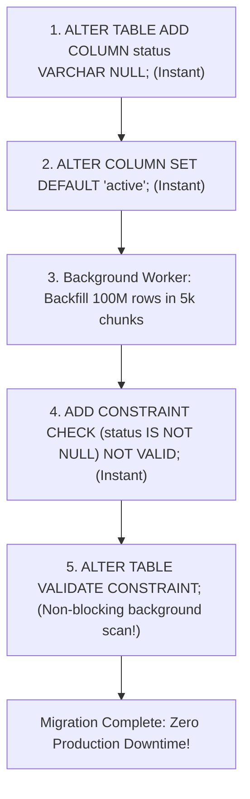

## Fast Revision (10-Second Recall)
- **The Danger:** In PostgreSQL prior to version 11 and in older MySQL engines, adding a column with a default value rewrote the entire table on disk, acquiring an `ACCESS EXCLUSIVE` lock that blocked all reads and writes for hours.
- **Modern PostgreSQL (PG 11+):** Adding a column with a **constant** default (`DEFAULT 'active' NOT NULL`) is an instant O(1) metadata operation! No table rewrite occurs.
- **The Safe Multi-Step Migration Pattern (If dynamic default or pre-PG11):**
- 1. **Step 1:** Add the column as `NULLable` with no default: `ALTER TABLE users ADD COLUMN status VARCHAR(20);` (Instant lock).
- 2. **Step 2:** Set the default for new rows: `ALTER TABLE users ALTER COLUMN status SET DEFAULT 'active';` (Instant).
- 3. **Step 3:** Backfill existing rows in micro-batches in the background (`UPDATE users SET status = 'active' WHERE id BETWEEN ...`).
- 4. **Step 4:** Add constraint without validation: `ALTER TABLE users ADD CONSTRAINT chk_status_not_null CHECK (status IS NOT NULL) NOT VALID;` (Instant lock).
- 5. **Step 5:** Validate constraint in background: `ALTER TABLE users VALIDATE CONSTRAINT chk_status_not_null;` (Scans table without blocking reads/writes!).

## The 30-Second Spoken Script
"Adding a NOT NULL column to a 100-million-row production table requires extreme care to prevent catalog locking from taking down the application.

First, it is vital to understand the database version capabilities. Since PostgreSQL 11, adding a column with a constant default value—such as DEFAULT 'active' NOT NULL—is an instantaneous metadata-only change. PostgreSQL stores the default value in the system catalog (pg_attribute) and fills it lazily when rows are read, taking an exclusive lock for only a fraction of a millisecond.

However, if you are running on an older database version, or if the default value requires a dynamic function calculation like uuid_generate_v4(), running ALTER TABLE directly will rewrite all 100 million rows on disk, taking an ACCESS EXCLUSIVE lock that halts all production traffic.

In those situations, I follow a zero-lock 5-step migration pattern:
First, add the column as NULLable with no default. This is an instant catalog update requiring only a brief lock.
Second, set the default value on the column so all subsequent new INSERTs receive the value automatically.
Third, backfill existing rows in the background using small indexed batches of 5,000 rows with a sleep interval to keep CPU and lock contention near zero.
Fourth, add a CHECK constraint with the NOT VALID flag. This ensures all future writes conform to the constraint, but skips validating existing rows, completing instantaneously.
Fifth, run ALTER TABLE VALIDATE CONSTRAINT. PostgreSQL scans the table to verify existing rows, but it only acquires a SHARE UPDATE EXCLUSIVE lock, allowing concurrent reads and writes to proceed without interruption."

## Scenario / Problem Context
A production table has 100 million records. Running `ALTER TABLE users ADD COLUMN status VARCHAR(20) DEFAULT 'active' NOT NULL;` in older database versions or poorly planned migrations acquires an exclusive lock, stalls all incoming traffic, and takes the entire application down. The interviewer tests your knowledge of database locking internals.

## Architectural Workflow / Sequence


## Deep-Dive Analysis & Root Causes

| Approach | Command | LockRequired | Risk |
| --- | --- | --- | --- |
| Modern PG (PostgreSQL 11+) | `ALTER TABLE tbl ADD COLUMN col INT DEFAULT 0 NOT NULL;` | ACCESS EXCLUSIVE for &lt; 5ms | Extremely safe IF the default is a constant literal. DANGEROUS if default is volatile function like `random()` or `clock_timestamp()`
Legacy / Dynamic Default Pattern | `ADD COLUMN ... NULL` $\rightarrow$ Backfill $\rightarrow$ `VALIDATE CONSTRAINT` | Brief metadata lock on start, non-blocking scan on validation | Requires running multi-stage background scripts, but guarantees 100% application uptime
Lock Timeout Guardrail | `SET lock_timeout = '2s';` before DDL | Fails fast if table is busy | Prevents DDL from waiting in lock queue and blocking all incoming read traffic behind it |


## Practical Debugging Commands & Code
```sql
-- 1. Always set lock timeout before any DDL in production:
SET lock_timeout = '2s';

-- 2. Step 1: Add column as NULLable (instant):
ALTER TABLE orders ADD COLUMN fulfillment_status VARCHAR(20);

-- 3. Step 2: Set default for future rows (instant):
ALTER TABLE orders ALTER COLUMN fulfillment_status SET DEFAULT 'pending';

-- 4. Step 3: Backfill existing rows in micro-batches (run via script):
-- UPDATE orders SET fulfillment_status = 'pending' 
-- WHERE id BETWEEN 1 AND 5000 AND fulfillment_status IS NULL;

-- 5. Step 4: Add NOT NULL constraint without scanning table:
ALTER TABLE orders ADD CONSTRAINT chk_orders_fulfillment_not_null 
    CHECK (fulfillment_status IS NOT NULL) NOT VALID;

-- 6. Step 5: Validate constraint without blocking concurrent traffic:
ALTER TABLE orders VALIDATE CONSTRAINT chk_orders_fulfillment_not_null;
```

## Prevention & Senior Best Practices
- **Always Set `lock_timeout`:** Never run DDL without `SET lock_timeout = '2s'`. If an existing analytical query is holding a lock, your DDL will queue up and block all subsequent reads, causing an outage.
- **Avoid Volatile Function Defaults:** `DEFAULT now()` is evaluated at rewrite time, whereas constant literals (`DEFAULT 'active'`) avoid table rewrites in modern PG.
- **Use Migration Linters:** Run tools like `strong_migrations` or `squawk` in CI/CD pipelines to catch dangerous DDL commands before deployment.
