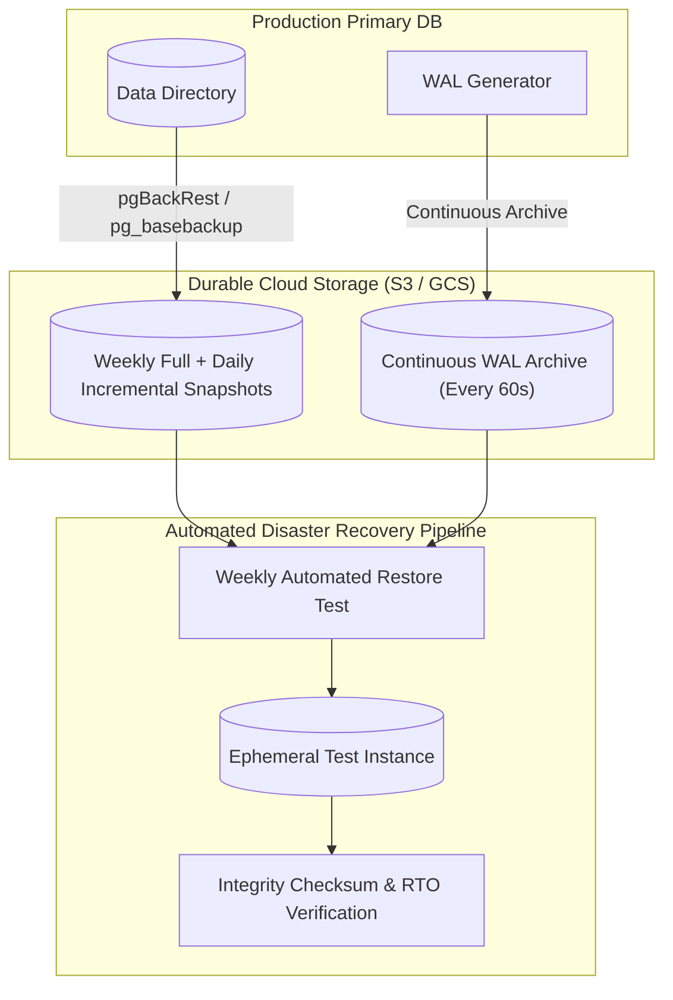

## Fast Revision (10-Second Recall)
- **The Universal Truth:** An untested backup is not a backup—it is merely a wish. You must verify restoration automatically.
- **Core Metrics:**
- 1. **RPO (Recovery Point Objective):** Maximum acceptable data loss duration (e.g., RPO &lt; 5 minutes means you can lose at most 5 minutes of data).
- 2. **RTO (Recovery Time Objective):** Maximum acceptable downtime to restore service (e.g., RTO &lt; 1 hour).
- **Backup Types:**
- 1. **Logical Backups (`pg_dump`, `mysqldump`):** Plain SQL text or custom binary format. Excellent for schema exports and table subsets; terribly slow for multi-terabyte databases.
- 2. **Physical Backups (pg_basebackup, Percona XtraBackup, AWS EBS Snapshots):** Raw file system copy of data directory. Fast restoration, point-in-time recovery capable.
- **Continuous WAL Archiving:** Streaming Write-Ahead Logs to remote cloud storage (S3/GCS) provides continuous sub-minute RPO.
- **The 3-2-1 Backup Rule:** 3 copies of data, 2 different storage media, 1 copy off-site / cross-region.

## The 30-Second Spoken Script
"A resilient database backup and restoration strategy is defined by two fundamental business SLA metrics: RPO—the maximum acceptable data loss in time—and RTO—the maximum acceptable downtime to restore service.

For enterprise production systems, I design a two-tier physical backup architecture using tools like pgBackRest or AWS Aurora automated snapshots combined with continuous Write-Ahead Log (WAL) archiving:

First, Full Physical Backups. Once a week, we take a full physical copy of the database data directory, supplemented by daily differential or incremental backups. Because physical backups copy raw disk blocks rather than replaying SQL, restoration is orders of magnitude faster than logical dumps like pg_dump.

Second, Continuous WAL Archiving. Every time a 16-megabyte WAL segment fills up or every 60 seconds, it is compressed, encrypted, and archived to durable off-site storage like Amazon S3. This guarantees an RPO of less than 1 minute—in the event of total datacenter loss, we can replay the WAL up to the final minute of transactions.

Third, Adhering to the 3-2-1 Rule. We maintain three copies of the data across two different media, with at least one immutable, cross-region copy protected by AWS S3 Object Lock to prevent deletion by compromised credentials or ransomware.

Finally, Automated Restoration Drills. The most critical failure in database management is finding out a backup is corrupted during an actual disaster. Every Sunday night, an automated CI pipeline spins up an isolated test instance, restores the latest base backup, replays WAL files to a target timestamp, runs data integrity checksums, and alerts the engineering team if restoration fails or exceeds our 1-hour RTO."

## Scenario / Problem Context
Data loss from ransomware, datacenter fires, or accidental corruption can bankrupt a business. The interviewer evaluates your end-to-end backup architecture, disaster recovery metrics (RTO/RPO), and whether your backups are actually tested and verifiable.

## Architectural Workflow / Sequence


## Deep-Dive Analysis & Root Causes

| Dimension | Mechanism | Pros | Cons |
| --- | --- | --- | --- |
| Logical Backup (`pg_dump`) | Dumps SQL statements (CREATE TABLE, INSERT) | Human-readable, portable across major database versions, can restore individual tables | Extremely slow for &gt; 100GB databases, high CPU overhead, no Point-in-Time Recovery
Physical Backup (pgBackRest, Percona) | Copies raw database data directory and disk blocks | Fastest backup and restore speeds, multi-core compression, full PITR support | Must restore to identical OS architecture and major database version
Storage Snapshot (EBS / SAN) | Volume-level copy-on-write snapshot | Near-instantaneous snapshot creation (&lt; 1 minute) | Requires database freezing (`pg_backup_start()`) or crash-consistent recovery |


## Practical Debugging Commands & Code
```sql
-- 1. PostgreSQL: Manual Base Backup with WAL stream:
-- pg_basebackup -h localhost -U replicator -D /backups/base_$(date +%F) -Fp -Xs -P -v

-- 2. Continuous WAL Archiving configuration in postgresql.conf:
-- archive_mode = on
-- archive_command = 'pgbackrest --stanza=db-prod archive-push %p'
-- archive_timeout = 60 -- Force WAL segment switch every 60 seconds for RPO guarantee

-- 3. Verify status of WAL archiving:
SELECT archived_count, failed_count, last_archived_wal, last_archived_time,
       last_failed_wal, last_failed_time
FROM pg_stat_archiver;
```

## Prevention & Senior Best Practices
- **Enable Immutable S3 Object Lock:** Store backup files in WORM (Write Once, Read Many) buckets with Object Lock to safeguard against ransomware attacks and rogue employee deletion.
- **Never Rely Solely on Snapshots Without WAL Archiving:** Daily snapshots leave a 24-hour RPO data loss window. Continuous WAL archiving is mandatory for sub-minute RPO.
- **Automate Restore Verification:** Integrate regular restoration tests into monthly game days or automated weekly CI jobs.
