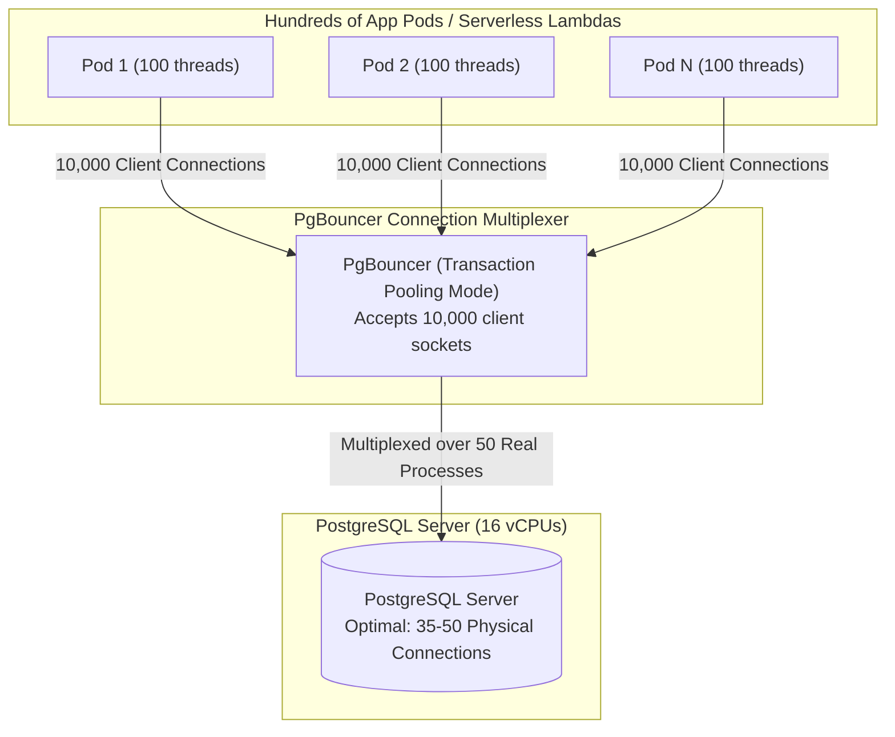

## Fast Revision (10-Second Recall)
- **Why Connection Exhaustion Destroys Performance:**
- In PostgreSQL, each connection is a separate operating system process allocating ~10MB of RAM. 2,000 connections create catastrophic CPU context-switching and lock thrashing, causing database throughput to collapse.
- **Top Root Causes:**
- 1. **Slow Queries Holding Connections:** A query that slows from 10ms to 5s holds onto its borrowed pool connection 500x longer, exhausting the pool rapidly.
- 2. **Unbounded Microservice / Serverless Pools:** 100 Kubernetes pods each configured with `maxPoolSize = 50` attempt to open 5,000 connections against a database with `max_connections = 500`.
- 3. **Leaked Connections:** Application code opens a connection but misses the `finally { conn.close() }` block in error paths.
- **The Architecture Fix:** Introduce a transaction-level connection pooler (**PgBouncer**). 10,000 client connections multiplex over 50 real database connections!
- **HikariCP Golden Sizing Formula:** `connections = (core_count * 2) + effective_spindle_count`.

## The 30-Second Spoken Script
"Database connection pool exhaustion occurs when all available database connection slots are checked out, forcing incoming client requests to queue up and eventually time out with 500 errors.

My immediate incident response:
First, inspect pg_stat_activity to see what those connections are doing. Are they active, idle, or idle in transaction?
If the vast majority are 'active', it means slow queries are holding connections open for seconds. I find the slowest running queries, terminate them using pg_terminate_backend(), and immediately apply a temporary statement_timeout to free slots.
If the connections are 'idle in transaction', it indicates application connection leaks or abandoned transactions; I terminate them and set idle_in_transaction_session_timeout.

To permanently solve connection exhaustion, I implement two architectural fixes:
First, I deploy PgBouncer in transaction pooling mode between the application pods and PostgreSQL. In transaction pooling mode, a physical database connection is only held for the exact duration of a single transaction or statement, rather than the entire client socket lifetime. This allows 10,000 application microservices or AWS Lambda functions to multiplex seamlessly over just 100 to 200 physical database connections.

Second, I right-size application-level pools. A common anti-pattern is setting pool sizes to 100 per pod. Following the proven HikariCP formula—pool size equals two times CPU cores plus effective spindle count—a database with 16 vCPUs runs optimally with a total pool of 32 to 50 physical connections. Keeping connection counts small maximizes CPU cache locality and eliminates operating system context-switching overhead."

## Scenario / Problem Context
The API begins throwing `FATAL: remaining connection slots are reserved for non-replicating superusers` or `Connection pool exhausted: Timeout waiting for idle connection`. All new requests fail with 500 errors. The interviewer assesses your ability to quickly restore service and re-architect connection pooling.

## Architectural Workflow / Sequence


## Deep-Dive Analysis & Root Causes

| PoolMode | Behavior | BestFor | MultiplexingEfficiency |
| --- | --- | --- | --- |
| Session Pooling | Connection tied to client for entire session lifetime | Legacy apps requiring session state, prepared statements across transactions | Low (1:1 client to server mapping)
Transaction Pooling (Recommended) | Connection returned to pool the millisecond `COMMIT` or `ROLLBACK` runs | Modern microservices, REST APIs, high-concurrency web apps | Very High (100:1 client to server mapping)
Statement Pooling | Connection returned after every individual SQL statement | Pure single-statement reads/writes | Extreme (multi-statement transactions prohibited) |


## Practical Debugging Commands & Code
```sql
-- 1. Check current connection counts by state and application:
SELECT state, application_name, count(*) 
FROM pg_stat_activity 
GROUP BY state, application_name 
ORDER BY count(*) DESC;

-- 2. Identify the longest-running queries consuming connections:
SELECT pid, now() - query_start AS duration, query, state
FROM pg_stat_activity
WHERE state != 'idle'
ORDER BY duration DESC
LIMIT 10;

-- 3. Terminate runaway idle-in-transaction connections:
SELECT pg_terminate_backend(pid)
FROM pg_stat_activity
WHERE state = 'idle in transaction'
  AND (now() - state_change) > interval '2 minutes';

-- 4. PostgreSQL guardrails in postgresql.conf:
-- idle_in_transaction_session_timeout = '30s'
-- statement_timeout = '30s'
```

## Prevention & Senior Best Practices
- **Deploy PgBouncer / ProxySQL Upfront:** Never allow hundreds of distributed microservice pods or serverless functions to connect directly to PostgreSQL without an intermediate pooler.
- **Right-Size Application Pools:** Cap individual pod connection pools to 5 to 10 connections. More connections do not equal more throughput; they cause disk thrashing and lock contention.
- **Enforce `statement_timeout` Globally:** Set a 15-second global statement timeout so slow unindexed queries cannot indefinitely hold connection slots during traffic spikes.
