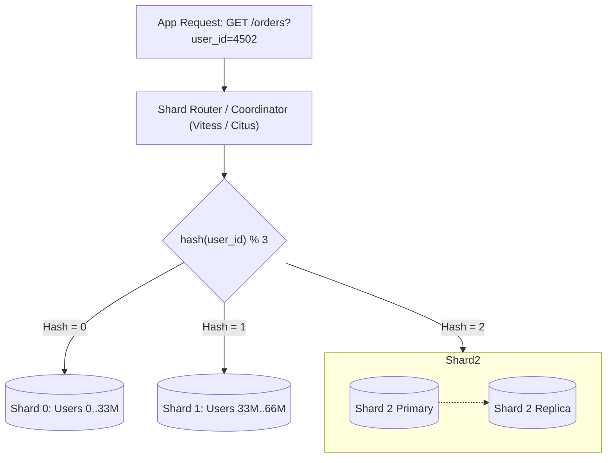

## Fast Revision (10-Second Recall)
- **Definition:** Horizontal data partitioning across multiple autonomous database servers. Each physical database server is called a **Shard**, holding a unique subset of rows.
- **Shard Key Selection (Most Critical Decision):**
- 1. **Hash-Based Sharding:** `shard_id = hash(key) % total_shards`. Uniform distribution, avoids hot spots; but range queries require querying every shard (scatter-gather).
- 2. **Range-Based Sharding:** Keys partitioned by ranges (e.g., A-F, G-M or Dates). Excellent for range scans, but creates extreme hot spot shards (e.g., all current writes hit today's shard).
- 3. **Entity/Directory-Based:** Grouping by `tenant_id` or `company_id`. All tenant data stays on one shard; isolates noisy neighbors, but large tenants require sub-sharding.
- **The Severe Costs of Sharding:** Cross-shard joins are impossible without app-layer assembly; cross-shard transactions require distributed 2-Phase Commit (2PC) or Saga; re-sharding / re-balancing requires complex data migration.

## The 30-Second Spoken Script
"Database sharding is the horizontal partitioning of a database across multiple independent physical database instances. Unlike read replicas where every node holds a complete copy of the data, each shard holds a mutually exclusive subset of the total rows.

The foundation of any sharding architecture is the Shard Key. Choosing the shard key dictates how evenly data and traffic are distributed:
For multi-tenant SaaS applications, tenant_id is typically the best shard key. This ensures all queries for a given customer are routed to a single shard, allowing local indexes and relational joins to execute efficiently.
For high-scale consumer applications like social networks or payment gateways, a hash of the user_id or account_id is used with consistent hashing to prevent write hot spots.

The query router layer—such as Vitess for MySQL, Citus for PostgreSQL, or an application-level routing layer—inspects the incoming query. If the query contains the shard key, the router dispatches the SQL directly to that specific shard with single-digit millisecond latency.

However, sharding introduces massive distributed systems complexity:
First, queries that lack the shard key must execute as 'scatter-gather', querying every single shard in parallel and aggregating the results in memory.
Second, relational joins between tables partitioned on different keys become impossible at the database level.
Third, cross-shard transactions require distributed two-phase commit (2PC) or asynchronous Saga patterns, which introduce significant latency and failure modes."

## Scenario / Problem Context
When write volume, connection counts, or dataset size exceeds the physical hardware limits of the largest available server, horizontal sharding is required. The interviewer wants to know if you understand shard key selection, query routing, and the steep engineering tradeoffs involved.

## Architectural Workflow / Sequence


## Deep-Dive Analysis & Root Causes

| Strategy | BestFor | Pros | Cons |
| --- | --- | --- | --- |
| Hash-Based Sharding | High-throughput consumer apps (e.g., Uber, Twitter, Stripe) | Even distribution of writes and storage; prevents hot spots | Range queries (`BETWEEN a AND b`) require querying all shards (scatter-gather)
Entity / Tenant Sharding | B2B SaaS platforms (e.g., Salesforce, Slack, Shopify) | All queries for a tenant remain local; full relational joins preserved within tenant | Mega-tenants create unbalanced hot shards requiring dedicated isolation
Range-Based Sharding | Time-series data, historical logs | Range scans are ultra-fast on a single shard | Severe write hotspot: 100% of current writes hit the shard with the latest range
Consistent Hashing (Virtual Nodes) | Dynamically adding or removing shard nodes | Adding a shard only moves $K/N$ keys instead of reshuffling the entire database | Requires distributed ring maintenance and complex rebalancing coordinator |


## Practical Debugging Commands & Code
```sql
-- 1. Citus (PostgreSQL Sharding Extension) - Creating a Distributed Table:
-- Enable Citus extension:
CREATE EXTENSION citus;

-- Create standard relational table:
CREATE TABLE user_orders (
    user_id BIGINT NOT NULL,
    order_id BIGSERIAL,
    order_total NUMERIC(10, 2),
    created_at TIMESTAMPTZ DEFAULT NOW(),
    PRIMARY KEY (user_id, order_id) -- Shard key MUST be part of primary key!
);

-- Distribute table across worker nodes using hash sharding on user_id:
SELECT create_distributed_table('user_orders', 'user_id');

-- 2. Query with shard key routes to a SINGLE worker:
EXPLAIN SELECT * FROM user_orders WHERE user_id = 4502;
-- Plan shows: Task-count: 1 (targeted shard routing)

-- 3. Query without shard key triggers SCATTER-GATHER across ALL workers:
EXPLAIN SELECT count(*) FROM user_orders WHERE order_total > 500;
-- Plan shows: Distributed Subplan (scans all 32 shards concurrently)
```

## Prevention & Senior Best Practices
- **Always Include the Shard Key in the Primary Key and Unique Constraints:** Distributed databases cannot validate global uniqueness without cross-shard communication unless the shard key is part of the constraint.
- **Avoid Cross-Shard Transactions:** Replace distributed 2PC with asynchronous eventual consistency and Idempotent Saga event handlers.
- **Use Consistent Hashing Rings:** When adding new shard servers, consistent hashing ensures only a fraction of keys need to be migrated.
