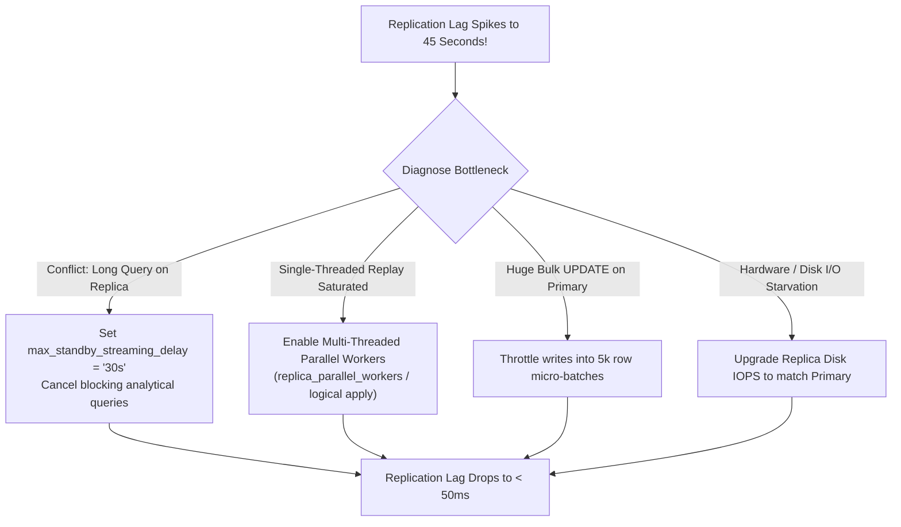

## Fast Revision (10-Second Recall)
- **What is Replication Lag?** The delay in time or bytes between a transaction committing on the primary and being applied/visible on a read replica.
- **Top 4 Root Causes:**
- 1. **Single-Threaded Replay Bottleneck:** Primary executes writes using 64 concurrent threads, but replica applies changes sequentially.
- 2. **Long-Running Queries on Replica:** A 5-minute reporting query on the replica holds shared table locks, blocking the WAL replayer from applying schema or row updates (Exclusive Lock conflicts).
- 3. **Massive Bulk Writes on Primary:** Unthrottled `UPDATE millions_of_rows` floods the network and saturates WAL receiver buffers.
- 4. **Network Bandwidth / Disk I/O Saturation:** Standby has inferior disk IOPS or saturated network bandwidth.
- **Immediate & Architectural Fixes:** Multi-threaded parallel replication workers; chunking bulk operations; killing conflicting replica queries (`max_standby_streaming_delay`); routing recent writers to primary (Read-Your-Own-Writes).

## The 30-Second Spoken Script
"Replication lag occurs when a read replica cannot replay transaction log changes as fast as the primary generates them. In production, this causes data inconsistency, where users query replicas and receive stale data.

My diagnostic and remediation strategy:

First, measure the lag accurately. In PostgreSQL, I query pg_stat_replication on the primary to check replay_lag and pg_wal_lsn_diff. In MySQL, I check Seconds_Behind_Source in SHOW REPLICA STATUS.

Second, identify the root cause among the four usual culprits:
1. Lock conflicts from long-running analytical queries on the replica. When a heavy SELECT query runs on a replica, the replayer cannot apply incoming WAL updates for that table. Setting max_standby_streaming_delay = '30s' cancels blocking replica queries so replication does not stall.
2. The concurrency mismatch. The primary writes with dozens of CPU threads, while the replica's replay engine is bottlenecked. Enabling multi-threaded parallel replication—like MySQL's replica_parallel_workers—allows independent transactions to replay concurrently.
3. Massive unchunked write operations on the primary. If a batch job updates 5 million rows in one statement, the replica has to digest a massive burst of WAL records. I force all batch updates to run in small, throttled micro-batches of 5,000 rows.

Third, protect the user experience with Read-Your-Own-Writes routing: after any mutation, the application routes that specific user's read queries to the primary database for 5 seconds. This guarantees the user sees their own updates immediately, completely masking replication lag from the user interface."

## Scenario / Problem Context
Read replicas are lagging behind the primary by 45 seconds during peak traffic hours. Users report seeing outdated order statuses and checkout totals. The interviewer tests your ability to detect lag, identify the root cause, and implement immediate and architectural remedies.

## Architectural Workflow / Sequence


## Deep-Dive Analysis & Root Causes

| Cause | Symptom | Solution |
| --- | --- | --- |
| Query Conflicts on Standby | Replica lag grows steadily while an analytical SELECT runs | Configure `max_standby_streaming_delay = '30s'` and `hot_standby_feedback = on`
Single-Threaded SQL Apply | Replica CPU shows 1 core pegged at 100% while other cores are idle | Enable parallel replication workers (`replica_parallel_workers = 8` in MySQL/PG)
Massive Transaction Bursts | Sudden spike in `replay_lag_bytes` following bulk ETL or data migrations | Batch mutations into chunks of 2,000 to 5,000 rows with 50ms sleep intervals
Stale User Reads | Users report updated profile changes disappearing on page reload | Implement session-based sticky routing to Primary for 5s after any write mutation |


## Practical Debugging Commands & Code
```sql
-- 1. PostgreSQL: Measure replication delay in bytes and time:
SELECT client_addr, application_name,
       pg_wal_lsn_diff(pg_current_wal_lsn(), replay_lsn) AS lag_bytes,
       round(extract(epoch from replay_lag)::numeric, 2) AS lag_seconds
FROM pg_stat_replication;

-- 2. PostgreSQL: Check for queries blocking the standby replayer:
-- Look for queries with long running times on the replica:
SELECT pid, now() - query_start AS duration, query, state
FROM pg_stat_activity
WHERE state != 'idle'
ORDER BY duration DESC;

-- 3. In postgresql.conf on Standby:
-- max_standby_streaming_delay = 30s -- Kills queries that delay WAL replay by > 30s
-- hot_standby_feedback = on          -- Informs primary to delay VACUUM on rows replica is reading
```

## Prevention & Senior Best Practices
- **Offload Heavy Analytics to a Dedicated Reporting Replica:** Never mix customer-facing low-latency API reads with heavy business intelligence reports on the same replica.
- **Match Hardware Specifications:** Replicas must have equal or greater CPU, RAM, and disk IOPS compared to the primary to keep up with write replay.
- **Set Automated Circuit Breakers:** If a replica's lag exceeds 5 seconds, remove it from the load balancer rotation automatically until it catches up.
